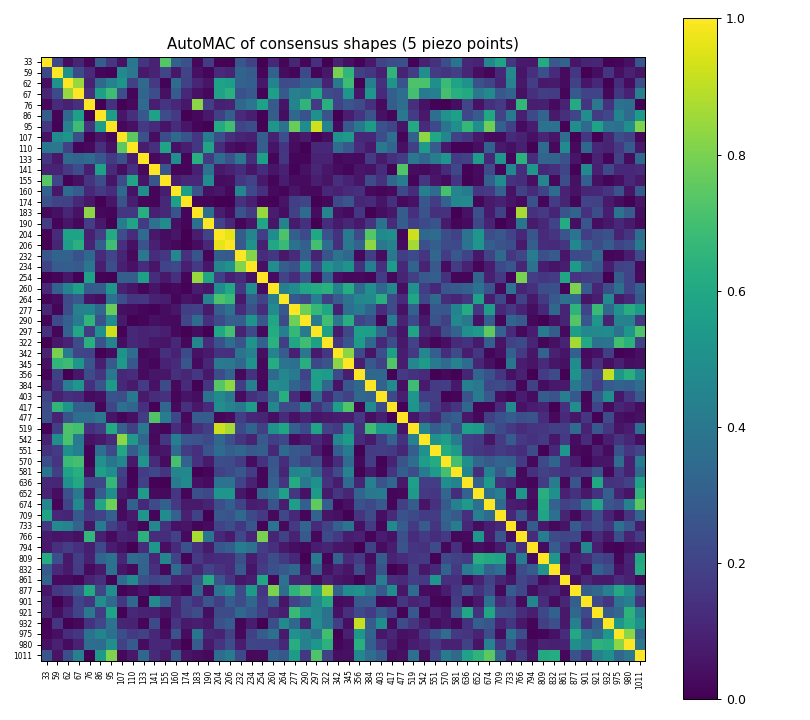
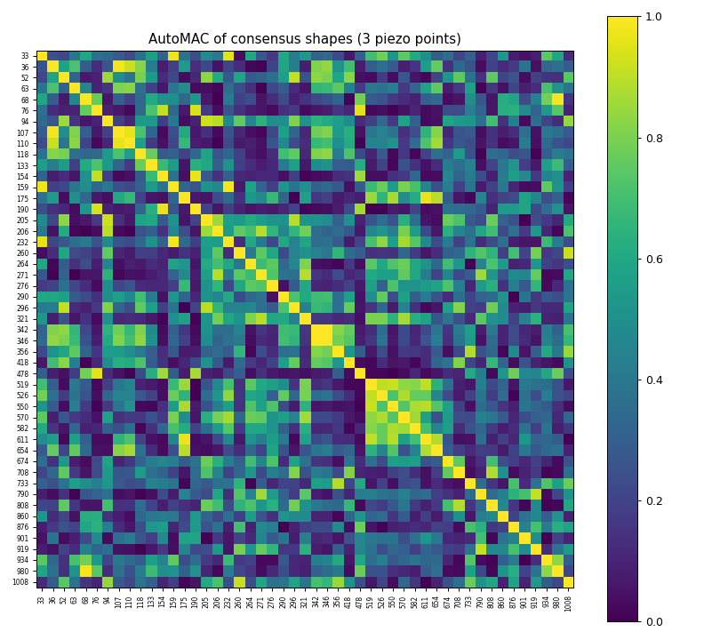
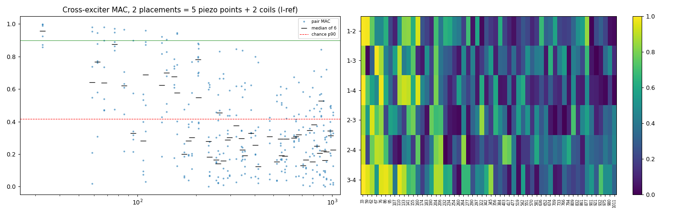
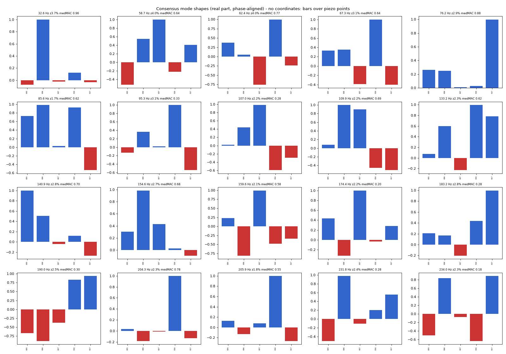

# Dev Session Log

- **Agent:** dev-fd69
- **Task:** Modal measurement: integration branch (4284+69fd), swept overwrite fix, rig checks, slower sweep, PolyMAX, chirp-ESPRIT, cross-exciter/method comparison
- **Started:** 2026-10-11T16:59:27Z
- **Plan file:** None
- **Status:** In Progress

## Actions

[STEP-0-COMPLETE] 2026-10-11T16:59:27Z
[PROGRESS] 2026-10-11T16:59:55Z step=1 note=context; reading docs MODAL_COLLECTION + proposals + branches
[PROGRESS] 2026-10-11T17:01:14Z step=1 note=coordinator: rig DISCONNECTED - no live sessions; code+offline+tests only, then report rig test plan
### Step 1: Understand Context — 2026-10-11T17:02:44Z
- integration worktree D:/repos/wt-fd69-core branch feature/dev-fd69-modal-methods off fa291d5; merged 4284 (e79156c) + 69fd (8b216f6) cleanly; .venv junction
[READ] 2026-10-11T17:02:44Z path=docs/proposals/swept-sine-mode-discovery-2026-10-11.md, MODAL_COLLECTION.md#asio-acquisition
[READ] 2026-10-11T17:02:44Z path=swept_discovery/* (doc-pointed deep-dive)
[PROGRESS] 2026-10-11T17:07:38Z step=2 note=baseline modal-adapter tests (no CUDA/engine change -> perf suite N/A; user stack running, not loading a 2nd engine)
[STEP-1B-VENV-CHECK] interpreter=D:/repos/PianoidInstall/PianoidCore/.venv/Scripts/python.exe
[BASH-CALL] 2026-10-11T17:07:38Z pytest modal-adapter subset baseline
[BASH-RETURN] 2026-10-11T17:20:00Z duration_ms=73000 exit_code=1

### Step 2: Baseline — 2026-10-11T17:21:00Z
- No CUDA/engine change in scope (python modal_adapter only) -> perf suite N/A (would load a 2nd engine next to the user's live backend); baseline = modal-adapter unit+integration subset on the integration branch.
[BASELINE-TEST] 2026-10-11T17:21:00Z result=pass passed=362 failed=3 skipped=1 note="3 fails pre-existing on feature/dev-4284-asio-collection (test_measurement_session_callback_param source-introspection; same 3 fail in wt-4284-core)"

### Step 3: Branch — 2026-10-11T17:22:00Z
- Core: worktree D:/repos/wt-fd69-core, branch feature/dev-fd69-modal-methods off dev fa291d5 + merge 4284 (e79156c) + merge 69fd (8b216f6), no conflicts.
- Coordinator 17:01Z: rig DISCONNECTED -> no live sessions; code + offline re-analysis of existing recordings + tests; then report the rig test plan and wait.

## Data Model Card — 2026-10-11T17:23:00Z

| Fact the fix relies on | Doc citation | Inferred-only? |
|---|---|---|
| RemoteAudioIO Capture.data[n] = drive frame n (loopback-marker aligned, lead + pre-roll removed); marker-only loopback default (mirror leaks into In5-7) | MODAL_COLLECTION.md#asio-acquisition-dev-4284 | N |
| Swept FRF tensor H3 = (F, receivers R=7, exciters E=4); f = natural freq abs(lambda)/2pi, zeta damping ratio | proposals/swept-sine-mode-discovery-2026-10-11.md §1, §3 | N |
| modes.npz per-scenario contract: e{e}_frequencies/damping_ratios/mode_shapes(n x R complex = residue column R[:,e])/poles/amplitudes/snr_db | swept proposal §4 | N |
| Old swept sessions/*/data.npy = raw capture incl. pre_roll_frames (meta.json), latency compensated by backend loopback, inputs In1..In7 + In8 (loopback) | swept proposal §2 + measured meta.json (rig3 coarse_e1: pre_roll 12000, onset 328) | N (measured) |
| ESPRIT band configs need ir_length_ms 400-600 (impulse cycle = 100 ms at 10 Hz) | brief + project esprit/config.json (measured) | N (measured) |
| Levels: dBFS peak, normal <= -20, hard ceiling -12 (refused) | swept proposal §2 Levels | N |
| Collection: exciter k alone -> scenario N+k; averaged_responses/average_chN.npy + measurements/scenario_N.npy feed ESPRIT | MODAL_COLLECTION.md#asio-acquisition-dev-4284 + #output-file-layout | N |

[DMC-COMPLETE]

### Step 4: Locks + Edit — 2026-10-11T17:24:00Z
- P1: excitation signal + IR derivation owned by the recorder's excitation module (new measurement/chirp_excitation.py) — recorder dispatches only; swept session transport owned by measurement/audio_io.RemoteAudioIO (single client); identification state owned by the new polymax package; comparison is a pure function module.
- P2: PolyMAX/LSFD = identification concern (new package modal_adapter/polymax), not swept_discovery; ESS generation/deconvolution shared helper (measurement/ess.py) used by swept + chirp collection (no duplication); recorder.py is RED (1116) -> only a dispatch hook added.
- dev-4284 still holds a lock row on recorder/dataset_collector/collection_engine/audio_io (stopped before Step 10, unmerged); this integration branch builds on top of it per the orchestrator brief -> inherited, noted here.
[LOCK ACQUIRED] swept_discovery/*, polymax/** (new), mode_comparison.py (new), measurement/{ess,chirp_excitation}.py (new), recorder.py, dataset_collector.py, audio_io.py, collection_engine.py, measurement_entity.py, tests, Tunner ImpulseSection.jsx
[EDIT] file=measurement/ess.py (NEW shared ESS: exp_sweep, deconvolve, harmonic split)
[EDIT] file=swept_discovery/{audio_io,procedure,signals,frf,report,__main__}.py (SessionAudioIO over RemoteAudioIO, tag-unique persisted sessions, repeat tags repeatN_fine_*, fine_rate/gap config, sweep-rate quasi-stationarity report)
[EDIT] file=tests/unit/test_swept_discovery.py (17/17 pass; overwrite regression test)
[PROGRESS] 2026-10-11T17:15:23Z step=4 note=part1 swept fix + IO unify done; committing
[EDIT] file=polymax/{plscf,stabilization,lsfd,identify,report,__init__,__main__}.py (NEW)
[TEST-WRITTEN] path=tests/unit/test_polymax.py
[PROGRESS] 2026-10-11T17:42:22Z step=4 note=polymax implemented; synthetic e2e: peak method 1 peak/0 of 22 matched vs PolyMAX 22/22; running tests
[PROGRESS] 2026-10-11T17:44:31Z step=4 note=polymax committed (6/6 tests); next chirp excitation for collection
[EDIT] file=measurement/chirp_excitation.py (NEW), recorder.py (+22 dispatch), collection_engine.py, measurement_entity.py, dataset_collector.py
[TEST-WRITTEN] path=tests/unit/test_chirp_excitation.py
[PROGRESS] 2026-10-11T17:50:19Z step=4 note=chirp collection committed (7/7); modal subset 377p/3 pre-existing; next: Tunner selector, offline analyses
[EDIT] file=PianoidTunner(wt-fd69-tunner feature/dev-fd69-chirp-ui, merged 4284 asio-devices) src/modules/panels/collection/ImpulseSection.jsx + test
[BASH-CALL] 2026-10-11T17:51:39Z jest ImpulseSection + CollectionSubpanel
[BASH-RETURN] 2026-10-11T17:52:58Z duration_ms=60000 exit_code=0
- Jest collection suites 80/81 (CollectionSubpanel first-test cold timeout flake; 4/4 when run alone, also 4/4 without my change); Tunner commit ef5f9d3
[PROGRESS] 2026-10-11T17:52:58Z step=4 note=Tunner selector committed; next offline analyses (crosstalk/linearity/coherence from existing data, PolyMAX+LOO, chirp-ESPRIT from coarse ESS, comparison module)
[PROGRESS] 2026-10-11T17:57:56Z step=4 note=rig_checks + mode_comparison committed; comparison reproduces scratch analysis exactly; next: offline analysis run (chirp-ESPRIT from coarse ESS, PolyMAX+LOO, comparison tables)
[PROGRESS] 2026-10-11T17:59:34Z step=7 note=offline analysis run (rig checks + chirp-ESPRIT CPU + PolyMAX + comparison) -> D:/modal_measurements/analysis/dev-fd69-2026-10-11
[BASH-CALL] 2026-10-11T17:59:34Z offline analysis (background)
[PROGRESS] 2026-10-11T18:05:44Z step=7 note=CPU ESPRIT too slow (>4 min/band) -> stopped, rerun with GPU (project setting)
[STEP-8 in progress] 2026-10-11T18:07:03Z docs: MODAL_COLLECTION (excitation types + swept/PolyMAX/comparison section, restoring the 69fd section lost in the 4284 doc commit), TESTING, CODE_QUALITY (recorder 1138), swept proposal status

### Step 4 summary — 2026-10-11T19:05:00Z
- Core commits (wt-fd69-core, feature/dev-fd69-modal-methods): 4805ba6 swept fix + IO unify + sweep rate; 95abbb3 PolyMAX; a554dcd chirp collection; a8a651b rig checks + mode_comparison.
- Tunner (wt-fd69-tunner, feature/dev-fd69-chirp-ui): ef5f9d3 excitation_type selector (+3 Jest).
[FILE-LOC] measurement/recorder.py before=1116 after=1138 (RED, dispatch only; CODE_QUALITY updated)

### Step 5: Post-change tests — 2026-10-11T19:10:00Z
- Modal subset + new tests: 377 passed / 3 failed (the same 3 pre-existing dev-4284 source-introspection fails) / 1 skipped; new: test_polymax 6, test_chirp_excitation 7, test_rig_checks 5, test_swept_discovery 17.
- Jest collection suites 80/81 (CollectionSubpanel cold-start timeout flake; 4/4 alone, also without the change).
[REGRESSION-CHECK] 2026-10-11T19:10:00Z new_failures=0 verdict=pass note="no engine change; perf suite N/A"

### Step 7: Verification (offline; rig disconnected per coordinator) — 2026-10-11T19:45:00Z
[VERIFY-INVOKE] skill=none mode=offline note="measurement-pipeline change; live rig surface unavailable (interface disconnected) -> offline re-analysis of the rig recordings + synthetic; live rig plan in the results doc §6"
- docs/development/diagnostics/dev-fd69-offline-analysis.py -> D:/modal_measurements/analysis/dev-fd69-2026-10-11 (comparison.log, rig_checks_offline.json, plots). Chirp-ESPRIT on GPU (CPU was > 4 min per band -> stopped).
- Key: repeat coherence >= 0.9996; sigma2/sigma1 0.31-0.53 at peaks; Out 3 H2 -24 dB; interface xtalk <= -57 dB; PolyMAX 63 modes <= 2 kHz, LOO + cross-run consistent, swept vs PolyMAX 40 matched (chance 13.8) MAC 0.93/0.80; chirp-ESPRIT ~ chance cross-exciter like impulse-ESPRIT.

### Step 8: Docs — 2026-10-11T19:55:00Z
[DOC-GAP] description="dev-69fd swept section in MODAL_COLLECTION was dropped by the dev-4284 doc commit" resolution=doc-edit ref=MODAL_COLLECTION.md#swept-sine-discovery-polymax-and-method-comparison-dev-69fd-dev-fd69
[STEP-8-COMPLETE] 2026-10-11T19:55:00Z docs_touched=MODAL_COLLECTION.md,TESTING.md,CODE_QUALITY.md,WORK_IN_PROGRESS.md,proposals/swept-sine-mode-discovery-2026-10-11.md,development/modal-methods-attached-exciters-2026-10-11.md
- WORK_IN_PROGRESS.md + MODULE_LOCKS.md left uncommitted: concurrent agent dev-b59d has its own uncommitted rows in both.
[PROGRESS] 2026-10-11T18:19:29Z step=7 note=offline work complete; reporting to coordinator with the rig test plan; awaiting the user's go (locks held, worktrees wt-fd69-core / wt-fd69-tunner kept, no servers started by this agent, user stack untouched)
[PROGRESS] 2026-10-11T18:21:35Z step=4 note=new requirement: multi-exciter optimal per-mode excitation (force appropriation) + sine dwell/free decay + decka feed; offline only
[EDIT] file=appropriation/{weights,dwell,__init__,__main__}.py (NEW), swept_discovery/audio_io.py (multi-output play_record + sim current refs), polymax/{lsfd,identify}.py (duplicate-pole merge)
[TEST-WRITTEN] path=tests/unit/test_appropriation.py
[LOCK ACQUIRED] modal_adapter/appropriation/** (new), tests/unit/test_appropriation.py
### Step 4b: appropriation — 2026-10-11T18:34:47Z
- Core d411bb1: appropriation package + multi-output IO + PolyMAX duplicate merge; 42/42 new-area tests; offline analysis re-run (PolyMAX rig3 60 modes); rig weights table D:/modal_measurements/analysis/dev-fd69-2026-10-11/polymax/20261011-rig3/appropriation_table.json + actuator_feed.npz (purity median 0.72 cplx / 0.68 real / 0.60 single)
[STEP-8-COMPLETE] 2026-10-11T18:34:47Z docs_touched=modal-methods-attached-exciters-2026-10-11.md (§6 appropriation, §7 plan test 6/8), MODAL_COLLECTION.md, TESTING.md, WORK_IN_PROGRESS.md
[PROGRESS] 2026-10-12T13:05:47Z step=7 note=USER GO: rig tests 1-6 live; checking /audio/devices + /health
[BASH-CALL] 2026-10-12T13:05:53Z rig test 1 crosstalk (Out 6 unconnected, ref Out 3, -30 dBFS)
[EDIT] file=measurement/audio_io.py (_measure_loopback package-import fallback for CLIs; first live crosstalk attempt failed on it)
[BASH-CALL] 2026-10-12T13:06:25Z rig test 1 crosstalk retry
[BASH-RETURN] 2026-10-12T13:06:58Z test1 ok: Out6->receivers -63..-71 dB re Out3 response
[BASH-CALL] 2026-10-12T13:06:58Z rig test 2 linearity -36/-30/-24
[BASH-RETURN] 2026-10-12T13:10:16Z test2 linearity ok (12 sessions, 0 xruns): linear FRF dev 0.1-0.5 dB median; Out3 H2 -29.5/-22.9/-16.8 dB at -36/-30/-24 (2nd-order growth), Out2 H2 -46/-40/-34
[BASH-CALL] 2026-10-12T13:10:16Z rig test 3 sweep speed 8/30/60 (background ~9 min)
[BASH-RETURN] 2026-10-12T13:21:58Z test3 ok (15 sessions, 0 xruns, onset 334): SNR 8/30/60 s = 56-64 / 62-69 / 66-73 dB (~10logT); FRF dev 8 vs 60 s 0.05-0.12 dB median; sigma2/sigma1 unchanged; PolyMAX 65/67/69 modes, across durations = run-to-run level (MAC 0.82)
[BASH-CALL] 2026-10-12T13:21:58Z rig test 4 swept rerun coarse 20 s, fine-rate 30 Hz/s, gap tau 8 (max 3 s), 3 repeats (background)
[BASH-RETURN] 2026-10-12T13:33:11Z test4 attempt 1 FAILED: absolute --fine-rate 30 Hz/s made wide HF zones 158 s > backend 120 s session limit (run 20261012-rig4 partial)
[EDIT] file=swept_discovery/{signals,procedure,__main__}.py (per-zone quasi-stationarity rate cap --fine-qs, max zone sweep 20 s)
[BASH-CALL] 2026-10-12T13:33:11Z rig test 4 retry: coarse 20 s, --fine-qs 0.05, gap 8 tau <= 3 s, repeat 3 x 6 zones (background)
[PROGRESS] 2026-10-12T13:43:12Z step=7 note=test 4 swept running
[BASH-RETURN] 2026-10-12T13:44:45Z test4 ok 20261012-rig4b: 73 modes, 491 s; repeat f spread 0.074% med, zeta 7.2% med; unique tags verified live
[BASH-CALL] 2026-10-12T13:44:45Z rig test 6 appropriation complex+single, 13 modes, -30 dBFS (Out 3 H2 -17 dB at -24), model = PolyMAX T60 (background)
[BASH-RETURN] 2026-10-12T13:46:28Z test6 attempt 1 aborted: two targets mapped to one model mode (tag reuse refused) -> CLI dedupes targets + writes report progressively; T60 model targets re-picked
[BASH-RETURN] 2026-10-12T13:48:48Z test6 ok: 13 modes x (complex+single, real) ; damping settled (appropriated median 1.58%, PolyMAX/appropriated 1.01, swept 1.31, ESPRIT 0.69-0.79)
[PERM-RISK] 2026-10-12T13:48:48Z action="start modal adapter :5001 from wt-fd69-core for test 5" method=start-process gate-risk=long-running starter
[SERVER-START] role=modal-adapter-worktree port=5001 pid=153388 (launcher 143972)
[BASH-CALL] 2026-10-12T13:49:14Z rig test 5 chirp collection e2e + ESPRIT

### Step 7 (live rig, user GO 2026-10-12 13:05Z) — 2026-10-12T14:20:00Z
[VERIFY-INVOKE] skill=none mode=rig-sessions note="POST /audio/session on the user's live :5000 (synthesis paused per session); /health audio ok before + after"
- test1 crosstalk 20261012T160627 (Out6 unconnected -63..-71 dB); test2 linearity 20261012T160700 (per exciter; Out3 H2 -29.5/-22.9/-16.8 dB); test3 sweep speed 20261012T161018 (SNR ~10logT, FRF dev <=0.12 dB, ident unchanged); test4 swept 20261012-rig4b (73 modes; attempt 1 20261012-rig4 aborted: absolute fine rate -> 158 s session > 120 s limit -> --fine-qs fix); test5 chirp collection ASIO-chirp-2026-10-12 (+_p1 ESPRIT 139/135/133/130); test6 appropriation 20261012T164630 (complex+single) / T164732 (real) (attempt 1 aborted: duplicate target -> CLI dedupe).
[SERVER-START] role=modal-adapter-worktree port=5001 pid=153388 (test 5 only)
[SERVER-STOP] port=5001 pid=153388 (+launcher 143972) — :5001 was not running before; listeners after = user's 3000/3001/5000 only
- Core 82ee2ef (CLI import fallback, --fine-qs, appropriation CLI dedupe, new swept defaults coarse 20 s / qs 0.05 / gap 8 tau <= 3 s); unit 56/56 on the touched suites.
- Damping settled: appropriated median 1.58 %; PolyMAX/approp 1.01, swept 1.31, chirp-ESPRIT 0.69, impulse-ESPRIT 0.79.
[STEP-8-COMPLETE] 2026-10-12T14:25:00Z docs_touched=modal-methods-attached-exciters-2026-10-11.md (§8 rig results), MODAL_COLLECTION.md (defaults), WORK_IN_PROGRESS.md (uncommitted: concurrent dev-b59d edits)
[PROGRESS] 2026-10-12T14:22:54Z step=7 note=user verdict: exciters must agree; sub-200 Hz focus; E1-E3 (stepped-sine per exciter, dwell shapes, level test, near-field/residual analysis)
[BASH-CALL] 2026-10-12T14:24:40Z E1 stepped + dwells, 25 modes <200 Hz (50 Hz hum excluded), 173 steps/exciter, Out3 -30 others -24 dBFS (~27 min, background) then E2 (~17 min)
[PROGRESS] 2026-10-12T14:35:40Z step=7 note=E1 running (Out 1 done 419 s)
[PROGRESS] 2026-10-12T14:45:38Z step=7 note=E1 Out 2 done
[BASH-RETURN] 2026-10-12T14:52:45Z E1 done D:/modal_measurements/rig_checks/20261012T172442-e1 (4 x 419 s); E2 running
[PROGRESS] 2026-10-12T14:54:56Z step=7 note=E3 on E1 done (corrected shapes agree median 0.90, 5 modes all-4 >= 0.9); waiting E2
[PROGRESS] 2026-10-12T15:05:02Z step=7 note=E2 running
[BASH-RETURN] 2026-10-12T15:10:53Z E2 done D:/modal_measurements/rig_checks/20261012T175239-e2
### E1-E3 (< 200 Hz) — 2026-10-12T15:12:32Z
- E1 D:/modal_measurements/rig_checks/20261012T172442-e1, E2 ...T175239-e2 (32 sessions, 0 xruns); Core c852885 stepped.py + test; corrected shapes median MAC 0.90, 5/25 modes all-4 >= 0.9; causes = overlap + close modes; not near-field/level/nonlinearity; recommend E9 then E6
[STEP-8-COMPLETE] 2026-10-12T15:12:32Z docs_touched=modal-methods-attached-exciters-2026-10-11.md §9
[PROGRESS] 2026-10-12T15:21:54Z step=7 note=user: chirp-ESPRIT restricted to < 200 Hz vs E1-E3 list
[BASH-CALL] 2026-10-12T15:23:22Z fresh LF chirp collection (15-300 Hz, 2 s IR, 3 x 4 exciters)
[BASH-RETURN] 2026-10-12T15:26:01Z LF chirp collected D:/modal_measurements/rig_checks/20261012T182323-lfchirp
### LF chirp-ESPRIT (< 200 Hz) — 2026-10-12T15:27:19Z
- fresh LF chirp D:/modal_measurements/rig_checks/20261012T182323-lfchirp (12 sessions ok); ESPRIT LF band set on live 1 s + LF 2 s IRs; result: freq hits ~ chance (ESPRIT 2x poles), shape MAC 0.61 (2 s) vs chance 0.14, zeta 5-10x low; doc §10

### Roving piezos, placement 1 (E9; user: "new set of three piezos connected", Telegram 2026-10-13 12:33 UTC) — 2026-10-13T13:25:00Z
**Trigger:** the user said on Telegram, 2026-10-13 12:33 UTC: "Now the new set of three piezos is connected, go ahead with new measurement."

**Plan followed:** E9 from the [2026-10-12 report §6.2](../report-mode-discovery-2026-10-12.md) ("more sensors or a roving sensor grid"). An earlier session today (scripts in `D:\modal_measurements\rig_checks\`, not committed until now) prepared the rig and the procedure:

- **Rewired rig.** In 1–4 now carry the **coil currents** of exciters Out 1–4. This is the E8 force reference: the current-referenced FRFs cancel interface latency and drive drift. In 5–7 carry **3 roving piezos**. The loopback is not used.
- Runs: `20261013T134636-linearity`, `T135846-frf4ref` (4 references, V and I), `T140346-drivingpoint` (driving-point impedance), `T142616-gaincheck`.
- `rove_capture.py` / `rove_analyse.py`: one placement per call, then stitching plus 4-reference PolyMAX. The analysis is current-referenced, excludes the 50/100/150 Hz hum lines, runs up to 1.1 kHz, and reports cross-exciter MAC and AutoMAC.
- Placement 0 is the "experiment 1 piezo positions", taken from `frf4ref`.

This session ran the user's new piezo set as **placement 1**. The two scripts are now committed as `diagnostics/dev-fd69-rove-{capture,analyse}-2026-10-13.py`. The analysis script gained a `--drop` option, which leaves out named piezo points (e.g. `P01.In5`).

#### Step 1: stack and rig probe

- Ports 3000/3001/5000/5001 were all down. The backend was started from the main `PianoidCore` checkout (`dev`, with the `/audio/session` endpoint) as a detached hidden process, then `/load_preset` BaselinePreset1 was loaded with `audio_driver_type` 4.
- `GET /audio/devices`: UMC ASIO Driver, 48 kHz / 64, 18 in / 20 out, reported round trip 304.
- **Probe** (`diagnostics/dev-fd69-rig-probe-2026-10-13.py`, `D:\modal_measurements\rig_checks\20261013T161056-probe3piezo`). Inputs: every ASIO input except In 8. Signal: 8 s ESS on each exciter at −30 dBFS, plus a silence record. 0 xruns.

| Input | Role | Noise rms | Probe result |
|---|---|---|---|
| In 1–4 | coil currents I1–I4 | −85 / −99 / −103 / −106 dBFS | Own exciter IR SNR 49–72 dB, arrival 0–1 sample after the round trip (electrical). Healthy. |
| **In 5** | piezo A | −83.6 dBFS (normal) | **About 30 dB below In 6/7 in every band**: SNR 24–35 (<200 Hz), 32–40 (200 Hz–1 kHz), 35–47 (1–8 kHz) dB. Sweep peak −64.6 dBFS. At placement 0, In 5 peaked at **−13.7 dBFS**. |
| In 6 | piezo B | −80.4 dBFS | SNR 55–65 / 65–72 / 71–78 / 67–75 dB. Healthy. |
| In 7 | piezo C | −79.3 dBFS | SNR 52–63 / 66–77 / 70–82 / 67–79 dB. Healthy. |
| SPDIF, ADAT 1–8 | — | digital zero | Nothing connected. |

**In 5 diagnosis.** The noise floor is unchanged from placement 0 (−83.5 vs −81.3 dBFS), so the cable and preamp are alive and the gain is probably unchanged. The signal, however, is about 50 dB down and flat across frequency. That points at the piezo element itself: not bonded to the board, a broken lead, or a shorted element. This needs the user's hands.

#### Step 2: placement 1 capture

Command: `rove_capture.py --placement 1`. Per exciter, 3 × ESS 20 s, 20 Hz–2 kHz. Levels: Out 2 at −36 dBFS, the others at −30 dBFS. 286 s, 0 xruns. Data: `D:\modal_measurements\rig_checks\rove-20261013\placement_01\` (`frf.npz`, `placement.json`, `sessions\`). No board coordinates were given.

QC:

- **Rig stable vs placement 0.** Own coil admittance is within 0.02 dB / 0.0°. Worst cross-coil difference is 0.16 dB. No clipping (max peak −14.0 dBFS).
- **Repeat SNR <200 Hz / 200 Hz–1 kHz, min over exciters:** In 5 **15** / 30 dB, which **fails the 20 dB gate**. In 6 41 / 51 dB. In 7 39 / 54 dB. Placement 0 was 42–53 dB for all three piezos.
- 50 Hz hum is 48–49 dB above the floor on the piezos, the same as placement 0.

#### Step 3: analysis (current-referenced PolyMAX, 25 Hz–1.1 kHz)

The three runs below are all `rove_analyse.py` output under `D:\modal_measurements\rig_checks\rove-20261013\`. Placement 0 alone is the earlier session's `analysis_validation_p0`.

| Set | Points (piezo + coils) | Modes <200 / 200–1k | Median ζ 150–1k | <200 Hz median cross-exciter pair MAC | Chance (median / p90) | AutoMAC off-diagonal <200 Hz (median / p95) |
|---|---|---|---|---|---|---|
| P0 only | 3 + 2 per pair | 15 / 33 | 1.66 % | 0.728 | 0.143 / 0.556 | 0.329 / **0.919** |
| P0 + P1 (all) | 6 + 2 | 15 / 37 | 1.62 % | 0.643 | 0.097 / 0.387 | 0.176 / 0.664 |
| **P0 + P1, P1-In 5 dropped** | 5 + 2 | 16 / 39 | 1.67 % | 0.572 | 0.102 / 0.416 | 0.144 / **0.588** |
| P1 only, In 5 dropped | 2 + 2 | 11 / 27 | 1.67 % | 0.703 | 0.225 / 0.738 | 0.64 / 0.981 |

**Reading:**

1. **Adding the second placement makes the shapes separable.** With P0 alone, the <200 Hz AutoMAC p95 was 0.92, so several distinct modes looked the same on 3 points. With 5 points the p95 is 0.59, and the median falls to 0.14. This is the effect E9 predicted.
2. **Cross-exciter agreement over the larger point set is not yet better than chance by a wider margin.** The pair MAC drops from 0.73 to 0.57–0.64, while chance falls from 0.14/0.56 to 0.10/0.39–0.42. Only 32.6 Hz (all 6 pairs ≥ 0.9) and 67.3 Hz (participation-gated) pass in the 5-point set. With 3 + 2 points the agreement was partly a low-dimension artefact. The <200 Hz modes that look consistent across both sets are 32.6, 35.7, 58.5/62.5, 67.4, 76.2, 94.5, 107, 109.9, 117–118.5, 133.1, 140.9, 154.5, 159.7, 174.6 and 183/190 Hz.
3. Against the 2026-10-12 cross-exciter consensus (33.0, 57.9/59.1, 67.8, 81.4 and 118.3 Hz, 7 fixed piezos, stepped-sine with local multi-mode fits):
   - 33, 58–59, 67.5 and 117–118 Hz are found again.
   - 81.4 Hz has no counterpart here. The nearest poles are 76.2 and 85.6 Hz.
   - The damping is consistent with the appropriated free decays (median 1.6 %).
4. Placement 1 alone is too small (2 piezo points) to judge. Its chance p90 is 0.74.
5. **Next:** repair or re-seat the In 5 piezo, then recapture as a new placement. The analysis gets its strength from the number of good piezo points, so each placement should add 3 healthy ones. Board coordinates for placement 0, placement 1 and the exciters (`--set-coords`, `--rig-coords`) would turn the bar plots into board maps.

Figures (5-point set, P1-In 5 dropped):

#### Cleanup

The backend started for this session (PID 10320 and its children) was stopped afterwards. Ports 3000/3001/5000/5001 are free again, as they were at the start. The modal adapter (:5001) was not used.

### Re-run after the user equalised the input gains; the "Out 1/2 vs 3/4" question — 2026-10-13T14:25:00Z
User (Telegram 13:49 UTC): the input gains had been set very differently per channel; they are now equalised, including the current detectors, and the "1/2 vs 3/4" difference may be related.
Stack clean before; backend started (main PianoidCore `dev`, BaselinePreset1, ASIO 48 kHz / 64), then stopped after; ports 3000/3001/5000/5001 free at the end.

**Probe** (`D:\modal_measurements\rig_checks\20261013T165038-probe-gainsEq`, 0 xruns, no clipping, max peak −13.8 dBFS):

| Input | Noise before → after (dBFS) | Own-exciter / sweep rms before → after (dBFS) | IR SNR after | Verdict |
|---|---|---|---|---|
| In 1–4 coil currents | −85 / −99 / −103 / −106 → −92 / −93 / −94 / −93 | −48.1 / −44.0 / −34.9 / −40.4 → −54.7 / −55.1 / −46.1 / −50.8 | 48–57 dB | equalised (In 2–4 came down ~4.5 dB re In 1) |
| In 5 piezo | −83.6 → −84.0 | about −80 → about −80 | 20–32 dB | **still weak**: gain normal, so the piezo itself (bond, lead or element) |
| In 6 piezo | −80.4 → −93.7 | −32…−41 → −76…−85 (**−43 dB**) | 21–31 dB | **now weak**: noise at the converter floor, so the gain is probably near minimum |
| In 7 piezo | −79.3 → −82.0 | −28…−38 → −30…−40 | 64–73 dB | healthy (gain −1.8 dB) |

**Placement 2** (same piezo positions as P1, captured with the equalised gains; `rove-20261013\placement_02`, 286 s, 0 xruns):
- QC FAIL on the piezo gate: repeat SNR <200 Hz is In 5 17, In 6 19, In 7 43 dB.
- Own coil vs P0 −7.0 / −11.5 / −11.9 / −11.1 dB and +3° (the gain change, as expected).
- Only In 7 is a usable piezo point. With 3 noisy rows the P2-only modal model collapses onto In 7: AutoMAC off-diagonal 0.94, chance 0.81. It is not interpretable on its own.

**Gain invariance, measured** (same positions, P2 vs P1, In 7; `dev-fd69-gain-pairs-2026-10-13.py`, `rove-20261013\gain_pairs.json`):
- Voltage-referenced, the ratio is −1.8 dB on all four exciters, flat to 0.07–0.20 dB IQR (phase IQR ≤ 4.5°).
- Current-referenced, it is +5.1 / +9.6 / +10.1 / +9.3 dB, again flat to ≤ 0.24 dB IQR. This is exactly the piezo gain minus each coil-channel gain change.
- So an input-gain change is a **frequency-flat complex scalar** per row (piezo gain) or per exciter column (coil gain). MAC, pole frequencies and damping are invariant to both.

**Out 1/2 vs Out 3/4, per-exciter level re Out 1** (median over lines; figure `dev-fd69-2026-10-13-gain-levels-per-exciter.png`):

| | Out 2 | Out 3 | Out 4 | Gain-dependent? |
|---|---|---|---|---|
| Piezo response per drive volt, In 7 (<200 / 200–1k Hz) | −1.9 / −3.0 | **+9.6 / +8.3** | **+8.3 / −1.2** | no (identical in P1 and P2) |
| Coil current per drive volt, old gains | +4.2 / +4.1 | +11.1 / +11.1 | +5.8 / +5.8 | yes |
| Coil current per drive volt, **equal gains** | −0.4 / −0.4 | **+6.2 / +6.2** | +1.7 / +1.8 | — |
| Piezo per coil ampere, old gains | −5.7 / −7.1 | −2.1 / −2.9 | +1.6 / −7.2 | yes, biased |
| Piezo per coil ampere, **equal gains** | −0.8 / −2.6 | +3.0 / +2.0 | **+6.4** / −3.1 | — |

**Reading:**
1. **The 1/2 vs 3/4 level difference is real at the drive.** Per volt, Out 3 moves the board 8–10 dB more than Out 1/2, and Out 4 8 dB more below 200 Hz. The voltage reference does not involve the coil channels, and the piezo gain is common to all exciters, so this cannot come from the gains.
2. **Most of Out 3's excess is current.** It draws +6.2 dB more current per volt than Out 1 at equal gains (amplifier channel gain or a lower coil impedance; it is also the nonlinear exciter). Per ampere, Out 3 is only +2…3 dB.
3. **Out 4 is about +6 dB per ampere below 200 Hz** but −3 dB above 200 Hz. That looks like position or coupling, not electrics.
4. With the old gains, the coil channels In 2–4 read about 4.5 dB high relative to In 1. Every current-referenced per-exciter magnitude was therefore biased by up to about 4.5 dB, which made Out 2–4 look 2–7 dB *less* efficient per ampere than Out 1.

**Cross-exciter MAC by pair group** (<200 Hz median; within = 1-2 and 3-4, cross = 1-3, 1-4, 2-3, 2-4):

| Data set | Within | Cross |
|---|---|---|
| 10-12 E3 corrected | 0.908 | 0.892 |
| 10-12 E3 raw | 0.364 | 0.283 |
| P0 V-ref | 0.773 | 0.696 |
| P0 frf4ref I-ref | 0.807 | 0.704 |
| P0+P1, 5 points | 0.593 | 0.529 |
| P2 V-ref | 0.727 | 0.720 |

The weakest pair is usually 2-3. There is no consistent 1/2 vs 3/4 split in the *shapes*. The ≈ 0.1 within-group excess in P0 is the same with V and I references, and an input gain cannot cause it (scalar invariance above).

**Effect on the 2026-10-12 conclusions.** That day was all voltage-referenced with 7 piezos on In 1–7; the per-channel gains then are unknown.
- **Not biased:** mode frequencies and damping (including the appropriated free decays), cross-exciter MAC and its "agree once overlap is modelled" conclusion (E1–E3), the Out 3 H2 levels (a ratio within one channel), the linearity and sweep-speed results, and the crosstalk dB (each is relative to the same receivers).
- **Possibly biased:**
  - (a) The "nearest sensor = largest |H|" assignment in E3 near-field test and report §2.1. The earliest arrival is gain-free, but an amplitude ranking across sensors is not.
  - (b) The absolute MAC values. Row weights follow the gains when the shapes are not noise-whitened: a high-gain sensor dominates and the effective dimension drops, which raises chance level. This can shift the numbers, but not the direction of the conclusion.
  - (c) Any statement comparing exciter strength through sensor amplitudes across *different* sensors.
- **Biased, from today:** the morning's current-referenced per-exciter magnitudes (participation factors, the participation gate in `frf4ref`/`rove_analyse`, the driving-point Z levels across exciters) carried the ~4.5 dB In 1 vs In 2–4 coil-gain error. MAC values from those runs are unaffected.
- **Analysis note:** P0/P1 and P2 cannot share averaged coil rows (the gains differ). `rove_analyse.py` gained `--coils-from N`.

**Analyses** (`rove-20261013\analysis_*`):

| Set | Piezo points | Modes <200 Hz | <200 Hz median pair MAC | Chance (median / p90) | AutoMAC off-diagonal p95 |
|---|---|---|---|---|---|
| p0_V | 3 | 17 | 0.723 | 0.16 / 0.59 | 0.78 |
| p01_noP01In5_coilsP0 | 5 | 16 | 0.55 | 0.11 / 0.43 | 0.59 |
| p02_In7only_coilsP2 | 4 | 10 | 0.40 | 0.16 / 0.53 | — |
| p012_good_coilsP2 | 6 | 12 | 0.40 | 0.15 / 0.48 | — |

The best usable set is still P0 + P1 without In 5. Adding P2-In 7 duplicates P1-In 7's position and adds nothing.

**Next:** turn the In 6 gain back up to match In 7, and re-seat or check the In 5 piezo. Then capture P3 (same positions, equal gains) and re-run `--placements 0,3 --coils-from 3`. Ideally P0 is also recaptured at equal gains, so that every coil row and per-ampere magnitude shares one gain set.

### 2026-10-14: 7 exciters, 8 piezos (piezo k on In k, exciter k on Out k, P8 at E7): ID runs
- Stack sweep (authorised: dev-ssot unresponsive): kill_pianoid on PIDs 22040, 20184, 22616, 19796 → ALL CLEAR, env_sweep exit 0. Clean backend started from the main checkout (PID 25960, ASIO 48 kHz/64).
- `20261014T132727-id-bursts-7exc` (13:27, **piezos NOT yet connected**): In 1–4 were coil currents (each hears only its own Out at +37–48 dB); In 7 hears every Out at +41–49 dB.
- Board layout from the user's photo: `layout-20261014/board_layout.json`, overlay `dev-fd69-2026-10-14-board-layout-overlay.png`.
- Passive silence `20261014T135201-silence-all-inputs`: In 1–8 at about −81 dBFS, dominated by 50 Hz hum (inter-channel correlation 0.84–0.95). SPDIF and ADAT are digital zero: no 2nd UMC stream.
- **`…-id-chirp-tone-7exc`** (`--all-inputs --with-tone`): per exciter, a 1 s chirp, then a 2 s 100 Hz sine, all at −30 dBFS, in 6 s slots; 43 s total, 0 xruns. Results (`id_bursts.json`, `id_check.json`):
  - **Out 6 is silent.** All inputs stay at the noise level for its chirp and its 100 Hz tone, so the exciter 6 / amplifier channel / cable is not driving.
  - **Driving point P8 / E7 confirmed.** For Out 7, In 8 is the loudest input and arrives first (0 samples).
  - **No clipping.** The maximum peak is −13.0 dBFS.
  - **In 5 is alive now.** It reads 22–36 dB above noise, about 8–12 dB below the other piezos. **In 6 is healthy**, among the loudest inputs.
  - **Proximity matching is mixed.** Level vs distance gives positive correlation for In 1, 2, 3, 5, 7 and 8 (0.51–0.83), negative for In 4 and In 6. The arrival order is dispersive, so it is not a reliable locator.
  - The 100 Hz levels are modal, not proximity-driven (table in `id_bursts.json` → `tone`).

### 2026-10-14: Out 1/2 vs Out 3/4 nonlinearity ladder (user: P8 removed, In 8 = sync reference from Out 8)
- In 8 check (passive, `20261014T140520-silence-in8ref`): −94.7 dBFS, no hum, uncorrelated with the piezos, so it is an electrical line. Every ladder session's Out 8 → In 8 marker arrived at 335 frames.
- Ladder (`dev-fd69-nonlin-exciters-2026-10-14.py`): per exciter and level, an ESS 8 s (20 Hz–10 kHz) followed by 1 s tones at 60, 100, 200 and 500 Hz. Levels −42 / −36 / −30 / −24 dBFS (plus −18 on Out 1/2), with the −3 dBFS stop. Other sessions: a piezo noise record, and an interface floor run (Out 8 → In 8 at −18 dBFS: ESS H2 −62.8 dB, tone THD −76.5 dB). 19 exciter sessions, 0 xruns.
- **D: ran full (0.01 GB free)** while saving out4_m24. I moved the run to `C:\modal_scratch` and recaptured out4_m24 there. After D: was freed, the run was moved back to `D:\modal_measurements\rig_checks\20261014T140816-nonlin-1234` (verified: 62 files, 460,866,579 bytes, byte-identical). Out 4 at −18 was skipped (expected peak about −0.6 dBFS).
- Peaks (max piezo, dBFS) at −42 / −36 / −30 / −24 / −18:

| Exciter | −42 | −36 | −30 | −24 | −18 |
|---|---|---|---|---|---|
| Out 1 | −30.0 | −24.0 | −18.1 | −12.4 | −6.6 |
| Out 2 | −27.7 | −21.7 | −15.7 | −9.7 | −3.9 |
| Out 3 | −16.5 | −10.0 | −3.9 | **−0.2** (stop) | — |
| Out 4 | −24.4 | −18.5 | −12.6 | −6.1 | — |

Out 3 moves the board about 12–14 dB more per volt.

| Metric (median of 7 piezos) | Out 1 | Out 2 | Out 3 | Out 4 |
|---|---|---|---|---|
| ESS H2 re linear @ −30 dBFS | −40.2 dB | **−36.0** | −42.5 | −46.2 |
| ESS H2 @ −24 dBFS | −32.9 | −31.4 | −36.7 | −40.8 |
| ESS H2 @ −18 dBFS | **−25.4 (5.4 %)** | −28.8 (3.6 %) | — | — |
| H2 growth (dB per dB drive) | 1.15 | 0.81 | 0.84 | 0.76 |
| ESS H3 @ −24 dBFS | −51.1 | −45.6 | −43.6 | −50.0 |
| Tone H2 at 200 Hz, force domain (FRF-equalised) @ −24 | −34.3 | −28.5 | −45.4 | −41.2 |
| Linear FRF change vs −30, 250 Hz–1 kHz, at top level | 0.51 dB (−18) | 0.58 dB (−18) | 0.63 dB (−24) | 0.22 dB (−24) |

**Reading:**
1. **At equal drive voltage, the 1/2 group has 4–10 dB more 2nd-harmonic distortion than the 3/4 group.** The ESS and the force-domain tone H2 agree. H2 grows about 1 dB per dB of drive, so it is a 2nd-order (asymmetric) mechanism.
2. **At equal board motion the gap is about 10 dB** (figure panel 2). Out 3 reaches the same piezo level with 12 dB less drive and is far cleaner.
3. H3 is −44…−51 dB and nearly level-independent, close to the floor. It is not the issue.
4. Compression is mild for all four exciters (≤ 0.6 dB in the linear FRF at the top level).
5. **Out 3 is no longer the nonlinear exciter.** On 2026-10-12 it gave H2 −22.9 dB at −30 dBFS; now it gives −42.5 dB. Since then the exciters were re-attached and re-numbered. The user should confirm whether the physical exciter on Out 3 is the same unit.
6. The interface floor is ≥ 20 dB below every exciter's H2, so the distortion is in the amplifier, coil, suspension or coupling.
7. **No coil current was recorded, so electrical vs mechanical cannot be separated.** Patching the current sense of Out 1/2 (+ one of 3/4 as control) for one rerun would decide it.
- Figure: `dev-fd69-2026-10-14-nonlin-exciters-1234.png`.

### 2026-10-14: new output map, E1/E2 short ladder, full fixed-layout 7 × 7 capture
**Output map** (user): E1 → Out 9, E2 → Out 10, E3–E7 → Out 3–7, Out 8 → In 8 sync, Out 1/2 monitor only (never driven). P1–P7 are on In 1–7 (P8 removed). The map is recorded in each run's `run_config.json` / `config.json`.

**Step 1: short nonlinearity ladder** (`20261014T143656-nonlin-9-10-3-4`, plot `dev-fd69-2026-10-14-nonlin-out9-10-3-4.png`). The user's hypothesis was that the Out 1/2 monitor/MAIN section causes the 1/2 nonlinearity. Result: **FAIL, the hypothesis is refuted.**

| Exciter | Drive | Max piezo peak | ESS H2 |
|---|---|---|---|
| E1 on Out 9 | −36 dBFS | −11.4 dBFS | **−30.4 dB** |
| E1 on Out 1 (morning) | −24 dBFS | −12.4 dBFS | −32.9 dB |
| E2 on Out 10 | −36 dBFS | −8.7 dBFS | −30.2 dB |
| E3 | −36 dBFS | −10.0 dBFS | −48.8 dB |
| E4 | −24 dBFS | −6.1 dBFS | −40.5 dB |

- Out 9/10 put out about 12–13 dB more than Out 1/2 did, because the MAIN knob was attenuating Out 1/2.
- At equal board motion, E1's distortion is the same on Out 9 and Out 1, so it follows the exciter / amplifier channel.
- At equal motion, E1/E2 remain 10–18 dB worse than E3/E4.
- E3/E4 repeat the morning values within about 1 dB.
- Next step to separate the amplifier channel from the exciter: swap amplifier channels E1 ↔ E3, or add current sense.

**Step 2: full fixed-layout capture** (`20261014T144226-fixed-layout-7x7`, `dev-fd69-fixed-layout-2026-10-14.py`).
- 7 exciters × 3 × ESS 20 s, 20 Hz–2 kHz, on P1–P7. V-referenced: there is no coil current.
- Levels: E1/E2/E6 −42, E3/E5/E7 −36, E4 −30 dBFS. No guard step-down was needed.
- Peaks were −17.5…−22.2 dBFS, about 18 dB of headroom. The 2 kHz-limited sweep has no HF peak energy.
- 21 sessions, 0 xruns, onset 335.
- **E6 was stable** (3 repeats within 0.01 dB).
- Repeat SNR <200 Hz was 45–54 dB, and 55–63 dB at 200 Hz–1 kHz.

Results:
- **60 modes up to 1.1 kHz** (15 below 200 Hz, 43 at 200 Hz–1 kHz).
- **Damping:** median ζ 2.46 % below 200 Hz and 1.58 % at 200 Hz–1 kHz.
- **Cross-exciter MAC, 21 pairs:**
  - Below 200 Hz: median 0.456 (gated 0.486) against a chance of 0.10 / 0.33 (median / p90).
  - 200 Hz–1 kHz: median 0.266, with only 874.8 Hz at ≥ 0.9.
  - Per exciter below 200 Hz (E1…E7): 0.47 / 0.39 / 0.50 / 0.45 / 0.47 / 0.47 / 0.47. **E2 is the least consistent.**
- **AutoMAC off-diagonal** below 200 Hz: 0.14 / 0.51 (median / p95). The 7 points separate the modes well.
- **Against the roving P0+P1 set:** 48 of 58 modes below 1 kHz match within 2 %, with a median ζ ratio of 1.00.
- **Against the 10-12 consensus:** 67.8, 81.4 and 118.3 Hz are found again. 33.0 and 57.9/59.1 Hz are not.
- **Gap below 60 Hz:** no PolyMAX pole is identified below 60 Hz, although the CMIF shows a peak at 32.5 Hz (P0 had 32.6 and 35.6 Hz). This is an identification gap and needs a dedicated low-frequency band / settings.

Plots: `dev-fd69-2026-10-14-fixed-7x7-{cross_exciter_mac,automac,shapes_board,stabilization}.png`.

### 2026-10-14: today vs yesterday mode table + dedicated LF run
**Mode correspondence** (`dev-fd69-modes-today-vs-yesterday-2026-10-14.py`; table `dev-fd69-2026-10-14-modes-today-vs-yesterday-table.md`, plot `dev-fd69-2026-10-14-modes-today-vs-yesterday.png`; data `D:\modal_measurements\rig_checks\compare-20261014\`).
- 7 × 7 (60 modes ≤ 1.1 kHz) vs 10-13 P0+P1: 43 matched, median Δf +0.01 % (|Δf| 0.18 %), median Δζ +0.01 pp.
- vs 10-13 P0: 36 / 49 matched. vs 10-12 E1–E3 (< 200 Hz): 13 / 25 matched.
- 49 of the 60 modes match at least one earlier set.
- **Shape MAC across days is impossible.** Log-|H| correlation of every 10-13 piezo vs every 10-14 piezo, for the exciters on Out 3/4 both days: best 0.50–0.79, against 0.71 for different positions today. No position coincides.
- **Only today** (11): 122.7, 222.6, 316.8, 377.5, 600.0/601.1, 643.5, 714.8, 760.4, 952.8, 1028.4 Hz. Likely from the new drive points E5–E7 and the new sensor positions.
- **Only yesterday:** < 60 Hz (identification gap), close-pair members (75.7/76.2, 81.0/81.4, 94.3/95.3, 133.3, 154.6/155.1), and some 10-12 "swept"-source estimates.

**LF identification** (`dev-fd69-lf-identification-2026-10-14.py`, `D:\modal_measurements\rig_checks\20261014T151153-lf-ident-7x7`, plot `dev-fd69-2026-10-14-lf-cmif.png`).
- Signal: ESS 30 s, 15–150 Hz, 3 repeats per exciter, plus an 8 s precheck ramp −36 / −30 / −24 dBFS.
- Two earlier attempts were aborted (`*-ABORTED`). At LF the ESS harmonic windows hold a level-independent floor (E1 H2 −19.9 / −19.1 dB at −36 / −42 dBFS), which tripped absolute and noise-relative H2 guards. The final guard stops on harmonic GROWTH (≥ 4 dB per 6 dB step while above −26 dB).
- **Real LF distortion growth** made the ramp stop at:
  - −30 dBFS for E1, E5, E7;
  - −36 dBFS for E3, E6.
  - E2 and E4 reached −24 dBFS.
- Peaks −29…−47 dBFS. E6 r1 had 1 xrun and was dropped. Repeat SNR (18–110 Hz) 37–53 dB.
- **No resolvable mode in 35–60 Hz.** The CMIF is a smooth plateau there. Below about 31 Hz it drops by about 14 dB (a shelf), with only a 1.5 dB bump at 32.5 Hz (CMIF + SDOF: 32.1 Hz, ζ 4.6 %).
  - Yesterday's coil-current data shows an impedance maximum (current minimum) at 33–40 Hz on all 4 exciters.
  - So the shelf and the 32–33 Hz bump coincide with the **inertial exciters' suspension resonance**: transmitted force rolls off below fs. The 32.6/33.0 Hz "mode" of 10-12/10-13 may be this resonance seen through the board, not a board mode.
  - 35.6/36.2, 47.8 and 57.9/58.7/59.1 Hz are not confirmed.
  - Deciding needs a force reference (coil current, with the exciter fs measured unloaded) or an impact hammer (E6).
- **LF PolyMAX found fewer poles than the 7 × 7 run:** 18.1/18.2 (below the sweep fade, likely an edge artefact), 76.6, 80.0, 92.6, 99.5 (next to 100 Hz hum) and 109.4 Hz. CMIF + SDOF: 32.1, 67.0, 76.2, 94.1 and 106.2 Hz. The 7 × 7 run remains the reference above 60 Hz.

### 2026-10-14: experiments 1–4 (1–2 kHz analysis, E1/E2 at −48, MIMO superposition, level ladder)
1. **1–2 kHz** (`dev-fd69-hf-band-2026-10-14.py`, `…fixed-layout-7x7\hf_1000-2000`):
   - Only 1–3 stable PolyMAX poles (1010, 1027, 1256 Hz). Pair MAC 0.146 against a chance of 0.145. CMIF sv2/sv1 is −3.4…−4.0 dB, i.e. not low-rank.
   - **No usable modal model on 7 points.** This is spatial aliasing: about 60–100 modes in the band against 7 sensors × 7 drives.
   - Plot: `dev-fd69-2026-10-14-hf-1-2k-mac-automac.png`.
2. **E1/E2 at −48 vs −42 dBFS** (`20261014T155701-e1e2-m48`, `dev-fd69-level-compare-2026-10-14.py`):
   - Modes: Δf 0.12 % and Δζ 0.15 pp (median absolute).
   - FRF below 250 Hz: 0.8–0.9 dB median |Δ|. About 0.4–0.6 dB of that is time drift (the 0 dB rerun 1.7 h later).
   - The rest is the generic level dependence seen on all exciters in step 4, not E1/E2-specific. H2 does not contaminate the linear results.
   - The loopback round trip read 329 frames in every session from 15:57 on (335 before). Captures are aligned on the measured marker.
3. **MIMO** (`20261014T160319-mimo-7x7`, `dev-fd69-mimo-2026-10-14.py`):
   - Signal: orthogonal random-phase multisines, 7 exciters at once, Tp 4 s, 20 Hz–2 kHz, 3 realisations at −18 dBFS drive peak (power-matched to the ESS). Piezo peaks −11…−13 dBFS.
   - **Above 35 Hz superposition holds:** 0.44–0.62 dB and 3–5° median against one-at-a-time ESS, path coherence 0.986–0.995.
   - Modes: 39 matched, Δf 0.32 %, Δζ 0.09 pp.
   - The MIMO variance is nonlinear distortion (−31 dB, against −46 dB measurement noise).
   - **Below about 30 Hz ESS and MIMO disagree by 10–20 dB** on E3/E6/E7. Two ESS runs agree with each other. The cause is unresolved: amplitude-dependent behaviour below the exciter suspension resonance is the leading candidate.
   - MIMO is viable for fast surveys (4.3 min against 8.4 min).
   - Plot: `dev-fd69-2026-10-14-mimo-vs-ess.png`.
4. **Level ladder** (`20261014T161215-ladder-7x7-m{0,6,12}`, `dev-fd69-ladder-analysis-2026-10-14.py`, `20261014T161215-ladder-analysis`, plot `dev-fd69-2026-10-14-ladder.png`):
   - Full 7 × 7 ESS at 0 / −6 / −12 dB, 63 sessions, 0 xruns. Peaks scale 1:1 with drive.
   - **FRF change per volt, −12 dB vs 0 dB** (median |Δ| over exciters), with the drift control (0 dB vs morning) in brackets:

| 20–32 Hz | 32–60 Hz | 60–250 Hz | 250 Hz–1 kHz | 1–2 kHz |
|---|---|---|---|---|
| 1.28 dB (0.42) | 1.45 dB (0.54) | 0.99 dB (0.49) | 0.25 dB (0.27) | 0.10 dB (0.15) |

   - **The level dependence is real only below 250 Hz,** about 1 dB per 12 dB, with exciter-dependent sign. It is not E1/E2-specific. Above 250 Hz it is at the drift level.
   - **Mode frequencies barely move with level:**
     - CMIF peaks: 17 of 24 tracked, Δf +0.06 % at −12 dB (higher at lower drive, i.e. slight softening with drive), half-power Δζ −0.3 pp.
     - PolyMAX: 42 tracked, Δf +0.14 %, Δζ −0.04 pp.
     - Both are comparable to the 1.7 h drift (0.13 %).
   - **Board/joint nonlinearity is small.**
   - **PolyMAX below 200 Hz is not repeatable run-to-run.** The same-level 0 dB rerun returned a different pole list: it now includes 32.5 and 48.4 Hz, while 62.4/72/80.8 Hz are missing. Its median pair MAC below 200 Hz was 0.28 against 0.46 in the morning run. Below-200 Hz conclusions need a consensus over runs / repeats (bootstrap), not a single fit.

### 2026-10-14: consensus pole set below 200 Hz (analysis only)
Script `dev-fd69-consensus-lt200-2026-10-14.py`; output `D:\modal_measurements\rig_checks\consensus-lt200-20261014\`; plot `dev-fd69-2026-10-14-consensus-lt200.png`.

**Method:**
- 4 broadband 7 × 7 runs: the morning run and the ladder at 0 / −6 / −12 dB. The LF run is used separately below 110 Hz.
- 18 PolyMAX fits per run: 3 band-edge sets × p_max 30/40 × (full data + 2 bootstrap resamples of the repeats).
- The poles are pooled and clustered (gap 0.6 %). A pole is consensus if it is found in ≥ 3 of 4 runs and in ≥ 25 % of all fits.
- Shapes come from LSFD with the consensus poles, per run.

**Result:** 20 consensus poles below 200 Hz.

| f (Hz) | ζ % | Runs | Fits | Pair MAC | Shape repeat |
|---|---|---|---|---|---|
| 32.67 | 2.88 | 3/4 (all ladder) | 74 % | 0.24 | 0.97 |
| 53.22 | 4.94 | 3/4 (all ladder) | 36 % | 0.22 | 0.97 |
| 62.38 | 3.80 | 3/4 | 33 % | 0.50 | 0.99 |
| 67.57 | 2.89 | 4/4 | 93 % | **0.64** | 0.99 |
| 76.36 | 3.08 | 3/4 | 47 % | 0.42 | 0.97 |
| 80.76 | 3.06 | 4/4 | 28 % | 0.52 | 0.95 |
| 94.92 | 2.46 | 4/4 | 40 % | 0.57 | 0.94 |
| 107.17 | 2.30 | 4/4 | 82 % | 0.47 | 0.98 |
| 109.72 | 2.05 | 4/4 | 71 % | 0.14 | 0.79 |
| 117.57 | 2.94 | 4/4 | 75 % | 0.32 | 0.98 |
| 122.88 | 2.04 | 4/4 | 68 % | 0.47 | 0.93 |
| 133.04 | 2.43 | 4/4 | 89 % | 0.32 | 0.95 |
| 137.24 | 2.27 | 3/4 | 25 % | 0.10 | 0.74 |
| 141.87 | 2.89 | 4/4 | 96 % | 0.18 | 0.82 |
| 145.63 | 2.19 | 4/4 | 72 % | 0.15 | 0.72 |
| 152.22 | 2.09 | 3/4 | 28 % | 0.13 | 0.44 |
| 154.82 | 2.55 | 4/4 | 60 % | 0.19 | 0.86 |
| 159.78 | 2.14 | 4/4 | 94 % | 0.27 | 0.97 |
| 175.12 | 2.39 | 4/4 | 58 % | 0.27 | 0.94 |
| 190.18 | 2.38 | 4/4 | 62 % | 0.20 | 0.60 |

- Frequency IQR across fits is 0.1–1.2 % (median about 0.3 %). ζ IQR is 0.1–0.5 pp.
- Median cross-exciter pair MAC is **0.30** (chance 0.10 / 0.33). Median shape repeatability across runs is **0.95**. AutoMAC off-diagonal is 0.16 / 0.62.

**Earlier statements revisited:**
- "No poles 35–60 Hz" (single fit): **revised.**
  - 53.2 Hz (ζ 4.9 %) recurs in all 3 ladder runs. It matches P0's 52.2 Hz from 10-13, and the 7 × 7 CMIF had a 53.5 Hz peak.
  - 35.6/36.2, 47.8 and 57.9/58.7/59.1 Hz still have no consensus. The LF run alone gives 38.7 Hz in 28 % of its fits, which is not consensus.
- "No PolyMAX pole below 60 Hz" (morning run): **was a single-fit artefact.** 32.67 Hz is in 74 % of fits (3/4 runs; absent only from the morning run).
- 32 Hz = exciter suspension resonance: **still a hypothesis, neither confirmed nor refuted.**
  - The pole is real and reproducible: 3 runs today, plus 10-13 (32.6 Hz) and 10-12 (33.0 Hz).
  - Today's low cross-exciter MAC (0.24) fits a forced response through each exciter's own resonance better than a single board mode.
  - But 10-12 had 4-exciter agreement ≥ 0.9 at 33.0 Hz, which fits a board mode.
  - Deciding it needs a force reference or a hammer.
- 48.4 Hz candidate: **not supported** (1 run, 8 % of fits).
- Cross-exciter MAC 0.46 below 200 Hz: **does not stand.**
  - The consensus median is 0.30, only weakly above chance (median 0.10 / p90 0.33).
  - The shapes themselves are repeatable (0.95). So the low cross-exciter agreement is real exciter-to-exciter disagreement (overlap), not identification noise.
  - Best modes: 67.6 Hz (0.64), 94.9 Hz (0.57), 80.8 Hz (0.52), 62.4 Hz (0.50).
- Today-vs-yesterday below 200 Hz: **rebuilt with the consensus list** (`dev-fd69-2026-10-14-modes-today-vs-yesterday-table-consensus.md`).
  - Below 200 Hz the matches improve: 15 of 20 consensus poles match a 10-13 or 10-12 mode. The single-fit list gave 13 of 15.
  - New matches: 32.7 ↔ 32.6 / 33.0, 53.2 ↔ 52.2 (P0), 76.4 ↔ 76.2 / 75.7, 133.0 ↔ 133.2 / 133.4, 154.8 ↔ 154.6 / 155.1.
  - Overall: 46 / 56 of P0+P1 matched, median |Δf| 0.18 %.
  - Still only yesterday: 58.7, 85.6 and 183.2 Hz (10-13); 36.2, 47.8, 57.9/59.1, 64.7 and 126.9 Hz (10-12).
  - Only today below 200 Hz: 122.9, 145.6 and 152.2 Hz.

### 2026-10-14 (evening): current-sense rig, B1–B4, program proposal
**Rig:** In 1–7 = coil currents of E1–E7, In 8 = P8 (collocated with E7). Outputs unchanged. No loopback: Out 8 is not driven, and the coil currents are the timing reference. Clean backend PID 20748. Script `dev-fd69-current-ref-b2b4-2026-10-14.py`.

- **Passive** (`20261014T171058-silence-coils-p8`): the coil lines show the converter floor plus pure 50 Hz hum. P8 looks like a piezo.
- **B1, wiring** (`…171225-wiring-coils-p8`, 1 s chirps at −42 dBFS): **PASS.**
  - In k answers only Ek, with crosstalk 24–33 dB down.
  - P8 is strongest for E7 per ampere (+17.5 dB vs 7.9–12.6) and its onset coincides with E7's current.
  - **E4 → P8** (current-referenced, `e4p8`): early-energy fraction 0.1 % (E7: 6.1 %), peak delay 50 samples, between E2 (42) and E1 (62). A normal transfer path, with E4 close to E7. The earlier 4-sample "onset" was a threshold artefact.
- **B2, 32 Hz** (`…172451-B2-32hz-currents`, plot `dev-fd69-2026-10-14-B2-admittance-p8.png`):
  - Coil admittance minima (fs): E1 37.8, E2 31.8, E3 34.8, E4 37.6, E5 40.6, E6 37.0, E7 45.0 Hz.
  - The P8 peak per ampere sits at 32.75 / 32.25 / 31.9 Hz for E1 / E2 / E3 (prominence 7–10 dB), although their fs differ. That is likely a **board mode at about 32.5 Hz**.
  - E4 / E6 peak at 37.4 / 36.9 Hz, matching their own fs: **exciter suspension resonances**.
  - E7 (driving point) shows almost no 32 Hz peak.
  - Moderate confidence (one sensor). Per ampere ≠ per newton near fs for inertial exciters.
- **B3, nonlinearity** (`…173134-B3-nonlin-current`, plot `dev-fd69-2026-10-14-B3-nonlin-current-vs-motion.png`):
  - **The coil currents are clean:** ESS H2 at the noise window, −50 to −58 dB; 100 Hz-tone H2 −61 to −86 dB. E2's current H2 is −40 to −44 dB, rising.
  - **Motion H2 at P8 grows with level for all exciters. E2 is the worst at −16 to −20 dB, 24 dB above its own current.** E1 comes next (−37 dB).
  - So the distortion is mechanical (exciter motor/suspension/mounting), not the amplifiers. **The E2 mounting should be inspected.**
- **B4, below 30 Hz** (`…173547-B4-lf-ess-vs-ms`, plot `dev-fd69-2026-10-14-B4-ess-vs-multisine.png`):
  - Single-exciter ESS vs multisine (matched rms and +6 dB) on E3 / E6 / E7 / E1: **no 10–20 dB discrepancy** in I/V, P8/V or P8/I at 18–30 Hz. The largest is E1 P8/V −5 dB at 18–30 Hz; the others are within ±3.4 dB.
  - So the MIMO-vs-ESS LF gap is not per-exciter stick-slip. It arises only with 7 exciters at once (or from MIMO LF processing at low SNR). Unresolved.
  - Side observation: I/V reads a constant +2 dB higher with the multisine than with the ESS at all frequencies (P8/V does not). The cause is not understood; it matters for absolute per-ampere levels across excitation types.
- **Program proposal:** `docs/proposals/modal-current-referenced-program-2026-10-14.md`.

### 2026-10-14 (late): coil currents as extra response points — 7 × 7 all-inputs capture
**Capture** (`20261014T183122-7x7-coils-p8`):
- Per exciter, ESS 20 s 20 Hz–2 kHz × 3, recording In 1–8 (In 1–7 = coil currents, In 8 = P8), no loopback.
- Levels: E1 −42, **E2 −48 (decision 3)**, E3 −36, E4 −30, E5 −36, E6 −42, E7 −36 dBFS.
- 21 sessions, 0 xruns; peaks −22.7…−37.6 dBFS.
- Backend PID 16836, stopped afterwards; ALL CLEAR.

**Analysis** (`dev-fd69-coils-as-sensors-2026-10-14.py`, output in `…\coils_as_sensors\`, plot `dev-fd69-2026-10-14-coils-shape-32Hz-mm.png`):
- **Crosstalk, confirmed and modelled:**
  - In 1–4 harness: a fixed coupling of −42…−45 dB at about 180° for every pair and direction (shared return).
  - In 5–7 ← P8 line: −43.6 / −41.2 / −40.8 dB, constant across all drives (spread 0.3–1.2 dB). This is pickup, not back-EMF.
- **Residual after removal** (re the drive current): −38 dB (repeat SNR 39 dB) at 25–200 Hz, −44 dB (30) at 200–600 Hz, −49 dB (20) at 600–2000 Hz.
- **Broadband reciprocity mostly fails.** Only 4 / 4 / 5 of the 21 pairs pass, all within E1/E2/E3/E4 (+ E1↔E7 below 200 Hz). Median ratio roughness is about equal to the individual roughness (no reciprocity) and median peak correlation is 0.38–0.66. The passing pairs sit inside the In 1–4 harness, so residual crosstalk is possible.
- **Combined model** (morning P1–P7 + P8 + the 4 passing coil rows C1/C2/C4/C7 below 200 Hz):
  - Median cross-exciter MAC 0.291 → 0.270 (+P8) → 0.272 (+coils). AutoMAC p95 0.616 → 0.539 → 0.537.
  - **P8 helps separation slightly; the coil rows add nothing.**
  - 200 Hz–1.1 kHz (no coil rows usable): +P8 gives AutoMAC p95 0.477 → 0.444 and MAC 0.244 → 0.212.
- **32.5 Hz shape:** dominated by P1/P2 (top, −0.85 / −1.0) and P5 (−0.35). The coil rows C2 / C1 (−0.61 / −0.28) are not trustworthy (see above).
- **Verdict:** with this harness, the coil currents are **not usable as additional response points**. They remain valid as **force references** (the diagonal), and this capture adds the broadband admittance of all 7 exciters, including E5/E6, for the per-ampere reprocessing (proposal §3 / S7).

### 2026-10-15: wires separated + weights on the exciters
**Map** as on 10-14 evening (In 1–7 coil currents, In 8 = P8 at E7). Clean backend PID 35760, stopped afterwards; ALL CLEAR.

**Wiring:**
- E3 was silent at 10:56, 11:01 and 11:16 (no coil current at all).
- E3 was fixed by 11:45, but then E6 was weak (own current +4 dB).
- Both fixed by 11:47: `20261015T114702-wiring-weights3`, all 7 healthy, own current +30–39 dB.

**Resonances** (`20261015T114739-B2-weights`, plot `dev-fd69-2026-10-15-B2-weights-fs-shift.png`):

| | 10-14 fs (Hz) | 10-15 fs (Hz) | Ratio | Implied mass ×1/ratio² |
|---|---|---|---|---|
| E1 | 37.8 | 28.0 | 0.74 | 1.8 |
| E2 | 31.8 | 27.1 | 0.85 | 1.4 |
| E3 | 34.8 | 32.6 | 0.94 | **1.1** |
| E4 | 37.6 | 30.0 | 0.80 | 1.6 |
| E5 | 40.6 | 28.6 | 0.70 | 2.0 |
| E6 | 37.0 | 30.5 | 0.82 | 1.5 |
| E7 | 45.0 | 34.9 | 0.78 | 1.7 |

- Median ratio 0.80 (moving mass ≈ ×1.6). Only E5 is a clean doubling, and E3 hardly changed.
- **The 32.5 Hz "board mode" is refuted.**
  - The 32–33 Hz P8/I peak for E1/E2/E3 disappeared: +5.4/+6.3/+4.8 → −2.6/0.0/−5.7 dB re its neighbours.
  - The peaks moved to about 28–30 Hz, following the exciter resonances.
  - Board peaks at 60–400 Hz (P8) did not move: median +0.08 %, IQR −0.8…+0.5 %, 39 matched.
  - So the 32.6–33.0 Hz feature of 10-12/13/14 is the exciters' own (board-coupled) resonance.

**Crosstalk** (`…-7x7-coils-p8-weights` vs `20261014T183122`, same analysis): **unchanged.**

| Quantity | 10-14 | 10-15 |
|---|---|---|
| In 1–4 harness coupling | −41.7…−45.4 dB, about 180° | −41.5…−45.1 dB (Δ ≤ 0.7 dB) |
| P8 pickup on In 5 / In 6 / In 7 | −43.6 / −41.2 / −40.8 dB | same (spread ≤ 1.3 dB) |
| Zero-delay energy share within In 1–4 | 0.27 | 0.17 |
| Off-diagonal residual (25–200 / 200–600 / 600–2000 Hz) | −38 / −44 / −49 dB | −39 / −45 / −49 dB |

- The shared return is a common-impedance (ground) path, so separating the wires does not touch it.
- Broadband reciprocity: 5 / 6 / 4 of 21 pairs pass, again only E1–E4 (inside the harness). The coil currents are still not usable as sensors.

### 2026-10-15: 32.5 Hz verdict challenged by the user — full before/after analysis (retraction)
**User:** the weights were attached to the exciters, not to the board.

**Analysis** (`dev-fd69-weights-before-after-2026-10-15.py`, `D:\modal_measurements\rig_checks\weights-before-after-20261015\`, plot `dev-fd69-2026-10-15-weights-model-test.png`):

- **Coil admittance minimum, per exciter:**

| E1 | E2 | E3 | E4 | E5 | E6 | E7 |
|---|---|---|---|---|---|---|
| 37.8 → 28.0 Hz | 31.8 → 27.1 | 34.8 → 32.6 | 37.6 → 30.0 | 40.6 → 28.6 | 37.0 → 30.5 | 45.0 → 34.9 |

  The admittance level above 60 Hz is unchanged (≤ 0.26 dB).

- **P8 peaks 26–40 Hz** (per volt and per ampere behave the same):

| Exciter | 10-14 | 10-15 |
|---|---|---|
| E1 | 32.8 | 27.8 and 36.3 |
| E2 | 32.3 | 28.0 |
| E3 | 31.9 | 30.1 |
| E4 | 29.1 and 37.4 | 30.1 and 37.5 |
| E5 | 31.6 and 36.6 | 32.5 and 28.1 |
| E6 | 31.8 and 36.9 | 33.9 and 29.1 |
| E7 | 25.6 and 34.4 | none |

  **For E3–E6 a peak at about 30–34 Hz is present on BOTH days** (shifted −1.8…+2.1 Hz), next to a peak that follows the exciter resonance. For E1/E2 the 32–33 Hz peak moved to about 28 Hz.
- **A P8 peak at 18.4 Hz** was present for every exciter on 10-14 and is **gone** on 10-15.
- **Above 60 Hz the P8 level changed** by −2.5…−5 dB for E1, E4, E5, E6, E7 (60–100 or 100–200 Hz) while the admittance did not, and peak frequencies moved ≤ 3 %. So the change is not confined to the exciters' own resonance.
- **2-DOF model test.** Model: inertial exciter on a board point, f_b shared by all exciters and both days; model A has no board mode, model B adds one.
  - Neither model fits well: residual rms ≈ 44 % (A) and 28 % (B) of the signal, and fitted fs / mass ratios hit their bounds.
  - The SSR profile prefers a shared mode at the **lower grid edge (22 Hz, ζ 5 %)**, not at 32.5 Hz (SSR 1096 at 22 Hz, 1967 at 33 Hz, 2663 without).
  - The single-suspension model cannot represent the double admittance dips or the several board modes nearby, so the test is **inconclusive**.

**Conclusion:** yesterday's "32.5 Hz is the exciter resonance (high confidence)" **is withdrawn.**
- The data show an exciter-related peak that moved, AND a 30–34 Hz feature that persists for E3–E6.
- They also show that the weights changed the board-side response (the 18.4 Hz peak vanished; −3…−5 dB above 60 Hz at P8).

**Status: OPEN.** Deciding needs the exciter dynamics removed: a tap/hammer test with the exciters' reaction masses blocked or the exciters detached.

### 2026-10-15: mode shapes for all modes + predicted appropriation (analysis only)
Script `dev-fd69-mode-shapes-appropriation-2026-10-15.py`; output `D:\modal_measurements\rig_checks\mode-shapes-20261015\` (`mode_shapes.json`, `mode_shapes_p1..p5.png`, also copied to logs).

- **Input:** 65 modes (20 consensus < 200 Hz + 45 single-fit 200–1100 Hz). LSFD on the four 10-14 7 × 7 runs (P1–P7, same positions, before the weights), per volt.
- **Per mode:** the response shape u over P1–P7 (mm), the drive vector v over E1–E7 (|v|, phase), the rank-1 share, the cross-exciter MAC and the repeat MAC across the 4 runs.
- **Reliability:** 5 good (67.6, 377.5, 418.0, 674.3, 899.5 Hz), 42 fair, 18 unreliable (mostly repeat MAC < 0.8: 137, 152, 204–264, 316–321, 526, 600–636, 760, 791, 796 Hz).
- **Predicted appropriation gain at f_m** (from the measured 7 × 7 FRFs per volt; unit-norm drive), dB relative to the SVD optimum:

| Drive vector | All 65 modes (median) | < 200 Hz (median) |
|---|---|---|
| Mode-derived | −1.3 dB (37 % within 1 dB) | −1.0 dB |
| Best single exciter | −2.0 dB | −2.8 dB |
| Uniform | −6.8 dB | — |
| Random | −7.6 dB | — |

  - MAC(mode vector, optimum): 0.69 overall, 0.73 below 200 Hz.
  - The mode vector beats the best single exciter for 57 % of modes (80 % below 200 Hz).
- **Caveat:** per volt, the "best single" is E1 or E2 for 62 of 65 modes, because Out 9/10 are the hot outputs. An equal-voltage RMS favours them, so equal force (current) RMS is the right constraint.

### 2026-10-15 afternoon: live force-appropriation check (P1–P8 piezos, weights on)
**Rig:** P1–P7 on In 1–7 (10-14 positions confirmed: level-pattern correlation with 10-14 0.71–0.87, chance p90 0.51), P8 on In 8, no loopback. One backend session (PID 34052, stopped afterwards; ALL CLEAR).
- **Latency:** the E7 → P8 IR peak sat at sample 39 in all 9 E7 sessions, so there was no drift.
- **FRFs:** 3 × full 7 × 7 ESS (`20261015T124849-7x7-piezos-weights-r{1,2,3}`), 63 sessions, 0 xruns.
- **Prep / live / eval:** `dev-fd69-appropriation-live-2026-10-15.py`, output `20261015T124849-appropriation\`, plot `dev-fd69-2026-10-15-appropriation-live.png`.
  - Modes: 45 (9 consensus < 200 Hz). Selected 17 (repeat MAC ≥ 0.9, rank-1 ≥ 0.6, or ≥ 0.5 below 200 Hz); 49.7 Hz dropped because it sits on the mains line.
  - Drive at equal **coil-current RMS** (today's admittance from `20261015T115434`). Vectors: mode, optimum (top singular vector of H_I), best single, uniform, 3 random.
  - Stepped sine at f_m: 2 s settle + 1 s lock-in. Largest output −36 dBFS (E2 −42). Peaks −18.9…−45 dBFS, 0 xruns.

**Results** (median over the 17 modes, dB relative to the optimum vector):

| Vector | Total response at P1–P8 | Response of the target mode |
|---|---|---|
| Mode-derived | −0.72 | −0.30 |
| Optimum | 0 | 0 |
| Best single exciter | −2.9 | −4.2 |
| Uniform | −7.0 | −8.5 |
| Random (median of 3) | −6.6 | −9.0 |

- **The mode vector beats every non-optimal vector in 17 of 17 modes**, and is within 1 dB of the optimum in 12 of 17. The worst cases are 220 Hz (−3.0), 505 Hz (−1.8), 901 Hz (−1.4) and 568 Hz (−1.3).
- For the target mode's own response the mode vector is −0.3 dB median, and it beats the optimum in 5 of 17. The optimum maximises total response, so it partly excites neighbouring modes.
- **Live matches the FRF prediction:** median live − predicted −0.06 dB for the mode vector (max |Δ| 2.3 dB at 220 Hz), and within ±0.1 dB median for all vectors. Superposition holds at f_m.
- **Answer to the user's claim:** driving the exciters in proportion to the mode's drive vector gives close to the maximum response at that mode for a fixed current RMS: −0.7 dB on total response and −0.3 dB on the mode itself. It is not exactly the maximum where modes overlap. The exact maximiser is the top singular vector of H(f_m).
