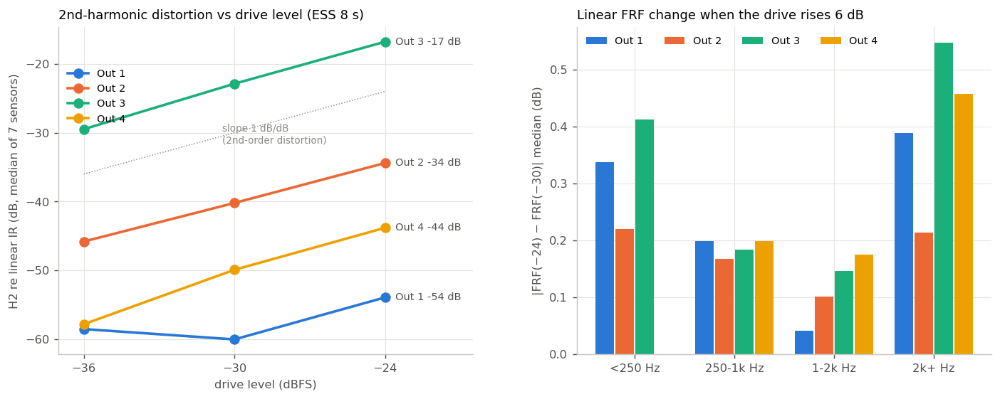
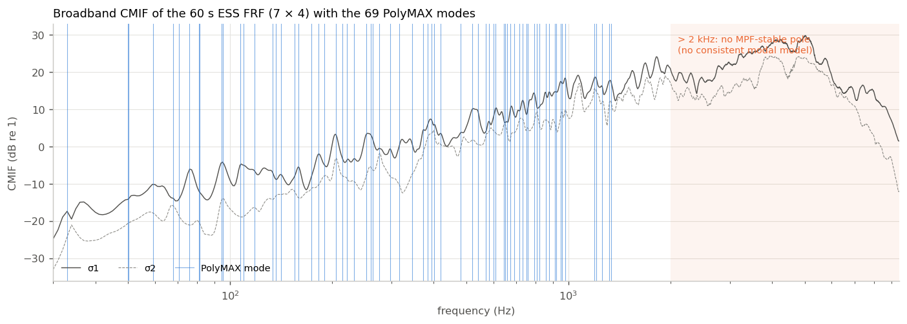
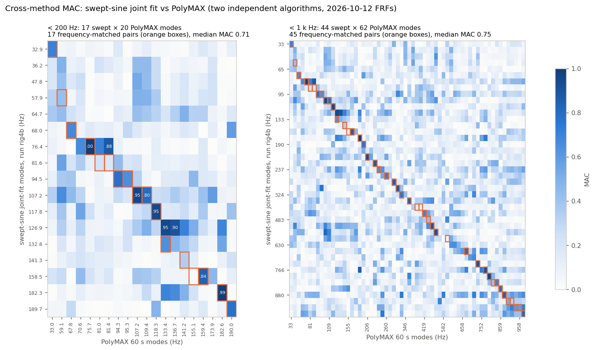
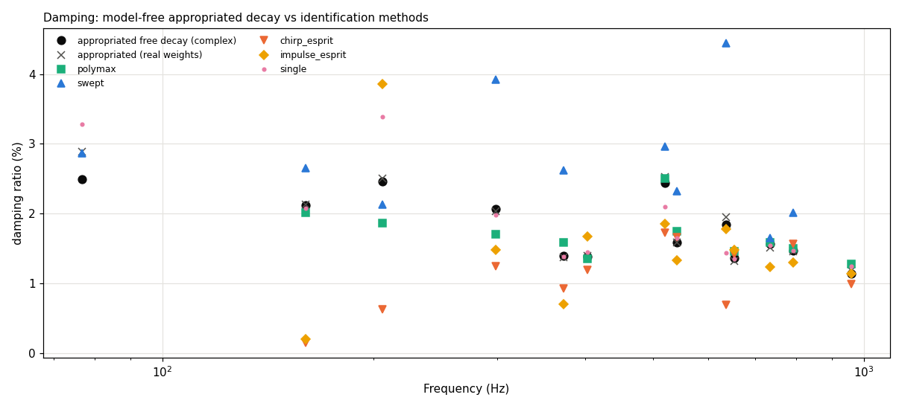
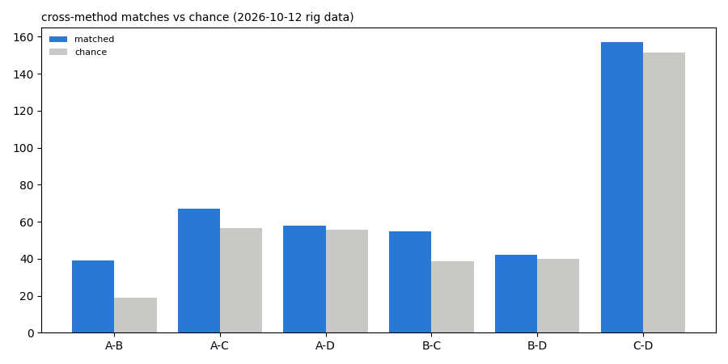
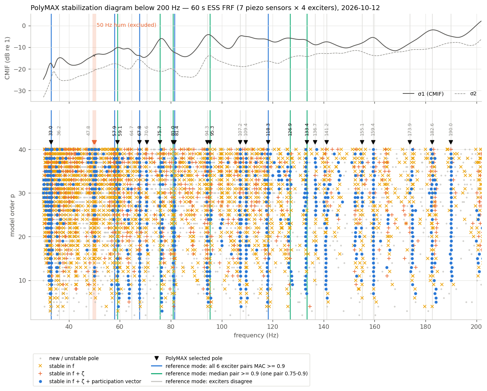
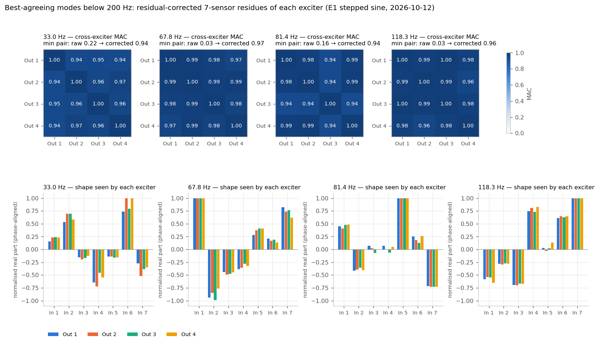
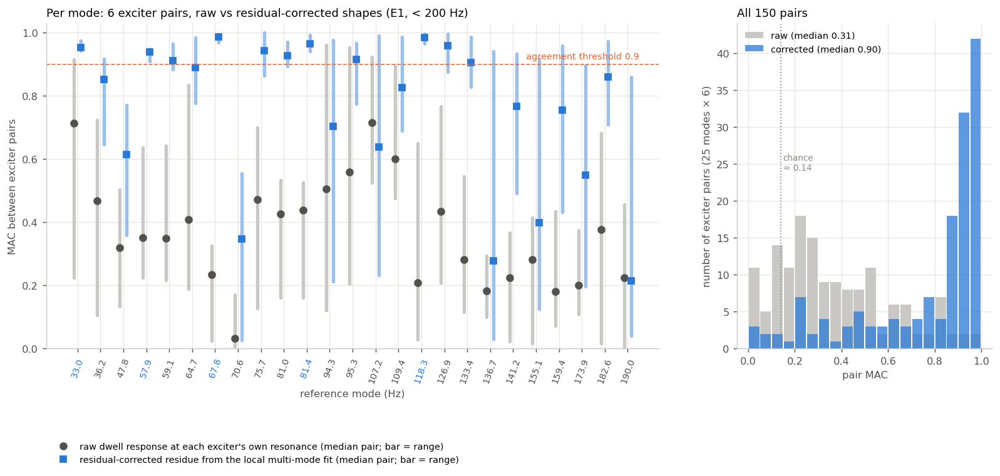
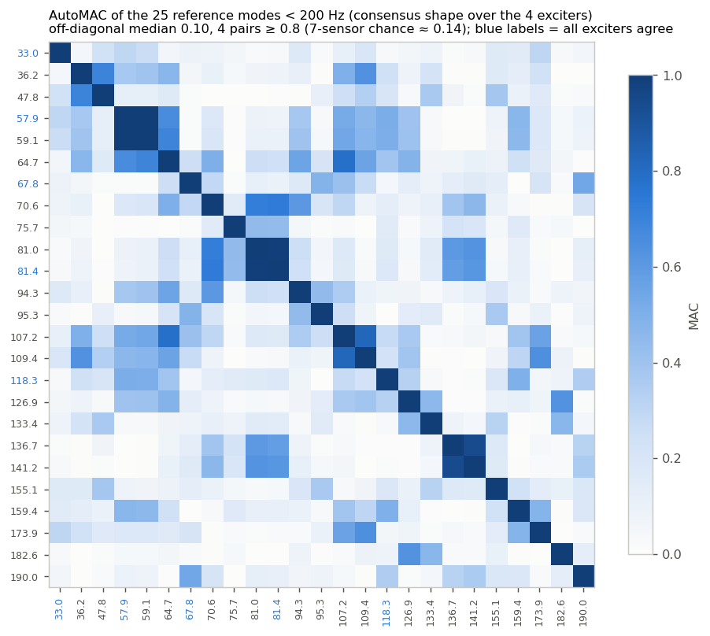
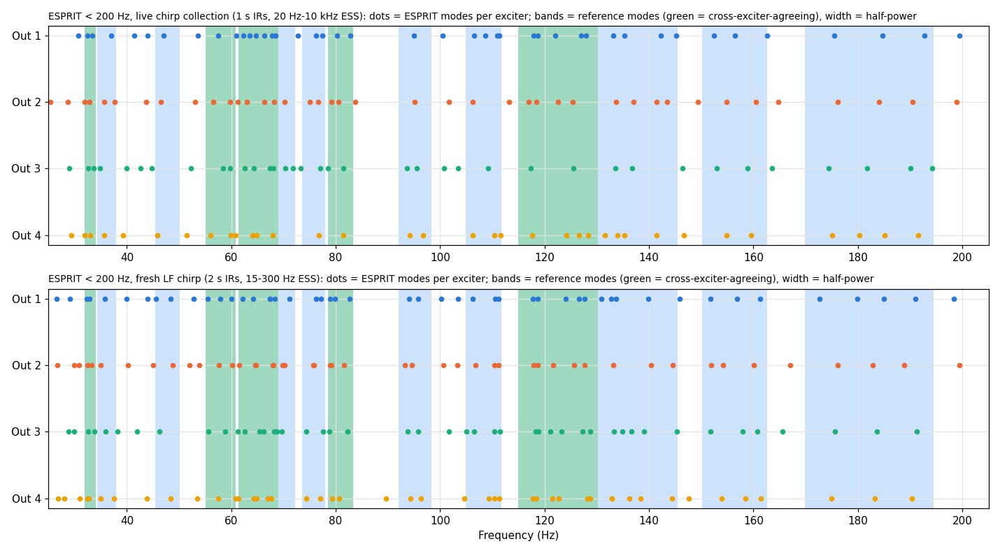

# Поиск мод деки с прикреплёнными возбудителями: отчёт о ходе работ (2026-10-12)

**Объём:** что было сделано 2026-10-11 и 2026-10-12 для идентификации мод деки стенда с 4 прикреплёнными электродинамическими возбудителями (voice-coil) и 7 пьезоэлектрическими контактными датчиками. В отчёте изложены теория, сравнение методов идентификации (наших и метода Димы) и предварительные результаты. Новых измерений на стенде для этого отчёта не проводилось. Все числа взяты из сохранённых данных и журналов анализа (источники — в Приложении A).

**Рабочие задачи:** dev-69fd (поиск мод свип-синусом), dev-fd69 (PolyMAX, chirp-ESPRIT, апроприация, проверки стенда, ступенчатый синус E1–E3), dev-1b6c / dev-4284 (измерительная сессия ASIO). Код — в ветке Core `feature/dev-fd69-modal-methods` (не слита).

---

## 1. Резюме

**Ключевые выводы**

1. **Измерительный тракт исправен.** Новая измерительная сессия ASIO воспроизводит и записывает с синхронизацией до отсчёта: начало петлевого (loopback) сигнала одинаково во всех сессиях (разброс 0), и за более чем 100 сессий было 0 срывов буфера (xruns). Повторные ЧХ (FRF) совпадают с γ² ≥ 0.9996 (SNR повторяемости 42–48 дБ). Перекрёстные наводки интерфейса −63…−71 дБ. На наших уровнях дека ведёт себя как линейная стационарная (LTI) система.
2. **Один возбудитель нелинеен.** У Out 3 искажения 2-го порядка: H2 составляет −23 дБ при −30 dBFS и растёт на 6 дБ на каждые 6 дБ возбуждения. Деконволюция свип-синуса и chirp-сигнала удаляет их из линейной ЧХ. Держать Out 3 на уровне ≤ −30 dBFS и проверить его крепление.
3. **Демпфирование установлено: ζ ≈ 1.6 % (медиана, диапазон 1.1–2.5 %) в полосе 150 Гц – 1 кГц.** Источник — безмодельное свободное затухание после многовозбудительной апроприации сил (force appropriation). PolyMAX с ним совпадает (отношение 1.01). Рациональная аппроксимация по свипу даёт значения примерно на 30 % выше. ESPRIT по отдельным возбудителям нестабилен и занижает значения (вплоть до 0.1–0.2 %).
4. **Методы, использующие все возбудители одновременно, работают на этой деке. ESPRIT по отдельным возбудителям — нет.** Совместная аппроксимация по свипу и PolyMAX — независимые алгоритмы. На одних и тех же ЧХ они совпадают по 39 модам (случайный уровень: 19), с MAC форм 0.81 ниже 250 Гц. ESPRIT совпадает с другими методами и сам с собой между возбудителями лишь на случайном уровне — как на импульсных, так и на chirp-импульсных характеристиках.
5. **Ниже 200 Гц около 22 мод.** Пять из них совпадают по всем 4 возбудителям с MAC ≥ 0.9: 33.0, 57.9/59.1, 67.8, 81.4 и 118.3 Гц. Ещё шесть почти совпадают. «Сырой» отклик на резонансе каждого возбудителя даёт медианный попарный MAC всего **0.31**. После локальной многомодовой аппроксимации с остаточными членами медиана — **0.90**. Главная причина — **модальное перекрытие**: медианный коэффициент перекрытия 1.9, поэтому на своём резонансе каждый возбудитель возбуждает разную *смесь* мод. Вторая причина — группы близких мод, которые 4 точки возбуждения × 7 датчиков не могут разделить. Нелинейность, уровень возбуждения, датчики в ближнем поле и неисправный возбудитель проверены и исключены.
6. **Используемая сейчас полоса — примерно 30 Гц – 1 кГц, около 55–65 мод.** 1–2 кГц — на грани. Выше 2 кГц данные 4 × 7 не поддерживают согласованную модальную модель, так как ни один полюс не стабилен по своему вектору участия.

**Подтверждено и открыто**

| Подтверждено | Открыто |
|---|---|
| Синхронизация тракта, линейность (кроме H2 у Out 3), повторяемость, перекрёстные наводки | Физическая причина искажений Out 3 (механическая проверка) |
| ζ ≈ 1.6 % (апроприированное затухание); ζ по PolyMAX верно | Абсолютная модальная масса (1/m) требует **опорного сигнала силы (тока)** |
| 5 + 6 мод ниже 200 Гц, по которым все возбудители совпадают (или почти совпадают) | ~11 мод в плотных группах ниже 200 Гц. Нужно **больше датчиков / подвижная сетка датчиков / молоток** |
| Ранжирование методов: PolyMAX (f, ζ, формы) + свип (перекрёстная проверка) ≫ ESPRIT по отдельным возбудителям | Сопоставление мод деки модам движка (decka / подача на актуаторы) |
| Сетевой фон 50 Гц проявляется как «мода» с ζ 0.36 % | Режекция / исключение фона в коде идентификации |

---

## 2. Установка

### 2.1 Стенд

| Элемент | Конфигурация |
|---|---|
| Интерфейс | Behringer UMC1820, **ASIO**, 48 кГц, буфер 64; все каналы `ASIOSTInt32LSB` |
| Возбудители | 4 электродинамических возбудителя на **Out 1–4**, прикреплены к деке, каждый через свой канал усилителя |
| Датчики | 7 пьезоэлектрических контактных датчиков на **In 1–7** |
| Петля (loopback) | **Out 5 → In 8**, электрическая, передаёт только метку синхронизации |
| Уровни | −36…−24 dBFS пик синуса/свипа (жёсткий предел −12 dBFS в коде; Out 3 держится на −30 dBFS) |
| Уровень шума | −78…−87 dBFS rms на датчик; SNR мод 18–88 дБ при −30 dBFS |

Физическая геометрия (положения датчиков и возбудителей) не задокументирована. Ближайший к каждому возбудителю датчик мы определили по самому раннему акустическому приходу: Out 1 → In 1, Out 2 → In 5/6, Out 3 → In 3, Out 4 → In 1/2.

### 2.2 Измерительная сессия ASIO (новая, 2026-10-11)

Тест ввода-вывода 2026-10-11 шёл через старый рекордер SDL3 / WASAPI (`sdl_audio_core`) и выявил структурные дефекты:

- нет возбуждения по отдельным выходным каналам (WASAPI предоставляет стереопары как конечные точки);
- воспроизведение на половинной скорости на стереоточках;
- идентификаторы устройств меняются между сессиями;
- джиттер до одного буфера между выходом и входом.

Поэтому весь измерительный ввод-вывод перенесён в **синхронизированную до отсчёта сессию ASIO внутри собственного ASIO-хоста движка** (`POST /audio/session` на `:5000`; dev-1b6c, dev-4284). Сессия работает так:

- Матрица воспроизведения и захват **взводятся в одном и том же `bufferSwitch`**, поэтому выход и вход разделяют один тактовый генератор и один начальный отсчёт.
- Синтез на время сессии приостанавливается, чтобы измерение и движок не конкурировали за Out 1–4.
- Каждая сессия выдаёт **метку петли** на Out 5 → In 8. Это даёт измеренную полную задержку каждого захвата, и захват выравнивается по ней.
- **Измеренная полная задержка: 334 отсчёта** во всех сессиях 2026-10-12 (328 отсчётов в прогонах 2026-10-11; разброс 0 внутри каждого дня). Драйвер сообщает **304 отсчёта** (`ASIOGetLatencies` вход 136 + выход 168). Драйвер занижает примерно на 30 отсчётов (0.6 мс), поэтому мы используем измеренное значение.
- Сигнал возбуждения **не** дублируется на выход петли. Продублированный сигнал проникает во In 5–7 всего на 33–42 дБ ниже.
- В пробе Phase-0 сессия также выявила и исправила **ошибку масштаба захвата** (1/2²³ вместо 1/2³¹, ошибка ×256).

### 2.3 Уровни и линейность возбудителей

На рисунке 6 каждый возбудитель возбуждается 8-секундным ESS при −36, −30 и −24 dBFS.

- **Линейные** ЧХ масштабируются с точностью 0.1–0.5 дБ. Худший случай — Out 1 ниже 250 Гц при −36 dBFS, ограниченный SNR.
- У **Out 3** H2 равно **−29.5, −22.9 и −16.8 дБ** для трёх уровней (7 % при −30 dBFS, 14 % при −24 dBFS). Это классические искажения 2-го порядка: растут на 1 дБ на каждый дБ возбуждения.
- Out 2 показывает ту же картину примерно на 17 дБ ниже. Out 1 и Out 4 чистые (H2 ≤ −44 дБ).
- Деконволюция ESS и chirp-сигнала сдвигает гармоники в отрицательное время, поэтому линейная ЧХ остаётся чистой. Последовательность импульсов этого не позволяет.



*Рисунок 6. Слева: H2 относительно линейной импульсной характеристики в зависимости от уровня возбуждения (медиана по 7 датчикам). Справа: изменение линейной ЧХ при +6 дБ возбуждения.*

---

## 3. Теоретическая основа

### 3.1 Модальная модель деки

Для линейной слабодемпфированной конструкции с вязким (или пропорциональным) демпфированием ЧХ от возбудителя *e* к датчику *k* есть сумма по модам:

```
H_ke(ω) = Σ_m  φ_k,m · φ_e,m / ( m_m · (ω_m² − ω² + 2 j ζ_m ω_m ω) )
        ≈ Σ_m [ R_m,ke / (jω − λ_m)  +  R*_m,ke / (jω − λ*_m) ]
λ_m = −ζ_m ω_m + j ω_m √(1 − ζ_m²)
```

Каждая мода описывается четырьмя величинами:

- полюсом λ_m, который даёт f_m и ζ_m;
- собственной формой φ_m в точках датчиков;
- её значением в точках возбуждения φ_e,m (**участие**, participation);
- модальной массой m_m.

При K датчиках и E возбудителях матрица вычетов R_m = φ_m · L_mᵀ / m_m имеет размер K × E и **ранг 1**. Все возбудители видят одну и ту же форму и отличаются только скалярным множителем. На этом свойстве основана наша идентификация. Его накладывает каждый многоопорный (multi-reference) метод: совместная аппроксимация по свипу, PolyMAX и SVD Димы.

**Взаимность.** H_ke = H_ek. Она позволила бы проверить точку возбуждения и откалибровать масштаб. На этом стенде её использовать нельзя: пьезодатчики не могут возбуждать, а катушки возбудителей не считываются как датчики.

### 3.2 MAC: как мы сравниваем формы

```
MAC(a, b) = |aᴴ b|² / ( (aᴴ a)(bᴴ b) )        ∈ [0, 1]
```

- MAC равен 1 для параллельных векторов, независимо от их масштаба и общей фазы.
- **Случайный уровень зависит от размерности.** Для двух случайных комплексных 7-мерных векторов ожидаемый MAC ≈ 1/7 ≈ 0.14. На перемешанных парах мы измеряем 0.12–0.16. Поэтому MAC 0.3 между формами по 7 датчикам — это **не** слабое совпадение. Это почти случайный уровень.
- Разные моды, измеренные лишь в 7 степенях свободы, тоже могут иметь высокий MAC: 7 датчиков не могут сделать 20 и более мод взаимно ортогональными (рисунок 3).
- Мы называем моду **согласованной** между возбудителями, если **все 6 пар возбудителей дают MAC ≥ 0.9**.

### 3.3 Модальное перекрытие: почему оценки по одному входу зависят от возбудителя

Коэффициент модального перекрытия сравнивает полосу по уровню половинной мощности с расстоянием между модами:

- Статистическая форма: M = η · f · n(f), где η = 2ζ — коэффициент потерь, n(f) — модальная плотность.
- Локальная форма, для каждой моды: M_m = 2 ζ_m f_m / Δf_m, где Δf_m — расстояние до ближайшего соседа.

При M ≳ 1 каждая частотная линия — суперпозиция нескольких мод с сопоставимыми весами. Отклик на резонансе возбудителя *e* тогда равен

```
y(ω_peak,e) ≈ Σ_m  φ_m · (L_m,e / m_m) · g_m(ω_peak,e),   g_m = 1/(ω_m² − ω² + 2jζ_m ω_m ω)
```

Веса смешения L_m,e зависят от того, где возбудитель *e* находится на каждой соседней моде. Поэтому каждый возбудитель «видит» свою смесь, и даже частота его пика смещается. Ниже 200 Гц мы нашли разброс резонансной частоты по возбудителям 1.7 % (медиана). Выбор пиков (peak-picking) по одному входу или аппроксимация с одной опорой тогда возвращает **зависящую от возбудителя псевдомоду**. Восстановить общую φ_m может только модель, аппроксимирующая все перекрывающиеся полюса совместно, с фоновым членом для мод вне полосы. Именно это и есть скачок MAC «сырой 0.31 → скорректированный 0.90» в §5.7.

### 3.4 CMIF / SVD-проверка ранга

На каждой частотной линии берём SVD матрицы ЧХ размера K × E: H(ω) = U Σ Vᴴ.

- **CMIF** σ1(ω) имеет пики на модах. U[:,0] — там рабочая форма колебаний, V[:,0] — вектор участия.
- **σ2/σ1 — проверка ранга.** Если линию доминирует одна мода, σ2 ≪ σ1. Высокое σ2/σ1 на пике означает, что активны несколько мод или данные не следуют модальной сумме низкого ранга.
- На этой деке σ2/σ1 на пиках CMIF составляет 0.31–0.36 ниже 250 Гц, 0.38–0.40 в 250 Гц – 1 кГц, 0.53–0.56 в 1–2 кГц и около 0.50 выше. Оно одинаково во всех повторах и при всех длительностях свипа, т.е. описывает деку, а не шум.
- Критерий приёмки у Димы — σ1/σ2 ≥ 1.35, т.е. σ2/σ1 ≤ 0.74. По сравнению с этими значениями это мягкий критерий.

### 3.5 Диаграммы стабилизации

Параметрический оцениватель, такой как pLSCF / PolyMAX, решается при возрастающих порядках модели p:

- **Физические полюса** возвращаются с теми же f, ζ и вектором участия на каждом порядке.
- **Математические (шумовые или подгоночные) полюса** «гуляют».

Полюс помечается стабильным по f, затем по f + ζ, затем по f + ζ + вектору участия (MPF) относительно предыдущего порядка. Наши допуски: 1 % по f, 10 % по ζ и MAC 0.9 по MPF. Полюса отбираются, если они стабильны хотя бы на 30 % порядков. Критерий MPF — строгий. Выше 2 кГц частоты и демпфирование стабилизируются, а MPF — нет; это та же несогласованность 4 × 7, которую показывает §3.4.

### 3.6 Опорный сигнал силы против опорного сигнала напряжения

Все наши ЧХ отнесены к **цифровому напряжению возбуждения**. Возбудитель — электромеханический преобразователь:

```
Z_el(ω) = R + jωL + (Bl)² / Z_mech(ω)          сила F = Bl · I
```

Z_mech — механический импеданс в точке крепления: дека плюс подвижная масса возбудителя. Поэтому опора по напряжению даёт три эффекта:

- **Разный масштаб и фаза для каждого столбца (возбудителя).** MAC их не видит, но абсолютное 1/m и сравнение участия между возбудителями — видят.
- **Демпфирование противо-ЭДС.** При усилителе с низким выходным импедансом ток движения (Bl)²/R добавляет демпфирование каждой моде, которую возбудитель раскачивает, и величина различается по возбудителям. Часть идентифицированного ζ принадлежит связанной системе «дека + возбудитель».
- **Массовая нагрузка.** Прикреплённые возбудители смещают частоты мод, на которых они стоят. Идентифицируемая нами дека — это «дека с 4 прикреплёнными возбудителями».

Дима измеряет **ток** возбуждения трансформатором тока (CT). Это опора по силе (с точностью до Bl). Мы планируем то же самое со вторым UMC1820 через ADAT. Это исправляет масштаб, фазу и распределение демпфирования по возбудителям. На MAC форм это **не** влияет.

### 3.7 Апроприация сил (фазовый резонанс) и свободное затухание

При E возбудителях на одной частоте **критерий фазового резонанса** (Asher / MMIF) говорит, что чистая нормальная мода возбуждена, когда отклик находится в квадратуре с силой. Мы реализуем энергетическую форму: выбираем веса возбудителей w, максимизирующие долю целевой моды в модальной энергии,

```
P_m(w) = |g_m|² ‖R_m w‖² / Σ_r |g_r|² ‖R_r w‖²,    g_r = 1/(jω_m − λ_r)
```

Это обобщённое отношение Рэлея, решаемое как главный обобщённый собственный вектор. Веса могут быть вещественными со знаком (форма Димы) или комплексными. Четыре возбудителя могут подавить не более трёх соседних мод.

После апроприированной выдержки возбуждение выключается. Свободное затухание затем модально фильтруется и демодулируется, что даёт **f и ζ без модели**: прямолинейная аппроксимация логарифма амплитуды и фазы. Остаток огибающей сигнализирует о любой оставшейся соседней моде. Именно этот эталон и решил вопрос о демпфировании.

### 3.8 Чего ожидать по литературе

Из `piano-soundboard-mode-count-literature-2026-10-10.md`:

- **Коэффициент потерь** η ≈ 2 % ± 1 % (ζ ≈ 1 %), примерно постоянный до нескольких кГц. Ege 2013 сообщает η 1–3 % ниже 1.2 кГц на пианино. Наше ζ ≈ 1.6 % (η ≈ 3.2 %) — у верхней границы, что согласуется с дополнительным демпфированием от прикреплённых возбудителей.
- **Два вида модальной плотности.** *Глобальная* плотность учитывает все моды (МКЭ). Для пианино это около 0.06 мод/Гц до 1 кГц; для рояля 0.1–0.24. *Наблюдаемая* (локальная) плотность — то, что видит одна точка. Выше примерно 1.1 кГц моды локализуются между рёбрами, поэтому наблюдаемая плотность падает до 0.01–0.02 мод/Гц.
- **Модальное перекрытие** выше 30 % при частотах выше 150 Гц и около 100 % на 1 кГц (пианино). Выше 0.5–1 кГц отдельные моды разрешить нельзя, и значение имеет только статистика отклика.
- **Наша дека вписывается в эту картину.** Около 22 мод ниже 200 Гц — это около 0.13 мод/Гц. ζ ≈ 1.5–3 % по ступенчатым аппроксимациям даёт локальные коэффициенты перекрытия около 2. Несколько датчиков не видят согласованной модальной модели выше примерно 2 кГц, что соответствует локализованным модам.

---

## 4. Сравнение подходов и алгоритмов

| | Возбуждение | Опора | Работа с несколькими возбудителями | Оценка демпфирования | Учёт перекрытия | Скорость (4 возб.) | Вывод для этой деки |
|---|---|---|---|---|---|---|---|
| **(a) ESPRIT по последовательности импульсов** (существующий конвейер) | последовательность импульсов 100 мс, 5 усреднений на возбудитель | возбуждение (цифровое) | нет: отдельный ESPRIT на каждый путь возбудителя | по полюсам; смещена **вниз** (медиана 0.77 %) | нет; ~130 полюсов на путь | ~4 мин + ESPRIT 1 мин | **Непригоден**: совпадение между возбудителями на случайном уровне; гармоники не отделены |
| **(b) Chirp → ИХ → ESPRIT** | ESS, деконволюция в ИХ 0.85–2 с | возбуждение | нет (по каждому возбудителю) | смещена вниз (0.6–1.0 %; 0.2–0.35 % ниже 200 Гц) | нет | ~4 мин + 1 мин | **Непригоден** для мод: повторяем для одного возбудителя (MAC 0.98), но между возбудителями на случайном уровне |
| **(c) Пик по свипу + совместная аппроксимация** (наш, dev-69fd) | грубый ESS 20 с + тонкие линейные свипы по зонам | возбуждение | **совместно**: полюса общие для всех возбудителей, многоопорная рациональная аппроксимация по зонам | из аппроксимации; примерно на **30 % выше** | контекстные полюса, дополнительные полюса по σ2; пропускает пары ближе ½ B | ~8 мин | **Хорош** для f и форм ниже 1 кГц; независимая перекрёстная проверка |
| **(d) PolyMAX** (pLSCF + LSFD, наш) | любая матрица ЧХ (использован ESS 60 с) | возбуждение | **многоопорный**: MPF в проверке стабильности | **верная** (отношение 1.01 к апроприированному затуханию) | разрешает перекрывающиеся моды в моделировании (22/22 при перекрытии 1.5–3) | секунды на готовой ЧХ | **Лучший**: основной для f, ζ, форм ≤ 2 кГц; выше — нет |
| **(e) Ступенчатый синус с синхронным детектированием + локальная многомодовая аппроксимация** (E1/E3, наш) | ступени с непрерывной фазой, установление ≥ 10 τ, синхронное детектирование по 50 периодам | возбуждение (возможен ток) | по каждому возбудителю, затем сравнение | аппроксимация по возбудителю (1.5–3 %) | свободные полюса + фоновые члены const / jω | **медленно**: 7 мин на возбудитель < 200 Гц | **Диагностический**: показывает, по каким модам все возбудители согласны |
| **(f) Апроприация сил + свободное затухание** (наш) | все 4 возбудителя одновременно, взвешенная синусоидальная выдержка, затем тишина | возбуждение (возможен ток) | решение многовозбудительное | **безмодельное** затухание, **эталон** | подавляет до 3 соседей; остаток огибающей выявляет неудачи | ~20 с на моду | **Эталон демпфирования**; веса актуаторов для каждой моды (форма decka) |
| **(g) `adjust_tr_10e` Димы** | ступенчатый синус с синхронным детектированием 100–4000 Гц, 72 точки/окт (≤ 2 Гц), установление 200 мс, ≥ 20 периодов | **ток через CT** (сила) | CMIF по матрице 6 × A, слияние пиков в пределах 0.6 %; решение с вещественными весами max \|uᴴAa\|² | **нет** | σ1/σ2 ≥ 1.35, MAC(u, f ± 0.15 %) ≥ 0.8; сохраняет только u₁ | ~12 мин на актуатор, ~1.5 ч на 7 | **Сильная опора и решение**; установление слишком короткое < 250 Гц; нет ζ; близкие пары теряются |

**(a) / (b) ESPRIT.** ESPRIT аппроксимирует ИХ каждого пути к датчику суммой затухающих экспонент. На одних и тех же данных аппроксимации очень повторяемы: тот же возбудитель в разных прогонах — f 0.03–0.15 % и MAC ≈ 1.0. Однако между возбудителями его ~130 полюсов на путь совпадают лишь на случайном уровне:

- совпавших пар 32–44 при случайном уровне 30–37;
- MAC форм 0.11–0.28;
- 15–21 из ~330 мод найдены всеми 4 возбудителями.

Когда моды сильно перекрываются и демпфированы на 2–3 %, подпространственная аппроксимация с одной опорой описывает каждый *путь* множеством слабодемпфированных полюсов. Общие моды она не описывает. Более длинные ИХ (2 с, отдельный набор полос ниже 200 Гц) дают формы, явно связанные с формами ступенчатого синуса (MAC 0.61 при случайном 0.14), но демпфирование остаётся в 5–10 раз заниженным, и возбудители по-прежнему не согласуются между собой.

**(c) Поиск мод свипом** (dev-69fd). Грубый ESS даёт ЧХ на сетке 0.25 Гц. Пики CMIF (выраженность ≥ 3 дБ, SNR ≥ 10 дБ, форма стабильна на пике) задают зоны. За тонкими линейными свипами по зонам следует многоопорная рациональная аппроксимация (variable projection по f и log ζ, линейные вычеты, фон const + jω). В моделировании он находит 38 из 42 мод в плотной случайной системе. Пропуски — всегда пары ближе одной полосы половинной мощности. На стенде его ζ примерно на 30 % выше, так как он частично поглощает немоделированных соседей.

**(d) PolyMAX** (dev-fd69). Это многоопорный оцениватель наименьших квадратов в комплексной частотной области (модель правой матричной дроби, взвешивание по шуму). Он строит диаграмму стабилизации для каждой полосы, автоматически отбирает полюса по критерию MPF, объединяет дубликаты и получает вычеты через LSFD. На синтетической системе с 22 модами при перекрытии 1.5–3 (где CMIF показывает ОДИН пик) он восстанавливает 22/22 моды с ошибкой f < 0.5 % и без ложных мод. Метод пиков по свипу находит там лишь 0–5 из них. Проверки согласованности на стенде:

- исключение одного возбудителя (leave-one-exciter-out): совпадают 40–49 мод против 14–17 случайных;
- от прогона к прогону: df 0.15 %, dζ 4.6 %, MAC 0.82.

**(e) Ступенчатый синус + локальная многомодовая аппроксимация.** Это медленная проверка с минимумом модельных допущений. Каждый возбудитель в отдельности проходит ступенями ±3 B вокруг каждой моды. Затем локальная аппроксимация использует свободные полюса, общие для 7 датчиков, и добавляет фоновые члены. Вычет целевого полюса — это *скорректированная по остаткам* форма. Именно это превратило «возбудители не согласуются» в «возбудители согласуются, если смоделировать соседей» (§5.7).

**(f) Апроприация.** См. §3.7. В моделировании ζ по затуханию отличается от истинного не более чем на 0.6 %, даже когда демпфирование модели ошибочно в ×0.5 или ×2. Лучший одиночный возбудитель смещён на ±8 % из-за биений. На этой деке вещественные веса работают так же хорошо, как комплексные (ζ в пределах 3 %), поэтому формы decka (один вещественный вес со знаком на возбудитель на моду) достаточно для воспроизведения.

**(g) Метод Димы** (из `adjust_tr_10e_4khz.py`). Он ближе всего к нашему. Используется ступенчатый синус с опорой по току через CT, пики находятся на CMIF (локальный максимум ≥ 1.45 × уровень фона, тонкое сканирование ±2 %), пик принимается по σ1/σ2 и стабильности MAC, и решается задача о вещественных весах актуаторов, максимизирующих |uᴴAa|² (та же целевая функция, что в нашей безмодельной апроприации, без фазы). Далее следует цикл уточнения в реальном времени по микрофону. В сравнении с нашими данными:

- **Сильные стороны:** опора по силе; полностью безмодельный; непосредственно даёт возбуждение актуаторов для каждой моды, которое нужно ПЛИС.
- **Время установления:** постоянные 200 мс слишком коротки ниже 250 Гц. При ζ = 1.6 % τ = 1/(2πζf) составляет 100 мс на 100 Гц, поэтому 200 мс — это лишь 2 τ (остаётся 14 % переходного процесса). На 50 Гц — меньше 1 τ.
- **Нет оценки демпфирования.**
- **Близкие моды:** проверка MAC в ±0.15 % остаётся внутри одного пика, а сохранение только u₁ на группу теряет близкие пары.
- **Только модуль тока:** при пересчёте фаза по актуаторам игнорируется.
- **Пик против собственной частоты:** `omega_coef` — это пик амплитуды, а не собственная частота.

Общее неустранимое ограничение — то же, что у нас. В полосе с перекрытием вектор пика CMIF u₁ — это смесь мод. Наши данные E1/E3 говорят, что он будет воспроизводиться между актуаторами лишь для примерно 5–11 наиболее изолированных низких мод.

---

## 5. Результаты (2026-10-11 и 2026-10-12)

### 5.1 Проверка возбудителей тонами и тест ввода-вывода (10-11)

Каждый возбудитель возбуждался тестовыми тонами на −30 dBFS. Каждый выход доходил до всех 7 датчиков с SNR > 20 дБ. Шум датчиков −78…−87 dBFS rms. Тест также выявил четыре дефекта SDL/WASAPI из §2.2, что привело к сессии ASIO. Её приёмочный прогон: 4 возбудителя × 5 измерений, каждая сессия возбуждает ровно `[Out k, Out 5]`, разброс начала петли 0, 0 срывов буфера.

### 5.2 Первый прогон свипом (10-11, `20261011-rig3`)

- 9 сессий за 233 с. Грубый проход дал 23 зоны.
- **70 мод от 33 Гц до 6.3 кГц** (20 ниже 250 Гц, 23 в 250–1 к, 11 в 1–2 к, 14 выше).
- Медиана ζ 3.2 %. MAC аппроксимации ≥ 0.966.
- Медиана σ2/σ1 матрицы вычетов 0.45.
- Повторяемость: разброс f 0.15 % (изолированные моды 0.002–0.06 %), разброс ζ 4.3 %.

### 5.3 Согласованность между возбудителями, первый анализ (10-11)

Независимые аппроксимации свипа и импульсный ESPRIT, по каждому возбудителю (`D:\scratch\xexc-2026-10-11`):

- **Аппроксимации свипа по возбудителям** согласуются ниже 250 Гц: медиана MAC 0.81, 33 % групп ≥ 0.9.
- Начиная с 250 Гц они падают до 0.42, а затем до 0.23–0.27.
- **ESPRIT** нигде не превышает случайного уровня (MAC 0.13–0.41; 15 из 320 групп видны всем 4 возбудителям).

Демпфирование по свипу было 3.2 %, по ESPRIT — 0.77 %, так что здесь и возник вопрос о ζ.

### 5.4 Проверки стенда (10-12)

| Проверка | Результат |
|---|---|
| Перекрёстные наводки (ESS на неподключённый Out 6) | −63 / −71 / −70 / −69 дБ относительно отклика Out 3, по полосам: **пренебрежимо** |
| Ранний приход (электрическая утечка по пути возбудителя) | нет компоненты при t = 0 сверх «звона» акустического прихода; верхняя оценка ≤ −31…−60 дБ |
| Линейность по возбудителям | §2.3: линейные ЧХ в пределах 0.1–0.5 дБ; H2 Out 3 −23 дБ при −30 dBFS |
| Скорость свипа 8 / 30 / 60 с | SNR растёт как 10 log T (56→66 дБ ниже 250 Гц); ЧХ отличаются ≤ 0.12 дБ; **σ2/σ1 не меняется** (0.35–0.56); PolyMAX 65 / 67 / 69 мод, совпадают как повторы |
| Новые значения по умолчанию | грубый ESS **20 с**; тонкие зоны ограничены индексом квазистационарности 0.05 (≤ 20 с на зону); пауза затухания 8 τ ≤ 3 с |

Более медленный свип даёт выигрыш в SNR, но не меняет того, что можно идентифицировать. Несогласованность — свойство деки и расположения датчиков, а не регистрации.

### 5.5 Повторный прогон свипом и PolyMAX (10-12)

- **Свип `20261012-rig4b`** (новые значения по умолчанию): 73 моды от 33 Гц до 7.4 кГц (21 / 23 / 13 / 16 по полосам), медиана ζ 3.0 %, 491 с. Повторяемость по 3 повторам: разброс f 0.074 % (медиана), ζ 7 %.
- **PolyMAX по ЧХ 60 с:** 69 мод, все ≤ 2 кГц (рисунок 7).
- **Исключение одного возбудителя:** совпадают 40–49 мод (случайно 14–17), MAC форм 0.49–0.71.
- **Свип против PolyMAX:** совпадают 39 мод (случайно 19.0). MAC форм по полосам: **0.81** ниже 250 Гц, **0.63** в 250–1 к, 0.27 в 1–2 к.
- **Рисунок 4** использует более мягкое частотное окно (в пределах max(ζ, 1 %)). Он находит 17 совпавших пар ниже 200 Гц (медиана MAC 0.71) и 45 ниже 1 кГц (медиана MAC 0.75). Диагональ отчётливо видна до 1 кГц.



*Рисунок 7. CMIF (σ1, σ2) ЧХ по ESS 60 с с 69 модами PolyMAX. Выше 2 кГц ни один полюс не стабилен по своему вектору участия.*



*Рисунок 4. Перекрёстный MAC между модами совместной аппроксимации свипа и модами PolyMAX. Слева: ниже 200 Гц (значения ≥ 0.8 подписаны). Справа: ниже 1 кГц. Оранжевые рамки — пары, совпавшие по частоте. Внедиагональные блоки с высоким MAC — близкие моды, которые 7 датчиков не могут сделать ортогональными.*

### 5.6 Сквозной сбор chirp и решение вопроса о демпфировании (10-12)

**Сбор chirp через интерфейс Tunner/REST:**

- Новое измерение с chirp по умолчанию (ESS 9.87 с, ИХ 1 с): 4 возбудителя × 5, 20 сессий, 0 срывов буфера.
- Метаданные гармоник по каждому измерению воспроизводят тест линейности (H2 для Out 1–4: −53.5, −39.7, −23.2, −49.6 дБ).
- ESPRIT даёт 130–139 мод на возбудитель, медиана ζ 0.85–1.0 %.
- Тот же возбудитель против предыдущего дня: MAC 0.98, df 0.09 %, т.е. повторяемо.
- Между возбудителями — по-прежнему случайный уровень.

**Апроприация и свободное затухание** на 13 модах, 76.8–958.5 Гц:

- Выполнены варианты с комплексными весами, вещественными весами и с лучшим одиночным возбудителем.
- 9 затуханий чистые (остаток огибающей < 2 дБ). В 4 есть биения, они только ориентировочные (76.8, 635.5, 652.9, 958.5 Гц).
- **Апроприированный ζ: медиана 1.58 % (1.1–2.5 %).**

| Метод | ζ относительно апроприированного затухания (9 чистых мод): медиана (диапазон) |
|---|---|
| апроприированное, вещественные веса | 1.00 (0.97–1.03) |
| **PolyMAX** | **1.01** (0.76–1.14) |
| лучший одиночный возбудитель | 1.00 (0.86–1.38) |
| совместная аппроксимация свипа | **1.31** (0.87–1.90) |
| chirp-ESPRIT | 0.69 (0.07–1.07) |
| импульсный ESPRIT | 0.79 (0.09–1.57) |



*Рисунок 8. Коэффициент демпфирования по методам на 13 апроприированных модах. Эталон — безмодельное апроприированное затухание (чёрный).*



*Рисунок 9. Число мод, совпавших между методами, в сравнении с числом, ожидаемым случайно (данные 2026-10-12).*

### 5.7 Ниже 200 Гц: согласуются ли возбудители? Эксперименты E1–E3 (10-12)

**Опорный список (25 кандидатов).**

- 20 мод PolyMAX по ЧХ 60 с.
- 5 кандидатов только из свипа: 36.2, 47.8, 57.9, 64.7 и 126.9 Гц. Аппроксимация дала им ζ 4–19 %. В таблицу ниже они внесены с начальным ζ 5 %.
- **49.9 и 50.1 Гц исключены:** «мода» с ζ 0.36 % на частоте сети — это **фон 50 Гц**. Он попадает и в совместную аппроксимацию PolyMAX, поэтому коду идентификации нужен режекторный фильтр фона.
- 57.9 и 59.1 Гц — одна и та же мода (AutoMAC 1.00), поэтому список содержит около **22 различных физических мод**.

**Эксперименты.**

- **E1:** каждый возбудитель в отдельности, ступенчатый синус из 173 точек в окнах ±3 B, плюс длинная выдержка на собственном резонансе. 7 мин на возбудитель, 0 срывов буфера.
- **E2:** тест уровня на 6 модах при −42, −36 и −30 dBFS.
- **E3:** анализ.



*Рисунок 1. Диаграмма стабилизации PolyMAX ниже 200 Гц, пересчитанная по ЧХ ESS 60 с от 2026-10-12 (полосы 30–60, 60–120, 120–250 Гц, порядки 2–40; в каждой полосе показаны только полюса внутри её диапазона). Вверху: CMIF σ1 и σ2.*

- **Маркеры:** закрашенный синий = стабилен по f + ζ + вектору участия; оранжевый + = стабилен по f + ζ; жёлтый × = стабилен по f; серый = нестабилен.
- **Треугольники** — полюса, отобранные PolyMAX. Они точно воспроизводят список из 22 полюсов; оранжевые треугольники на 49.9 и 50.1 Гц — фон.
- **Вертикальные линии** — 25 опорных кандидатов, окрашенные по согласию между возбудителями в E1: синий = все 6 пар ≥ 0.9; зелёный = медиана ≥ 0.9; серый = не согласуются.
- **30–60 Гц:** мод у деки здесь мало, но шум относительно выше, поэтому многие математические полюса стабилизируются только по f.
- **Выше 60 Гц:** физические столбцы отчётливо выделяются.

**Согласие форм между возбудителями**

| Форма, сравниваемая между 4 возбудителями | медиана попарного MAC | мод со всеми 6 парами ≥ 0.9 |
|---|---|---|
| сырой отклик выдержки на собственном резонансе каждого возбудителя | **0.31** | **0 / 25** |
| скорректированный по остаткам вычет (локальная многомодовая аппроксимация) | **0.90** | **5**: 33.0, 57.9 (= 59.1), 67.8, 81.4, 118.3 Гц |
| то же, с удалением датчиков, ближайших к обоим возбудителям | 0.90 | 5 (те же) |
| только возбудители с участием ≥ 0.3 от наибольшего | — | 7: + 64.7 (2 возб.), 126.9 (3 возб.) |



*Рисунок 2. Четыре наиболее согласованные моды. Вверху: MAC 4 × 4 между возбудителями для скорректированных по остаткам вычетов. Внизу: форма по 7 датчикам, видимая каждым возбудителем (нормированная, вещественная часть после выравнивания фазы). Все четыре возбудителя видят одну и ту же картину, датчик за датчиком.*



*Рисунок 5. Слева: для каждой моды медиана и диапазон 6 MAC пар возбудителей, сырая выдержка (серый) против скорректированных по остаткам (синий). Справа: все 150 пар. Сырые формы группируются около случайного уровня, скорректированные — около 1. Примерно 25 % скорректированных пар, оставшихся низкими, приходятся на плотные группы.*



*Рисунок 3. AutoMAC 25 опорных кандидатов. Форма каждой моды здесь — консенсус по 4 возбудителям (первый сингулярный вектор скорректированных вычетов). Медиана вне диагонали 0.10. Четыре высоких внедиагональных пары:*

- *57.9 / 59.1 Гц, MAC 1.00: одна и та же мода;*
- *81.0 / 81.4 Гц, MAC 0.99;*
- *107.2 / 109.4 Гц, MAC 0.82;*
- *136.7 / 141.2 Гц, MAC 0.94.*

*Это близкие пары, которые 7 датчиков не могут различить по форме.*

**Таблица по модам (ниже 200 Гц).**

- **Ист.:** P = PolyMAX, S = только свип.
- **ζ:** значение модели PolyMAX; * = начальное значение для кандидата только из свипа.
- **M:** локальный коэффициент перекрытия.
- **Разброс f:** разброс резонансной частоты по 4 возбудителям.
- **n возб.:** число возбудителей с участием ≥ 0.3 от наибольшего.

| f (Гц) | ист. | ζ (%) | M | разброс f (%) | сырой MAC мед. | скорр. MAC мин / мед | n возб. | согласие |
|---|---|---|---|---|---|---|---|---|
| 33.0 | P | 3.3 | 0.7 | 1.1 | 0.71 | 0.94 / 0.95 | 4 | **все 4** |
| 36.2 | S | 5* | 1.1 | 4.5 | 0.47 | 0.65 / 0.85 | 4 | |
| 47.8 | S | 5* | 0.5 | 10.9 | 0.32 | 0.36 / 0.61 | 3 | |
| 57.9 | S | 5* | 5.0 | 3.5 | 0.35 | 0.91 / 0.94 | 3 | **все 4** (= 59.1) |
| 59.1 | P | 3.0 | 3.0 | 3.4 | 0.35 | 0.88 / 0.91 | 4 | почти |
| 64.7 | S | 5* | 2.1 | 2.6 | 0.41 | 0.78 / 0.89 | 2 | 2 возбуждающих согласны (0.98) |
| 67.8 | P | 2.8 | 1.3 | 0.8 | 0.23 | 0.97 / 0.99 | 4 | **все 4** |
| 70.6 | P | 2.3 | 1.1 | 1.4 | 0.03 | 0.03 / 0.35 | 2 | |
| 75.7 | P | 2.9 | 0.8 | 1.7 | 0.47 | 0.86 / 0.94 | 1 | почти (один возбуждающий) |
| 81.0 | P | 3.0 | 10.2 | 1.5 | 0.43 | 0.89 / 0.93 | 4 | почти |
| 81.4 | P | 1.9 | 6.4 | 0.3 | 0.44 | 0.94 / 0.96 | 2 | **все 4** |
| 94.3 | P | 2.3 | 4.3 | 1.3 | 0.51 | 0.21 / 0.70 | 4 | группа |
| 95.3 | P | 3.1 | 5.8 | 0.8 | 0.56 | 0.77 / 0.92 | 3 | почти |
| 107.2 | P | 2.2 | 2.2 | 0.5 | 0.72 | 0.23 / 0.64 | 1 | группа (0.98 в узком окне E2) |
| 109.4 | P | 2.0 | 2.0 | 2.7 | 0.60 | 0.69 / 0.83 | 4 | группа |
| 118.3 | P | 2.8 | 0.8 | 0.5 | 0.21 | 0.96 / 0.98 | 4 | **все 4** |
| 126.9 | S | 4.4 | 1.7 | 1.3 | 0.43 | 0.87 / 0.96 | 3 | почти |
| 133.4 | P | 2.4 | 1.9 | 0.7 | 0.28 | 0.83 / 0.91 | 3 | почти |
| 136.7 | P | 2.4 | 2.0 | 4.8 | 0.18 | 0.03 / 0.28 | 2 | группа |
| 141.2 | P | 3.0 | 1.9 | 3.0 | 0.22 | 0.49 / 0.77 | 2 | группа |
| 155.1 | P | 3.2 | 2.3 | 3.0 | 0.28 | 0.13 / 0.40 | 2 | группа |
| 159.4 | P | 2.0 | 1.5 | 2.2 | 0.18 | 0.43 / 0.75 | 1 | один возбуждающий |
| 173.9 | P | 2.3 | 0.9 | 3.0 | 0.20 | 0.20 / 0.55 | 2 | группа |
| 182.6 | P | 2.6 | 1.3 | 0.6 | 0.38 | 0.71 / 0.86 | 4 | группа |
| 190.0 | P | 2.3 | 1.2 | 6.7 | 0.23 | 0.04 / 0.21 | 4 | группа |

**Проверенные гипотезы**

| Гипотеза | Проверка | Вывод |
|---|---|---|
| Соседние / фоновые моды загрязняют отклик каждого возбудителя | сырой 0.31 → скорректированный 0.90; медиана коэффициента перекрытия 1.9 (> 1 у 20 / 25) | **главная причина** |
| Близкие моды, которые данные 4 × 7 не могут разделить | неудачи идут группами (94/95, 107/109, 133/137/141, 155/159, 174/183/190 Гц). PolyMAX по отдельным возбудителям находит 15 / 19 / 20 / 20 мод против 21 при совместной обработке. 107.2 Гц согласуется (0.98), когда окно исключает 109.4 Гц | **вторая причина** |
| Малое участие | 75.7, 107.2 и 159.4 Гц возбуждаются только одним возбудителем | объясняет ~3 моды |
| Датчик в ближнем поле | удаление ближайших датчиков оставляет медиану 0.90 | **не причина** |
| Нелинейность / уровень | E2: разность ЧХ уменьшается вдвое на каждые +6 дБ (ограничено SNR); MAC формы по ступеням в зависимости от уровня ≥ 0.97; пары с Out 3 согласуются **лучше всего** (0.92) | **не причина** ниже 200 Гц |
| Один неисправный возбудитель | медианы по парам 0.86–0.92; выделяющегося возбудителя нет | незначительно |

### 5.8 ESPRIT на основе chirp ниже 200 Гц (10-12)

Проектный конвейер ESPRIT был запущен без изменений, с отдельным набором полос ниже 200 Гц, на двух наборах ИХ: (a) рабочий сбор chirp (ИХ 1 с) и (b) новый chirp 15–300 Гц с ИХ 2 с.

| | (a) ИХ 1 с | (b) НЧ chirp, ИХ 2 с |
|---|---|---|
| полюсов ESPRIT ниже 200 Гц на возбудитель | 35–43 | 46–49 (≈ 2× опорного списка) |
| попаданий по частоте в пределах B/2 (случайно) | 96–100 (79.5) | 98–100 (83.5) |
| MAC формы относительно скорректированной формы E1 (случайно) | 0.10 (0.11) | **0.61** (0.14) |
| ζ ESPRIT / опорный ζ | 0.08 | 0.11 |
| опорных мод, подтверждённых ≥ 2 возбудителями | 0 | 7 |

ESPRIT независимо не находит те же моды. При вдвое большем числе полюсов, чем мод, совпадение частот лишь примерно на 15 % выше случайного. Длинные низкочастотные ИХ делают его формы явно связанными с формами ступенчатого синуса, но его демпфирование остаётся в 5–10 раз заниженным.



*Рисунок 10. Полюса низкочастотного chirp-ESPRIT против 25 опорных кандидатов (частота, демпфирование, MAC формы).*

### 5.9 Сетевой фон 50 Гц

PolyMAX на каждой ЧХ возвращает пару полюсов на 49.9 и 50.1 Гц с ζ 0.36–0.38 %. Это примерно в 5 раз меньшее демпфирование, чем у любой моды деки, и оно лежит точно на частоте сети. Это сетевой фон в тракте датчиков, а не мода деки. Он исключён из опорного списка. Идентификации нужен режекторный фильтр или полоса исключения на 50 Гц и его гармониках перед экспортом результатов.

---

## 6. Выводы и следующие шаги

### 6.1 Выводы

1. Использовать **PolyMAX** для частот, демпфирования и многоопорных форм примерно до 1 кГц (2 кГц — на грани). Его демпфирование совпадает с безмодельными затуханиями.
2. Использовать **совместную аппроксимацию свипа** как независимую перекрёстную проверку частот и форм. Её ζ примерно на 30 % выше.
3. **Отказаться от ESPRIT по отдельным возбудителям** для этой деки — как на импульсных, так и на chirp-ИХ.
4. Ниже 200 Гц возбудители **действительно** согласуются по модам деки, если смоделировать перекрытие. Это верно для 5 мод при MAC ≥ 0.9 и ещё 6 почти. Оставшееся расхождение — **проблема разрешения**: 4 точки возбуждения × 7 датчиков против примерно 20 сильно перекрывающихся мод. Это не нелинейность, не уровень возбуждения, не эффект ближнего поля и не плохой возбудитель.
5. Для воспроизведения через Out 1–4 **вещественные веса по модам** (форма decka) здесь так же хороши, как комплексные (`actuator_feed.npz`).

### 6.2 Следующие шаги в порядке приоритета

| # | Шаг | Зачем | Трудоёмкость |
|---|---|---|---|
| E9 | **Больше датчиков** (16–24) или **подвижная сетка датчиков** | 7 степеней свободы не могут разделить около 20 перекрывающихся мод (случайный MAC 0.14; близкие пары на 0.8–1.0). Это решающий эксперимент | оборудование + 1 день |
| E6 | **Ударный молоток с датчиком силы, перемещаемый по сетке** | много точек возбуждения; опора, независимая от возбудителей; показывает эффект массовой нагрузки от прикреплённых возбудителей | молоток + 1 день |
| E8 | **Измерение тока** (2-й UMC1820 через ADAT, `--current-inputs`) | опора по силе: масштаб, фаза и демпфирование противо-ЭДС для каждого возбудителя; абсолютное 1/m | проводка + код (S) |
| E7 | **Механическая проверка Out 3** (крепление, связь, усилитель) | H2 −23 дБ при −30 dBFS | вручную, 10 мин |
| — | **Режекция / исключение фона 50 Гц** в PolyMAX / свипе | предотвращает ложные моды | S |
| — | **План слияния** | Core `feature/dev-fd69-modal-methods` + Tunner `feature/dev-fd69-chirp-ui` → `dev` после ревью; сбор chirp уже по умолчанию для новых измерений | ревью + слияние |
| — | **Сопоставление мод деки ↔ движка** для `actuator_feed.npz` → коэффициенты decka | использование при воспроизведении | M |

E4 (перестановка кабелей) и E5 (по одному возбудителю) малоценны. Перекрёстные наводки −63…−71 дБ, и ни один возбудитель не выделяется.

### 6.3 Открытые вопросы к Диме

1. Какое демпфирование (Q) он видит? Может ли он прислать `.npz` обзорного измерения, файл калибровки CT и схему расположения датчиков/актуаторов? PolyMAX может взять его ЧХ напрямую и вернуть ζ.
2. Ниже 250 Гц меняются ли его результаты, если время установления увеличить с 200 до 1000 мс? (При ζ 1.6 % 200 мс — это около 2 τ на 100 Гц.)
3. Актуаторы и усилитель: управление напряжением или током? Кривые импеданса? CT или шунт? Отличается ли фаза тока между актуаторами?
4. Даёт ли каждый актуатор одну и ту же собственную форму (MAC столбцов на пике)? На нашей деке это выполняется лишь примерно для 5–11 низких мод и только после многомодовой аппроксимации.
5. Как он обрабатывает близкие или вырожденные пары? Его кластеризация сохраняет только u₁.
6. КНИ тока на рабочем уровне: насколько он велик и зависит ли от уровня?
7. ПЛИС: затухает ли слот при обычной игре? В каких единицах `omega_coef`, множитель ×10000 и `f·690·0.97`?
8. Насколько его цикл REFINE улучшил результат по сравнению с решением через SVD?
9. Находится ли какой-либо датчик в той же точке, что и актуатор? ЧХ в точке возбуждения (drive-point FRF) дала бы 1/m.

---

## Приложение A: Источники и воспроизведение

- Методы + результаты стенда: `docs/development/modal-methods-attached-exciters-2026-10-11.md` (§1–§10).
- Проект свипа: `docs/proposals/swept-sine-mode-discovery-2026-10-11.md`.
- Сравнение с методом Димы: `docs/development/dima-vs-pianoid-mode-discovery-2026-10-11.md`.
- Сессия ASIO: `docs/proposals/asio-audio-core-retire-sdl-2026-10-11.md`.
- Литература: `docs/development/piano-soundboard-mode-count-literature-2026-10-10.md`.
- Данные: `D:\modal_measurements\`
  - `swept_discovery\20261011-rig{1,2,3}`, `20261012-rig4b`;
  - `rig_checks\20261012T160627-crosstalk`, `T160700-linearity`, `T161018-sweep_speed`, `T172442-e1`, `T175239-e2`, `T182323-lfchirp`;
  - `appropriation\20261012T164630`, `T164732`;
  - анализ в `analysis\dev-fd69-2026-10-1{1,2}\`; первый анализ согласованности в `D:\scratch\xexc-2026-10-11\`.
- Рисунки 1–7 пересозданы из сохранённых данных скриптом `docs/development/diagnostics/dev-fd69-report-figures-2026-10-12.py`. Он заново запускает PolyMAX ниже 270 Гц на ЧХ 60 с и воспроизводит список из 22 полюсов. Рисунки 8–10 скопированы из существующих результатов анализа.

---

*Перевод на русский язык подготовлен AI помощником Леонида. Подписи внутри рисунков (оси, легенды) оставлены на английском языке.*
