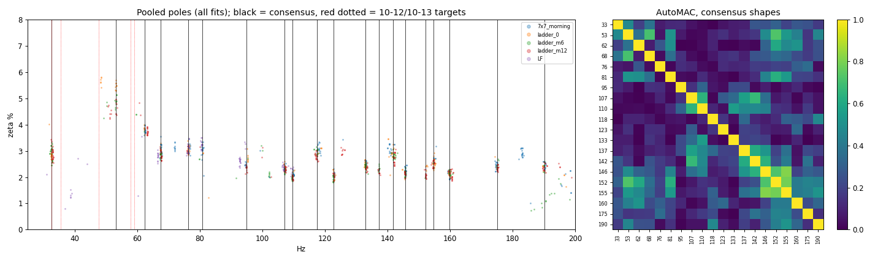
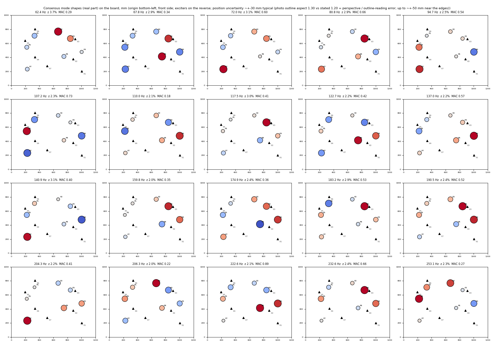

# Поиск мод деки: сводный отчёт (2026-10-14)

Этот отчёт заменяет report-mode-discovery-2026-10-12.md. Тот отчёт остаётся без изменений, так как он уже был вам отправлен; теория и подробности методов — в нём. Здесь собраны результаты измерительных дней 12, 13 и 14 октября 2026 г. (далее даты в тексте и таблицах записаны как «месяц-день»: 10-12 = 12 октября, 10-13 = 13 октября, 10-14 = 14 октября). Данные: D:\modal_measurements\rig_checks\. Журнал сессий: logs/archive/dev-fd69-2026-10-11-165927.md. План: proposals/modal-current-referenced-program-2026-10-14.md.

Обозначения: **E1–E7** — возбудители (электродинамические, voice-coil), **P0–P8** — пьезодатчики, **Out N / In N** — выходы и входы звукового интерфейса UMC1820.

Два термина:

- **MAC** показывает, насколько похожи две формы мод: 1 = формы одинаковы, около 0.1-0.3 = не лучше случайного совпадения при 7 датчиках.
- **Полюс** — одна идентифицированная мода с её частотой и демпфированием.

## 1. История конфигураций стенда

| Дата | Возбудители → выходы | Датчики → входы | Опорный сигнал |
|---|---|---|---|
| 10-11/12 | 4 возбудителя на Out 1-4 | 7 пьезодатчиков на In 1-7 (положения не записаны) | петлевой (loopback) сигнал Out 5 → In 8 |
| 10-13 | те же 4 | токи катушек 4 возбудителей на In 1-4; 3 переставляемых пьезодатчика на In 5-7 (положения P0, P1, P2) | ток |
| 10-14 утро | 7 возбудителей E1-E7 на Out 1-7; E1/E2 позже перенесены на Out 9/10 | пьезодатчики P1-P8 на In 1-8 (P8 позже снят) | петлевой сигнал Out 8 → In 8 |
| 10-14 вечер | E1 → Out 9, E2 → Out 10, E3-E7 → Out 3-7 (Out 1/2 не использовались) | токи катушек E1-E7 на In 1-7; P8 у E7 на In 8 | нет (токи) |

- Дека примерно 1200 × 1000 мм. Положения — в мм от нижнего левого угла лицевой стороны, сняты по фотографии (±30 мм, у краёв до ±50 мм): layout-20261014/board_layout.json.
- Пьезодатчики ни разу не стояли в одном и том же месте два дня подряд (проверено измерением). Поэтому формы мод нельзя сравнивать между днями; частоты и демпфирование — можно.

## 2. Что известно о модах

**Ниже 200 Гц:** консенсус по 4 полным прогонам 7 × 7 (каждый возбудитель × каждый датчик), по 18 аппроксимаций на прогон. «Дни» = мода найдена также 10-13 и/или 10-12. «Согласие» = насколько похожа форма, видимая из разных возбудителей (медианный MAC; случайный уровень около 0.10).

| f (Гц) | Демпфирование % | Достоверность | Дни | Согласие |
|---|---|---|---|---|
| 32.7 | 2.9 | подтверждена | 10-12, 10-13 | 0.24 |
| 53.2 | 4.9 | подтверждена, слабая | 10-13 (52.2) | 0.22 |
| 62.4 | 3.8 | подтверждена | 10-13 | 0.50 |
| 67.6 | 2.9 | подтверждена | все три | 0.64 |
| 76.4 | 3.1 | подтверждена | все три | 0.42 |
| 80.8 | 3.1 | подтверждена | 10-12 | 0.52 |
| 94.9 | 2.5 | подтверждена | все три | 0.57 |
| 107.2 | 2.3 | подтверждена | все три | 0.47 |
| 109.7 | 2.1 | подтверждена | все три | 0.14 |
| 117.6 | 2.9 | подтверждена | все три | 0.32 |
| 122.9 | 2.0 | подтверждена | только 10-14 | 0.47 |
| 133.0 | 2.4 | подтверждена | все три | 0.32 |
| 137.2 | 2.3 | на грани | 10-12 | 0.10 |
| 141.9 | 2.9 | подтверждена | все три | 0.18 |
| 145.6 / 152.2 | 2.2 / 2.1 | подтверждены | только 10-14 | 0.15 / 0.13 |
| 154.8 | 2.6 | подтверждена | все три | 0.19 |
| 159.8 | 2.1 | подтверждена | все три | 0.27 |
| 175.1 | 2.4 | подтверждена | все три | 0.27 |
| 190.2 | 2.4 | подтверждена | все три | 0.20 |

*Рисунок 1. Слева: все полюса из всех аппроксимаций (цвет — прогон: утренний 7 × 7, три уровня лестницы 0 / −6 / −12 дБ, НЧ-свип), ось Y — демпфирование ζ в %. Чёрные линии — консенсусные полюса, красные пунктирные — частоты, заявленные 10-12/10-13. Справа: AutoMAC консенсусных форм (насколько формы разных мод похожи друг на друга).*

- **Повторяемость:** частоты повторяются примерно до 0.3 %, демпфирование — примерно до 0.2 п.п. (процентного пункта).
- **Формы** повторяются от прогона к прогону (MAC 0.95), но разные возбудители видят разные формы (0.30). Моды перекрываются, и 7 датчиков не могут их разделить. Главное ограничение — именно это, а не шум.
- **32.5 Гц** — вероятно, мода деки. У E1, E2 и E3 пик остаётся на 32-33 Гц, хотя их собственные резонансы различаются (31.8-37.8 Гц). Уверенность умеренная: один датчик, нет калибровки силы.
- **35-60 Гц:** повторяется только 53.2 Гц. Моды 35.6/36.2, 47.8 и 57.9-59.1 Гц (заявленные 10-12) не подтверждены. 38.7 Гц — слабый кандидат; 48.4 Гц не подтверждается. Пики 36-39 Гц — это собственные резонансы возбудителей.
- **200 Гц-1.1 кГц:** 43 моды. Частоты надёжны: 48 из 58 совпадают с данными 10-13 в пределах 2 % (медиана 0.18 %), медиана демпфирования 1.6 %. Формы ненадёжны (согласие между возбудителями близко к случайному).
  - 204, 206, 223, 233, 253, 259, 264, 276, 297, 317, 321, 344, 377, 384, 402, 418, 526, 542, 550, 580, 600/601, 611, 637, 644, 658, 674, 707, 715, 740, 760, 766, 791, 796, 820, 831, 861, 875, 900, 920, 936, 953, 978, 1011, 1028 Гц.
- **1-2 кГц:** пригодной модели нет. Только 1-3 стабильных полюса; там примерно 60-100 мод, которые 7 точек не могут разрешить.
- **Демпфирование:** примерно 2-3 % ниже 150 Гц и примерно 1.6 % от 150 Гц до 1 кГц (свободные затухания от 10-12 с этим согласуются).

*Рисунок 2. Формы консенсусных полюсов (вещественная часть) одного утреннего прогона 7 × 7 от 10-14, нанесённые на деку в мм (начало координат — нижний левый угол, лицевая сторона). Кружки — пьезодатчики P1-P8 (цвет — знак и величина, размер — амплитуда), треугольники — возбудители E1-E7 (на обратной стороне). В заголовке панели: частота, ζ («z») и согласие между возбудителями (MAC). Набор полюсов этого отдельного прогона не полностью совпадает с итоговой таблицей выше; итоговой следует считать таблицу. Погрешность положений около ±30 мм (у краёв до ±50 мм).*

## 3. Возбудители и стенд: установленные факты

| Факт | Основание |
|---|---|
| Резонансы подвеса возбудителей 32-45 Гц (E1 37.8, E2 31.8, E3 34.8, E4 37.6, E5 40.6, E6 37.0, E7 45.0). Ниже них сила возбуждения падает (ступень 14 дБ ниже примерно 31 Гц). | адмиттанс катушек, НЧ-прогоны |
| E2 даёт механические искажения (2-я гармоника движения -16 дБ при -36 dBFS), E1 — меньше. Токи катушек чистые, значит усилители и UMC исправны. E2 работает на 6 дБ тише до осмотра (10-15). | ток против P8 |
| Out 1/2 шли через регулятор MAIN на UMC (примерно на 13 дБ тише). Различие «1/2 против 3/4» переходило вместе с возбудителями. | перестановка Out 1/2 → 9/10 |
| На вольт возбудители различаются (Out 3 примерно +9 дБ, в основном за счёт тока). Данные на ампер это устраняют. | лестницы уровней |
| Суперпозиция выполняется выше 35 Гц (все 7 одновременно = по одному, в пределах 0.4-0.6 дБ). | мультисинус |
| Зависимость от уровня мала: около 1 дБ на 12 дБ ниже 250 Гц, частоты в пределах 0.15 %. | 7 × 7 на 3 уровнях |
| Дрейф за 1.7 ч: около 0.13 % по частоте, 0.4-0.6 дБ на НЧ. | повторы |
| Открыто: ниже 30 Гц мультисинус на 7 возбудителей и свип расходятся на 10-20 дБ. Это не прилипание-скольжение (stick-slip) отдельных возбудителей. | MIMO, B4 |

(B1-B4 — проверки стенда с измерением тока 10-14: B1 проводка, B2 адмиттанс возбудителей, B3 искажения тока против движения, B4 свип против мультисинуса на НЧ.)

## 4. Неопределённости

- Сегодня только один датчик движения (P8). На нём держатся вывод о 32.5 Гц и ранжирование возбудителей по искажениям движения.
- Отдельные аппроксимации PolyMAX ниже 200 Гц ненадёжны (одни и те же данные давали разные списки). Используются только консенсусные результаты выше.
- Нет калибровки силы (ни на вольт, ни на ампер), а вблизи резонансов возбудителя ток не равен силе. Нет калиброванного акселерометра, поэтому масштаб только относительный и модальных масс нет.
- Нет общего датчика между днями, поэтому формы сравнимы только внутри одной сессии.
- Положения известны с точностью ±30-50 мм.

## 5. Обнаруженные проблемы

| Проблема | Последствие | Исправление |
|---|---|---|
| Жгут измерения тока In 1-4 с общим обратным проводом (перекрёстные наводки -43 дБ) | токи катушек непригодны как дополнительные датчики | раздельные обратные провода / экранированные пары |
| Кабель P8 наводится на In 5-7 (-41 дБ) | то же | проложить кабель P8 иначе |
| Слабый пьезодатчик на In 5 (10-13) | потерянные точки | проверка проводки перед каждой записью |
| Неравные усиления входов 10-13 (до 20 дБ) | смещённые уровни на ампер для P0/P1 (MAC не затронут) | выровнять усиления, сначала пробный замер |
| E6 один раз отключился (10-14) | один потерянный прогон | проверить разъёмы |
| Диск D: заполнился во время прогона | одна сессия переснята | держать ≥ 5 ГБ свободными (теперь проверяется) |

## 6. Дальнейшие шаги (в порядке приоритета)

Сессии S0-S7 — это запланированные измерительные сессии из плана (proposals/modal-current-referenced-program-2026-10-14.md); их содержание и длительность — в таблице §7.4.

1. Осмотр крепления E2 (Леонид, 10-15), затем повторная проверка искажений E2.
2. S7 — повторная обработка (без времени на стенде): пересчитать сегодняшние данные «на вольт» в данные «на ампер» по измеренному адмиттансу каждого возбудителя (записан для всех 7). Заново получить консенсусные полюса и посмотреть, какая часть расхождения между возбудителями была электрической.
3. S0-S1b (около 1.5 ч): откалибровать вольты и амперы, измерить импедансы возбудителей и методом добавочной массы получить силовой коэффициент (Bl). Это даст отклики на ньютон и заодно проверит 32.5 Гц (резонанс возбудителя смещается при добавочной массе, мода деки — нет).
4. Исправить проводку (обратные провода токов, кабель P8) и добавить входы: второй UMC через ADAT или 4 тока + 4 пьезодатчика.
5. S3: по одному пьезодатчику рядом с каждым возбудителем — для измерения в точках возбуждения и проверки взаимности.
6. Сетка: 200 мм (30 точек, 5 расстановок) для < 200 Гц, затем 100 мм (около 110 точек) для форм примерно до 500-800 Гц. P8 у E7 оставить на месте как опорный датчик между сессиями. Для 1-2 кГц нужен виброметр или подвижный молоток.
7. Стандартная методика: консенсусные полюса; свипы для опорных данных; мультисинус выше 35 Гц для быстрых обзоров; отдельный НЧ-свип ниже 35 Гц.

## 7. Параметры процесса и затраты времени

**Общее:** UMC1820 через ASIO в бэкенде движка, 48 кГц, буфер 64, 32 бит, записывается 8 входов (7 в утренних прогонах с пьезодатчиками). Защита: при уровне на входе выше -6 dBFS уровень возбуждения понижается; выше -3 dBFS — остановка. Уровни по возбудителям: E1/E6 -42, E2 -42 (-48 по решению Леонида), E3/E5/E7 -36, E4 -30 dBFS. Время записи измерено по файлам сессий; знак ~ отмечает время анализа, которое не замерялось.

### 7.1 Полная сессия, как она прошла 10-14

| Этап | Сигнал | Запись | Анализ | Данные |
|---|---|---|---|---|
| Чистый перезапуск + запуск бэкенда + пресет (открытие ASIO) | — | ~1 мин | — | — |
| Запись собственного шума | тишина 5-10 с, 8 входов | 0.2 мин | секунды | 15-17 МБ |
| Проверка проводки / идентификационные импульсы | chirp 1 с 100 Гц-2 кГц на каждый возбудитель, с интервалом 3 с (+ вариант с тоном 100 Гц 2 с) | 0.4-0.7 мин | секунды | 57-196 МБ |
| **Полный 7 × 7 ESS** | ESS 20 с 20 Гц-2 кГц (+3 с хвост), × 3 на возбудитель, 21 сессия | **8.8 мин** (измерено 8.4-8.8, 4 прогона) | PolyMAX на всю полосу + LSFD + MAC + графики ~3-5 мин | 710-790 МБ |
| НЧ ESS | 8 с предварительное нарастание (-36/-30/-24) + ESS 30 с 15-150 Гц × 3 на возбудитель | 16 мин | ~2 мин | 1.3 ГБ |
| MIMO (все 7 одновременно) | ортогональные мультисинусы 20 Гц-2 кГц, период 4 с, 7 блоков × 3 периода, 3 реализации | 4.3 мин (3 × 85 с) | ~1 мин | 680 МБ |
| Лестница уровней | полный 7 × 7 при 0 / -6 / -12 дБ | 26 мин (3 × 8.8) | 3 × PolyMAX + сравнение ~10 мин | 2.1 ГБ |
| Лестница нелинейности | ESS 8 с 20 Гц-10 кГц + 4 тона, 3-5 уровней × 4 возбудителя | 3.3-6 мин | ~2 мин | 250-440 МБ |
| B2: адмиттанс возбудителей (НЧ) | ESS 20 с 15-200 Гц × 2 на возбудитель | 5.7 мин | <1 мин | 610 МБ |
| B3: искажения тока против движения | ESS 8 с 20 Гц-5 кГц + 3 тона, 2-3 уровня × 5 возбудителей | 3.6 мин | <1 мин | 330 МБ |
| B4: свип против мультисинуса (НЧ) | ESS 20 с + 2 × мультисинус (16 с), 4 возбудителя | 4.0 мин | <1 мин | 380 МБ |
| **Консенсусные полюса < 200 Гц** | 18 аппроксимаций PolyMAX на прогон (3 набора полос × 2 порядка × 3 бутстрэп-выборки) | — | **190 с на прогон** (измерено); 4 прогона + НЧ = **16 мин** | мало |
| Пробный PolyMAX 1-2 кГц | 3 набора настроек | — | >10 мин (измерено) | мало |

### 7.2 Итоги

| Сессия | Время на стенде | Анализ | Общее время |
|---|---|---|---|
| **Минимально полезная:** проверка проводки + один полный 7 × 7 + аппроксимация | ~11 мин | ~5 мин (одна аппроксимация) | ~20 мин |
| **Минимально надёжная ниже 200 Гц:** 3 × полный 7 × 7 + консенсус | ~28 мин | ~16 мин | **≈ 45 мин** |
| **Полная программа 10-14** (13:15-18:40) | ~2 ч записи | ~1 ч вычислений | ~5.5 ч, включая ~2 ч ожидания решений и перекоммутации |

### 7.3 Предыдущие дни

| День | Этап | Запись | Данные |
|---|---|---|---|
| 10-12 | линейность (3 уровня × 4 возбудителя, ESS 8 с) | 2.2 мин | 230 МБ |
| 10-12 | скорость свипа (ESS 8/30/60 с × 4 + шум) | 9.5 мин | 820 МБ |
| 10-12 | поиск свипом (грубый 20 с + тонкие зоны, 3 повтора) | 8.2 мин | — |
| 10-12 | ступенчатый синус E1 / E2 (< 200 Гц) | 26 / 16.5 мин | 2.4 / 1.5 ГБ |
| 10-12 | сбор chirp-сигналов (4 × 5 × 11.5 с) + ESPRIT | ~4 + 1 мин | — |
| 10-13 | **одна расстановка переставляемых датчиков** (3 × ESS 20 с × 4 возбудителя, 3 пьезодатчика) | **4.8 мин** записи + перекоммутация (Леонид; между расстановками проходило 40-60 мин, включая обсуждение) | 410 МБ |

### 7.4 Запланированные сессии

| Сессия | Содержание | Время на стенде | Ручная работа |
|---|---|---|---|
| S0 | калибровка вольт и ампер | 20 мин | мультиметр на выходе усилителя, резистор или токовые клещи |
| S1 | импедансы возбудителей 15 Гц-5 кГц | 10 мин | — |
| S1b | добавочная масса, 2 массы на возбудитель | 30-45 мин | закрепить массы |
| S2 | второй UMC через ADAT, проверка синхронизации | 15 мин | оптический кабель, настройки тактирования |
| S3 | пьезодатчик у каждого возбудителя (точки возбуждения) | 15 мин | ~15 мин на приклейку |
| S5 | сетка 200 мм, 30 точек | 5 × 8 мин | 5 × ~5 мин перекоммутации |
| S6 | сетка 100 мм, ~110 точек | ~16 × 8 мин ≈ 2.2 ч | 16 × ~5 мин |
| S7 | повторная обработка «на ампер» | нет | нет (~30 мин вычислений) |

### 7.5 На что уходит время и как его сократить

- **Запись:** основное время — ESS 20 с × 3 × 7 (8.8 мин на 7 × 7). MIMO выше 35 Гц (4.3 мин) плюс короткий НЧ-свип сокращают его примерно вдвое; 2 повтора вместо 3 экономят ещё треть, ценой оценки шума.
- **Анализ:** основное время — консенсусные аппроксимации (190 с на прогон). Они независимы и могут выполняться параллельно: 16 мин превращаются в ~4 мин на 4 ядрах.
- **Общее время:** определяется решениями и перекоммутацией, а не измерениями. Если один раз исправить проводку и входы и заранее согласовать план сессии, большая часть простоя уйдёт.
