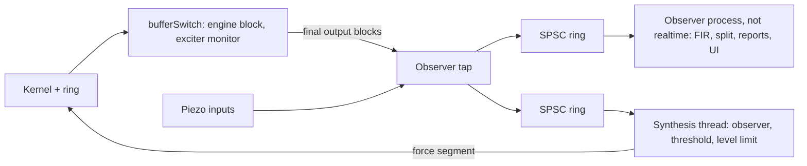

# Board Observer: Predict the Piezos, Improve the Model, Stream the Real Board into the Virtual Strings

**Status:** design only (2026-11-02). Nothing built, nothing committed. Offline figures come from a CPU-only pass
over existing rig recordings.

**User request (2026-11-02):** predict the board's movement at each piezo while playing and compare it with the
measurement; distinguish systematic error from external noise on the board; analyse the systematic part for model
improvement; feed the noise part back to the virtual board so a thump on the real board makes the virtual strings
resonate, routed similarly to the low thump.

**User decisions (2026-11-02):**

- Stage 3 is a **continuous stream of the real data, over a string**. No discrete synthetic thumps.
- **No speakers.** Everything goes through the exciters.
- **No damper lifting.** Dampers stay as they are. The target is the realistic sound of hitting a real piano, and the
  user will compare with that.
- The Out 8 to In 8 cable can stay if needed. It stays, as the timing reference.
- The confidence-threshold observer is the design basis (section 8), and the systematic data must feed model
  improvement (section 7).

Evidence labels used throughout: **measured** (read from a recording, a document's measurement, or the source),
**inferred** (calculated from measured facts, not observed), **unknown**.

## 1. Result in brief

| Stage | Recommendation |
|---|---|
| 1. Predict | A measured FIR from the seven final exciter output blocks to each piezo, sample-locked in the ASIO callback. The engine's modal state is the wrong predictor (section 4) |
| 2. Split | Residual = piezo minus FIR. Repeat replay separates repeatable (systematic) from non-repeatable. Live, correlation with the drive does the same job less precisely. What remains after systematic removal sets the confidence threshold |
| Improve | Compare the engine's own modal board with the measured motion, parameter by parameter, and write only new presets (section 7). The FIR plays no part in this: its job is cancellation |
| 3. Inject | A continuous stream of the real residual through a dedicated string whose force row is a ring buffer, through the exciters only, above a confidence threshold |

**Design basis (user direction, 2026-11-02): a state observer with a confidence threshold, not an echo canceller.**
The injected signal is part of the model state, so the next residual holds only new error. Accumulation is possible
only for periodic error. The chain: remove the systematic error as well as possible; what remains is the residual
error; the residual error sets the confidence threshold; nothing below the threshold is fed in. Section 6 gives the
chain with numbers, section 8 tests the observer in a closed-loop simulation built on real model error.

**The figures that govern everything:**

- Residual after systematic removal: about -17 dB re the drive-induced signal per band (measured). The threshold then
  sits 3-12 dB under the band's recent model level. Quiet board: about -91 to -96 dBFS per band above 120 Hz.
- Simulation with real model error: below loop gain 1 nothing accumulates; above it the only failure is one growing
  spectral line, exactly the periodic case. The threshold held in every case but one.

**Biggest risk: a delay slip.** An 8-frame slip raises the loop gain 10-24 dB and breaks the threshold's assumption.
The simulation ran away despite the gate (section 8). Injection gain must stay under the unity point, and the slip
watch and the periodic-line detector must act on their own.

**The finding that threatens the goal.** With dampers down, gain is not the limit: the limit is physics and masking.
The strings that can ring freely are keys 91 and up, above about 1.5 kHz, where a hand thump has little energy, and the
stream adds to a hit the board has already made loudly itself. Expect a short damped bloom and a delayed copy of the
board's own sound, possibly inaudible next to the real hit. Section 8 has the reasoning. Held keys and pedal should be
clearly audible.

## 2. What exists today

| Fact | Evidence |
|---|---|
| The engine **can** read every input during realtime playback: `bufferInfos[i].buffers[index]` is passed for all inputs on each switch, in the same callback that wrote the outputs | measured, `AsioAudioInterface.cpp:340-356`, `ExciterMonitor.cpp:119-146`; verified live at 47.3-48.7 k frames/s ([controlled playback](controlled-playback-exciter-current-2026-10-20.md)) |
| But during playback it keeps only block peak and sum of squares per input, published at 25 Hz. No samples leave the callback. The mic capture keeps samples of ONE input (`AsioAudioInterface.cpp:370-377`). `/audio/session` keeps N inputs but pauses synthesis and owns all outputs | measured, [AUDIO_DRIVERS](../modules/pianoid-cuda/AUDIO_DRIVERS.md#exciter-monitor-dev-8f54) |
| Input frame n and output frame n share one switch, so the output-to-input offset is a hardware constant | measured, AUDIO_DRIVERS (ASIO Measurement Session) |
| Loopback onset 336 frames in today's long run (334-335 earlier); it can shift between backend instances | measured, run `20261102T095900` meta; [rig facts](../guides/MODE_DISCOVERY_FOR_ASSISTANT.md#rig-board) |
| Current wiring, In 1 mic, In 2-7 piezos P2, P3b, P4b, P5b, P6, P7b, In 8 loopback from Out 8. The note's "In 2-8" is six piezos plus the loopback | measured, 2026-11-02 run configs. Six piezos, seven exciters; P8 not in use |
| Piezo floor -81 to -84 dBFS rms, mostly hum | measured, silence takes 2026-10-30 and 2026-11-02 |
| Piezos are not calibrated to physical units. There is no force calibration and no calibrated accelerometer. All scales are relative | measured, [step 2](../guides/MODE_DISCOVERY_FOR_ASSISTANT.md#step-2) |
| The drive gain moved 8.4-9 dB between 1 and 2 Nov, cause unknown | measured, note n-20261102094916 |
| The exciter monitor config is disabled and still mapped to the old current-sense wiring | measured, `pianoid_local_settings.json` |
| Measurements held: long sweep 7 x 6 (`modes_set2_r3_long`, 5 repeats), level-matched sweep, stepped-sine map 33 x 6 x 7, combo test, table v5 (25 modes). **No recording of real playing or of a thump on the piezos** | measured, rig_runs and notes |

## 3. Signal flow

The tap goes **after** the exciter monitor, so limiter gains are part of the reference. It copies 13 channels x 64
samples, about 1 kB per cycle.

## 4. Stage 1: the predictor

### Why not the engine's modal state

The virtual board is not what moves the real board. The real board receives the *output*, a derivative of the
virtual stem motion, and adds its own resonances: real motion is virtual output filtered by the real FRF. The virtual
`q` carries the virtual resonance once, while the real piezo carries it through a second, real one. Virtual `q` is
therefore a proxy, as the user's note says, and also has the wrong shape in frequency. `W[c,m]` and the radiance
factors map to outputs and have no piezo row at all.

Nor does a modal fit do well as a predictor of the *real* board. Table v5's 25 poles, residues refit per path with
residual terms, against the long-sweep FRF:

| Band, Hz | 20-60 | 60-120 | 120-250 | 250-500 | 500-750 |
|---|---|---|---|---|---|
| Error re FRF, dB (measured) | -6.2 | -10.1 | -12.8 | -15.8 | -8.8 |

Those are 3-17 dB worse than the FIR in section 5. That rules the modal bank out as the canceller. It is exactly the
measurement model improvement needs, though: section 7 does this comparison with the preset's own parameters.

### Recommended: measured FIR

Reference: seven final output blocks. Target: each piezo. 8192 taps at 48 kHz (170 ms) reach the limit at and above
120 Hz; 60-120 Hz needs 32768 (table below). The energy is below 2 kHz, so decimate by 8 to about 6 kHz.

### Where it runs and what it costs (inferred, none benchmarked)

| Piece | Place | Cost per 64-sample cycle (budget 1333 us) |
|---|---|---|
| Tap | `bufferSwitchTimeInfo`, after `exmon::onBufferSwitch` | under 5 us: convert and copy to a ring. Disabled = one atomic load |
| Stage 1-2 observer | separate below-normal process over shared memory | no realtime constraint. All 42 paths at 6 kHz with 1024 taps = 344 k MAC per cycle, about 3 % of a core. A separate process matters: CPU starvation froze the realtime backend on 2026-10-19 |
| Stage 3 observer | synthesis thread, before the kernel launch | one or two piezos: 7-14 paths, 1024-4096 taps, 60-460 k MAC, 6-50 us. It is already a Pro-Audio thread and already where a GPU copy must be queued. No new thread |
| Force segment upload | `cudaMemcpyAsync` on `synthesis_stream_` | 1-4 kB per cycle, expected 10-30 us host side. Must be measured against the cp0-cp1 profile |
| GPU kernel | unchanged | zero: the kernel already reads every string's force row each cycle, `MainKernel.cu:479-499` |

No GPU work is proposed for stages 1-2. The GPU has no information the output blocks lack, and the cycle has no
margin to spare.

## 5. What cancellation is achievable

**Method.** Long sweep: 30 s ESS, E1, E2 at -30, E3-E7 at -24 dBFS, 5 repeats, 6 piezos. Train on repeats 1-4
(E2 without its slipped repeat 3), predict repeat 5 in the time domain, compare. Residual over signal, summed over exciters, per
piezo, median of six piezos. Scripts and results:
`C:\Users\astri\AppData\Local\Temp\claude\D--repos-PianoidInstall\e3e92ee6-279f-44a6-8ae0-61d28f337451\scratchpad\boardobs\`.

**Measured:**

| Band, Hz | 20-60 | 60-120 | 120-250 | 250-500 | 500-1000 | 1000-2000 |
|---|---|---|---|---|---|---|
| Same session, 2048 taps | 0 | -8 | -10 | -14 | -22 | -29 |
| Same session, 8192 taps | 0 | -18 | -25 | -19 | -26 | -35 |
| Same session, 32768 taps | 0 | -18 | -25 | -19 | -26 | -35 |
| Same, worst piezo | 0 | -17 | -16 | -13 | -18 | -27 |
| Train on one take, test 16 min later | 0 | -18 | -24 | -19 | -25 | -33 |
| Other run 30 min earlier, **same level** (E4-E7) | 0 | -16 | -20 | -23 | -27 | -27 |
| Other run, **3-4 dB different level** (E1-E3) | 0 | -13 | -15 | -16 | -18 | -20 |
| Fundamental only (sweep-tracked lock-in) | | -18 | -22 | -30 | -33 | |
| Repeat-to-repeat limit (fundamental) | | -23 | -40 | -46 | -46 | |
| Noise floor re signal | 0 | -25 | -41 | -38 | -49 | -57 |

**What limits it:**

1. **Not the filter length or drift.** Above 8192 taps nothing improves; 16 minutes costs under 2 dB.
2. **Harmonics.** Harmonic-time energy sits about -17 dB re the fundamental in 250-500 Hz (measured). That is
   most of the gap between -19 and the fundamental's -30. E2 is known to be mechanical. Static polynomial terms (x², x³) did
   **not** help in one quick trial, run before the estimator's pre-window fix and not repeated, so this is open.
3. **Level dependence.** A 3-4 dB level change costs 5-8 dB of cancellation. This is the "1 dB per 12 dB" and "0.9
   dB per 3.5 dB compression" in the notes. Playing is far more dynamic than a sweep, so **this row is the honest
   planning figure: -15 dB**.
4. **A repeatable part remains**, 13-18 dB between the fundamental fit and the repeat limit at and above 120 Hz. Below 120 Hz the repeat
   limit is itself low because of noise. Above that it is real, so a better model can in principle gain about 10 dB.
5. **Slips.** E2 repeat 3 slipped 8-9 samples against normal loopback alignment. Against that take the model gave -3
   to +2 dB at and above 500 Hz: nothing, or a gain. Cause unknown. A slip watch is mandatory (section 7).
6. **Below 60 Hz no signal reaches the piezos.** At -24 dBFS the sweep there equals the noise floor. So the 20-60 Hz
   band carries almost no drive at the piezo, which could make it a natural thump band, if a thump shows up there and
   if the piezos respond there. Unknown until a thump is recorded.

**Limits of this estimate.** One exciter at a time, sweep drive, level at or above playing. Polyphony, seven exciters
at once and fast dynamics are untested. Phase 0 measures them on real music.

Section 6 takes these figures further, through systematic removal, to the residual and the threshold.

**Planning figures (inferred):** static model, ε about -15 dB over 60-1000 Hz; with a slow per-exciter, per-band gain
trim and a level table, -20 to -25 dB. A static single-frequency check agrees: 0.13 % drift at ζ 1.56 % gives -22 dB
at a mode peak.

### Timing

| Path | Value |
|---|---|
| Output to input, electrical | 336 frames, 7.0 ms (measured) |
| Plus exciter and board to the IR peak | 51-56 frames, about 1.1 ms (measured, three paths) |
| Prediction margin for a causal FIR | 336 frames: the drive is known that long before it reaches the input |
| Thump at piezo to the output at the DAC | 136 + 15 frames in, block up to 64, cycle up to 64, ring depth x 64, 168 + 15 out. Ring depth 8: 20.2 ms; 4: 14.9 ms; 2: 12.2 ms (inferred, agrees with the measured event-to-loopback 19.7, 14.4, 11.7 ms) |

## 6. Stage 2: splitting the residual

`r(t) = y(t) - ŷ_FIR(t)` holds model error, nonlinearity, noise and external events together.

**Offline, exact:** replay the same render N times through `/audio/session`. The engine is deterministic and the
session is sample-locked, so the mean of `r` over repeats is systematic and the rest is non-repeatable. One repeat with
the user thumping gives a labelled external signal in the actual presence of the drive.

**Live, approximate:** nothing repeats in free playing. Systematic = the part of `r` that correlates with the drive
over a long window, per band; external = onsets that do not. Requires separate handling for each:

| Component | Signature | Used for |
|---|---|---|
| Linear model error | coherent with the drive at the same frequency | update FIR |
| Level dependence | gain error tracks level | level table |
| Harmonics | coherent with drive at 2f, 3f | exciter diagnosis |
| Hum | fixed 50 Hz and harmonics | notch |
| External | onset, no drive coherence, on two or more piezos | stage 3 |

What the systematic part means for the model itself is section 7. This section uses it only to reach the residual.

### From systematic error to residual error (measured)

Test: an independent take from a different run than the model, 30 minutes apart. All paths pooled. Each rung removes
more of the systematic error. Figures are residual re the drive-induced signal, dB, E4-E7 (equal level).

| Rung | 60-120 | 120-250 | 250-500 | 500-1000 | 1000-2000 |
|---|---|---|---|---|---|
| Static model, other run | -12 | -15 | -12 | -10 | -21 |
| + session trim (smooth gain and phase, 1/12 octave, from one take) | **-19** | **-19** | **-17** | **-16** | -14 |
| + harmonic terms x², x³ | -20 | -20 | -17 | -17 | -14 |
| Model refit from this session (best linear) | -17 | -19 | -20 | -24 | -37 |
| Non-repeatable, the true floor | -28 | -33 | -27 | -30 | -41 |

E1-E3, at 3-4 dB different level, reach -19, -18, -16, -19, -13 after the trim, so a session trim absorbs small level
changes. Above 1 kHz the trim hurts (static is better there): apply it only below 1 kHz.

Third-octave residual after the trim, centre Hz: 63 -17, 79 -19, 100 -20, 126 -16, 159 -22, 200 -19, 252 -18, 318
-20, 400 -15, 504 -18, 635 -19, 800 -15, 1008 -17, 1270 -25, 1600 -16 dB.

Reading: **about -17 dB is the expected residual now; about -25 dB is reachable if the repeatable remainder is
modelled.** The session refit reaches -24 at 500-1000 Hz; the non-repeatable floor stops it at -27 to -33. The harmonic
terms give at most 1.3 dB here, so a live harmonic model is not worth building yet. Sweep data only.

### The residual sets the threshold

Per band is needed: residual, noise and level differ by more than 10 dB across bands. The threshold follows the
model's own level, since the residual scales with it:

`T(band, t) = max( T_floor(band), m(band) · E(band, t) )`

E is the recent peak of the predicted level in that band over about 1 s, plus -15 dB of the band below it (harmonics
of lower notes arrive before the band's own level rises). Detection needs at least two piezos on two consecutive 5.3
ms frames.

**A property worth having:** the prediction includes the injected signal, so the injected signal raises T. Its own
model error cannot hold the gate open while the error stays inside the assumed fraction. That is the reason to scale T
with the prediction.

| Band, Hz | 60-120 | 120-250 | 250-500 | 500-1000 | 1000-2000 |
|---|---|---|---|---|---|
| m, dB re E: first level with no false detection (sweeps, under 1 min per band, so resolved to about 2-3 per minute) | -9 | -12 | -9 | -3 | -3 |
| Noise, frame rms, dBFS | -102 | -117 | -110 | -114 | -113 |
| Noise, loudest of 54 k frames, dBFS | -87 | -93 | -93 | -98 | -98 |
| T_floor, quiet board, dBFS (planning) | -85 | -91 | -91 | -96 | -96 |
| T at the attack of a G4 render at -31 dBFS peak per output, median of piezos (inferred) | | | about -72 | | |
| T 2 s after that attack (inferred) | | | about -81 | | |

The frame ratio has a heavy tail on sweeps (median -30, p99 -9 to -3 dB): the residual is low most of the time and
bursts at antiresonances and on harmonics. Music may differ either way. Phase 0 sets m from real playing.

### How small a thump can be seen

Scale reference: a -24 dBFS exciter sweep reads about -66 dBFS at the piezo in 250-500 Hz (measured).

| Condition | Smallest thump in 250-500 Hz (inferred) |
|---|---|
| Quiet board | about -91 dBFS: 25 dB below what that sweep does |
| At a note's attack | about -72 dBFS: 6 dB below that sweep |
| 2 s into the note | about -81 dBFS |

Simulated check at P6, a synthetic note at -31 dBFS peak: -70 and -60 dBFS thumps did not open the gate, -50 and -40
did (broadband peak, against a band threshold), and the note alone caused no opening. **How this compares with a real
hand thump is unknown.** One recording answers it.

## 7. Model improvement: the systematic error as a parameter source

### Which model

Two models must be kept apart.

| | Measured FIR | Engine's virtual board |
|---|---|---|
| What it is | Output-to-piezo response, fitted | Preset modes: `frequency`, `decrement`, `mass`, output rows W[c,m], deck rows |
| Job | Cancellation | Sound |
| Its error | Small because it absorbs the real board | **What needs improving** |
| Says about the virtual board | Nothing directly | |

A low FIR residual proves nothing about the preset. Improvement needs the preset's own board to predict the measured
motion, with nothing absorbing the difference.

### How to compare, with piezos away from the exciters

The preset has no piezo row, and W and radiance are output weights. But W has a meaning that can be tested: an output
row is the mode shape at the exciter (`SYNTHESIS_ENGINE`, coupling coefficients), so by reciprocity it is also how the
exciter drives that mode. So:

`H_model[p,e](f) = Σ_m u[p,m] · W[e,m] · D_m(f)`, with `D_m` from the preset's frequency and decrement.

The only free quantity is `u[p,m]`, one piezo-shape value per mode and piezo. All seven exciter columns must share it.
That is the test: **free `u` cannot fix a wrong frequency, damping or exciter pattern**, and the fit error is the
model's error. Radiance plays no part (it scales speaker output). During playing the same model runs offline: the known
output blocks through a bank of preset modes, compared with the piezo.

### What the existing data shows today (measured)

Long sweep 2 Nov, 40-1000 Hz, weighted so no band dominates. Error re measured FRF, dB. Scripts `est13.py`, folder
in section 5. Fits below the first three rows are in-sample, without a hold-out.

| Model | 40-120 | 120-250 | 250-500 | 500-750 | 750-1000 |
|---|---|---|---|---|---|
| Preset 26 in use (`belarusfit_thump_assistant_26`) | -5.3 | -6.5 | -3.4 | -1.8 | -2.6 |
| Preset `set2_assistant_1` (never loaded) | -9.3 | -4.0 | -3.5 | -3.7 | -1.2 |
| Table v5 (not in any preset) | -9.0 | -8.7 | -8.3 | -3.2 | -1.5 |
| Control: exciter pattern ignored | -2.4 | -1.0 | -1.0 | -0.3 | -0.3 |
| v5, frequency and damping tuned | -10.0 | -9.5 | -9.7 | -4.8 | -2.7 |
| + exciter weights free | -9.9 | -9.2 | -9.8 | -6.0 | -2.7 |
| + 20 poles, simple search | -10.3 | -9.4 | -9.9 | -8.2 | -7.4 |
| Limit: free residues, same poles | -11.7 | -12.9 | -18.6 | -14.7 | -11.6 |
| Measured FIR, for scale (section 5, trimmed) | -19 | -19 | -17 | -16 | -16 |

What this says:

1. **The board in use predicts only 2-7 dB of the real motion.** Above 250 Hz about half or more of the energy is
   unexplained.
2. W carries real information (error 1-8 dB better than the control), so the reciprocity test works.
3. Preset 26's model has moved far from the plywood: ζ 12-30 % on most modes in 250-1000 Hz against 1-2 % measured,
   and exciter weights agree with the fit at median MAC 0.23 (v5: 0.85). This was tuned toward the piano sound, so it
   is not a mistake but a **conflict**: a board-true model and a piano-fit model are different presets.
4. Merging v5 is the cheapest large step: up to 5 dB below 500 Hz with no new measurement. Above 500 Hz the table runs
   out: modes are missing.
5. Tuning frequency and damping gains 1-2 dB, so individual parameters are near their limit for a mode list this
   short. A rank-1 model with real weights stops near -10 dB. The free-residue line shows 3-9 dB more needs better
   shapes: complex or more modes.
6. The pole search piled poles at band edges and 50 Hz, so the -8 and -7 dB rows understate what better mode finding
   could do.

Absolute mass is not identified: free `u` absorbs any scale, and piezos are uncalibrated. Today's data cannot test
string-to-board coupling at all.

### Each error type and the parameter it corrects

| Error type | Parameter | Signature | Confidence |
|---|---|---|---|
| Frequency | `frequency` | Residual flips sign across a peak; phase slope offset | High for isolated modes. Repeat limit 0.3 %, up to 1.5 % seen. Change below that is noise |
| Damping | `decrement` | Peak height and width wrong with frequency right | Medium. Low below 500 Hz: beating makes ring-downs an upper bound |
| Mass | `mass` | Modal gain ratio | **Low.** Only the product with `u` is seen. Needs a driving point (P8 at E7, not in use) or a calibrated sensor. Relative trend only |
| Missing mode | new mode entry | Residual line repeating across takes, rank-1 across exciters | Medium. Dense below 500 Hz; two fits can disagree. Needs stepped-sine confirmation, as the notes show (95, 122, 198 Hz dropped) |
| Exciter coupling | W[c,m] | Wrong pattern across exciter columns at a mode | Medium-high when isolated. Low at 358-361 Hz, where patterns did not separate modes |
| Piezo shape | none in the preset | `u` itself | Fitted. Also a candidate deck row for a virtual string placed at that piezo. Inferred |
| Drive gain | exciter trim, session | One gain across all modes of an exciter | High. The 9 dB shift of 1-2 Nov belongs here |
| Level law | hardware, observer's table | Gain falls with level, per band | High as a measurement. It is the **rig**, not the preset; do not write it into modes |
| Excitation law | hammer, curves | **Not observable here**: excitation is upstream of the drive, and the drive is known exactly. Only the piano target speaks to it | None |
| Nonlinearity | none: mounting, exciter | Energy at 2f, 3f, rank by exciter | High for identifying. Fix is mechanical; E2 first |
| String-to-board feedback | deck rows, `deck_feedback_coefficient` | **Not observable from the drive**: the plywood has no strings or bridge. Deck rows are placeholders | None today. Stage 3 with a real piano comparison is the only route, by ear first |

### The improvement loop

1. **Measure.** Offline now: sweeps. After Phase 0: replayed music. After Phase 1: live playing, as drive and piezo
   logged together. Always one take kept for checking, from another run.
2. **Fit** with the preset's parameters against `H_model`, one error class at a time, in the order of the table: gain,
   frequency, damping, weights, added modes.
3. **Propose** a list: parameter, mode, old, new, confidence, predicted error change. Nothing below the repeat limit.
   Added modes need stepped-sine confirmation.
4. **Apply** on a working copy: `preset.spawn_working_copy`, edits, then `preset.save` to a **new** file name. Never
   `preset.promote`, which overwrites the original, and never save onto a loaded original.
5. **Prove.** Re-measure on the check take with the new preset: error must fall in the targeted band and no other band
   may worsen by over 1 dB. Check keyboard stability (CFL, gate trips), since modes affect the strings. The user listens.
6. **Record** old and new error per band beside the preset.

**Stop rule.** Stop a band when any holds:

- Error is within 3 dB of the non-repeatable floor.
- Two rounds gain under 1 dB on the check take.
- Every remaining proposal is under its repeat limit.
- Listening shows no difference on two rounds.

**Can the assistant run it?** Mostly, today, on sweeps:

| Step | Tool |
|---|---|
| Measure | `modal.rig_capture`, `modal.rig_process frf`, `polymax`, `modal.rig_files` |
| Fit, propose | `analysis.run_python` on exported FRFs. The fit is about 60 lines and runs in seconds |
| Apply | `preset.spawn_working_copy`, `param.set`, `preset.save` (destructive tier, per command), `modal.rig_process build_preset` for a new structure |
| Prove | Rig again, `render.*` for keyboard checks |

Gaps: the merged table has no builder import (already noted, needs mode and feedback writes); `/audio/session` has no
assistant command (needed for Phase 0 replay; it exists on REST); no live log until Phase 1.

## 8. Stage 3: injection

### Does the thump string fit?

| Question | Answer (measured from source) |
|---|---|
| Stream or one-shot? | **One-shot.** `gaussKernel` precomputes a 7-segment, 9.33 ms force row at note-on (`gaussTest.cu:100`) |
| Repeated use? | A second trigger inside 9.3 ms cuts the first pulse (SYNTHESIS_ENGINE) and one batch has one thump (`Pianoid_excitation.cu:218-245`) |
| Continuous input path? | None for strings or modes. `addModeExcitation` sets state once |
| Stream into a row? | **Possible with no kernel change.** The bow's `EXCT_MODE_WRAP` loops a window of the force row (`MainKernel.cu:477-499`, `944-958`). Host writes one segment per cycle on `synthesis_stream_`, ordered before the launch, so there is no race |
| Conflict with the key thump? | Yes: `gaussKernel` overwrites the row and resets the descriptor (`gaussTest.cu:101-119`). The stream needs its **own** string, never fired by a note |
| Band limit | The low-rim row zeroes modes above 250 Hz. That cannot be used here: the undamped strings sit above 1.5 kHz. The stream needs a full row |

Inferred, to verify when built: WRAP needs that string's damper state `DUMP_OPEN`, and arming the descriptor from the
host instead of `gaussKernel`.

### The path

| Path | Change | For | Against |
|---|---|---|---|
| **Stream into a dedicated string** (chosen) | Host-side `.cu`, string added by the preset tool, no `MainKernel` change | The user's decision, real data, kernel cost zero | Modes share frequencies with the real board. One row = mono. Output carries a delayed modal copy of the hit |
| Bridge motion, optional later: `feedback += ext(t) · row[string]` on piano strings only | `MainKernel` change, `+1` buffer | Virtual strings sit on the real moving board. No force through the virtual modes, so no modal copy | Kernel edit, register and perf check, output pitches must stay excluded |

**Dampers.** Nothing special: a damped string is simply damped (section "What a hit will sound like").

### The observer

Two model states exist. The engine's state is the virtual board. The observer's state is the predicted real board:
FIR memory of the actual outputs, which already contain everything injected.

**Does the injected signal enter the model state? Yes, by construction.** The reference is the final output block, so
anything fed in reaches the prediction as it leaves for the DAC. With d the drive, n external, E = H - Ĥ, K the
injection gain, V the virtual system:

`r = n / (1 - E·V·K)`

So the user's statement holds exactly: with a perfect model E = 0, r = n, and nothing can accumulate. The loop gain is
only the part of the injected signal **the model gets wrong**.

**Innovation form.** One thing is missing from the FIR state: the real board's ring from the *thump itself*. Without it
the residual repeats that ring for its whole decay, and the ring is not new error. A full observer keeps real-board
modal states and corrects them with the residual; its innovation is the estimated new **force**. The equivalent filter
passes the residual through the inverse of the board's resonances. This also removes the double resonance of the string stream,
since the force then rings once in the virtual modes. Model mismatch reduces the benefit, not the safety. Tested below
with a 25-mode whitener.

### Dead time

Thump to output 12-20 ms, output to input 8.1 ms (section 5).

- **The prediction needs no extra alignment.** The injected signal enters the tap when it is written to the device
  buffer, and the measurement sees it 8.1 ms later, the delay the FIR already holds. While it sits in the ring it is in
  neither, so nothing is double-counted. This depends on tapping final outputs: a tap in the synthesis thread would be
  ring-depth early and wrong.
- **During the dead time the residual still holds the thump** and is fed in. Correct: nothing predicts it yet.
- **Delay matters only through E.** A loop delay of about 20 ms puts the loop in phase every 50 Hz or so. A periodic
  error can build only near those frequencies.
- **The delay must stay right.** See the slip result.

### Simulation with real model error

Closed-loop time simulation, 6 kHz, three piezos. Truth = the FIR of one run, model = the trimmed FIR of another run, so
E is measured, not assumed. Virtual board = table v5 with its measured weights as outputs (the coherent worst case).
Loop delay 20.2 ms, thump -60 dBFS at the piezo on a proxy path. K = gain at a mode's peak, piezo FS to drive FS.
Scripts `est10.py`, `est11.py`, `est12.py` in the folder named in section 5.

| Piezo | Max loop gain at K 0 dB: trimmed / static / 8-frame slip, dB | K where the open loop runs away (trimmed) | Line |
|---|---|---|---|
| P7b | -35 / -28 / -12 | above +34 | |
| P6 | -29 / -21 / -11 | +30 to +34 | 533 Hz |
| P3b | -22 / -15 / -12 | +20 to +26 | 404 Hz |

| Test | Result |
|---|---|
| Open loop, K under unity | Drive falls with the thump, then to the noise. **No accumulation** (P6 at +30: -67 dBFS, then a flat -82) |
| Open loop, K over unity | **One spectral line grows**: the periodic case |
| Threshold -6 dB, three piezos, K up to +44 (9-22 dB over unity) | One opening, closes, decays. No runaway |
| Model error per mode, median of piezos | -14 to -35 dB; worst 254 Hz, -14, the mode that also failed to repeat in the 2 Nov stepped sine |
| Model error per frequency, 60-1000 Hz, by piezo | Median -17 to -30 dB, at response peaks -23 to -32, 95th percentile -2 to -15 |
| String partial, T60 10 s, on the worst in-phase frequency, peak +20 to +40 dB re a mode | Open loop grows at 16-40 dB/s. With the threshold, no runaway at any tested loop gain (up to +39 dB) |
| **8-frame slip + threshold, K +38** | **Runs away on all three piezos**, full scale in under 0.5 s |
| Slip, open loop, K +10 / +20 | Stable / runaway |
| Whitened feed (innovation), same loop margin | K +48 vs +23, 14 dB more drive per thump |

**Correction to the first draft.** Its growth of 3 dB per loop trip was wrong for high-Q lines. A resonator closes the
loop at its own rate: growth = σ(|L| - 1). A string at T60 10 s and L +9 dB grows at 10-16 dB/s (formula, simulation),
slower than detection. A board mode at 254 Hz, ζ 1.5 %, L 1.4 can reach about 83 dB/s, which leaves less time.

**Reading.** The user's model is confirmed for a correct delay: below unity nothing accumulates, above unity only a line
can. The threshold holds well past unity **only while the error stays inside its assumed fraction**.

**Limits.** The truth is linear, so real harmonics and level changes are absent and real E is larger. One thump shape.
The virtual board is a modal table, not the engine. String gain is assumed, not rendered. An offline engine render in
Phase 3 replaces these.

### Periodic error: the one accumulation case

A real thump's ring decays; a loop line does not. Detector on the residual: 170 ms sliding spectrum, hop 21 ms; a line
15 dB over its neighbourhood, frequency stable, level not falling, over 6 hops. In these runs it never fired on a
thump alone and fired in every runaway, 0.25 s after the thump in the slip runs. It fired twice on runs that stayed
decaying (the +39 dB string; a note with a sustained partial): false alarms of a narrow, cheap kind.

Response, in order: notch that frequency in the feed, then close the feed if it recurs. A residual line matching a
played partial is expected at the residual's level, so only growth counts.

### Slip watch

A slip shows in the residual as a phase change proportional to frequency. Measure the cross-spectrum of r with the
prediction per band over 100-200 ms: a linear phase slope is a delay. Correct the model if small, close the feed
otherwise. It has to act well under the 0.5 s runaway time.

**Out 8 to In 8** stays as the electrical timing reference: Out 8 carries no exciter, and a sparse marker gives the
converter delay to the sample during playing (a small addition to the tap). It catches electrical shifts between backend
instances. It does not catch the E2 slip, whose loopback alignment was normal, so the residual check stays.

### Backstop

The primary mechanism is the observer, the confidence threshold, the periodic detector and the slip watch. Backstop only:

1. **Hard off:** one atomic per cycle, effective within a block, from UI, REST and the assistant. Off by default, off
   across load, calibration, session and preset switch.
2. **Level limit** on the feed, and a per-exciter output ceiling while armed. The kernel output is unlimited
   (`MainKernel.cu:618-628`).

**Operating rule.** K at most 6 dB under the unity point of the chosen piezo, recomputed each session from the measured
residual. Choose the piezo with the lowest loop gain: P7b on current data, P3b is 13 dB worse. Peak drive = thump + K -
15 dB (simulated), so at K +24 a -40 dBFS thump reaches about the live peak of -31 dBFS.

### The exciter path as the only path

The exciters are the stronger loop: the speakers' roughly 20 dB of air isolation is not available, so all isolation is
the model's.

**The -30 to -22 dB gain.** That first estimate assumed ε -15 dB and coherent addition, as broadband gain. The
simulation with measured E gives unity at K +22 to +35 at a mode's peak, about -8 to +5 dB broadband. Keeping 6 dB gives
+16 to +29 (-14 to -1 broadband). But that simulation is linear; its error is below the -17 dB residual of section 6.
Taking 8 dB off for that gives **+21 at P7b, +15 at P6, +8 at P3b** at a mode peak. The old -30 to -22 stands as the
pessimistic bound until Phase 3 measures loop gain on real music. P7b is the piezo to use.

**Would the stream be heard at that gain?**

| Hit at the piezo, peak | Drive peak at K +21 (raw feed) | With whitened feed (+14 dB) |
|---|---|---|
| -60 dBFS | -54 | -40 |
| -40 dBFS | -34 | -20, level limit applies |
| -20 dBFS | -14, level limit applies | level limit applies |

Live playing peaks at -31 to -35 dBFS. **So the gain limit does not make it inaudible** for any hit at or above about
-40 dBFS at the piezo. The sweep at -24 dBFS drive gives piezo peaks of -27 to -42 dBFS (measured), and a hand on the
board likely exceeds that (inferred, level unknown). The opposite may apply: a hard hit could **clip the piezo input**,
which makes the residual meaningless. The input gains need checking in Phase 0, and a clipped input must close the feed.

### What a hit will sound like

Dampers stay as they are. Effect on which strings ring (measured from the preset, `damper_string`):

| Strings | State | What they do when the board moves |
|---|---|---|
| Keys up to 89 | Closed: `damper_string` about 4e-6 | Short damped response. Same initial amplitude, fast decay. A dull bloom, not a ring |
| Key 90 | Intermediate, 1.5e-6 | Between |
| Keys 91-108 | Effectively undamped, 7.4e-10. Fundamentals from about 1.57 kHz | Ring freely, as on a real piano, whose top strings have no dampers |
| Any held key, or all with the pedal | Open | Ring. The clearly audible case |

Consequences, inferred:

1. **The free strings need high-frequency drive.** They answer only above about 1.5 kHz. A hand thump has a contact of
   several ms, so its energy is mostly below a few hundred Hz. Little reaches them unless the hit is hard or sharp. The
   same physics holds on a real piano, so a faint top shimmer is the right result.
2. **The stream must span to several kHz**, with a full mode row. The preset has 160 modes above 1.4 kHz. Model data
   exists: on the 30 Oct sweep to 8 kHz, P2 and P6, four exciters, residual -23 dB at 2-4 kHz and -28 at 4-8 kHz
   (same session), repeat -41 and -46 (measured). Current piezo positions have no sweep above 2 kHz: one is needed.
3. **The real hit masks it.** The hit is on the same board the exciters drive, and the exciters at their ceiling move
   the board about as much as a moderate hit, not more (inferred).
4. **The delayed copy.** A string-routed stream sends force through the virtual modes, so the exciters replay the
   board's own sound 12-20 ms later. That adds nothing a real piano has and may colour the hit. Bridge motion avoids it.
   If the copy is audible or dominates, that optional step becomes necessary.

**Compared with a real piano (no data held).** The notes hold no recording of a hit on a piano body. Expected there,
with dampers down: mostly the case and board knock, a short damped bloom, faint top strings. With pedal: a rich
ring. So a result that is **subtle with dampers down** may be the correct one. The user's comparison needs a reference:
a hit on the real piano recorded with dampers down and with pedal. The target metric is unknown until then.

**Plain statement.** With dampers down, added sound beyond the real hit may be too small to hear, and this cannot be
settled by gain. It can be measured cheaply offline before any C++: Phase 0 records real hits, then a render of those
through the engine with the real preset gives the expected added level, pedal up and down.

## 9. Phased build

| Phase | Delivers on its own | Rebuild |
|---|---|---|
| **0. Evidence**: 7-channel render replayed through `/audio/session` with the piezos, 3 repeats, one with hits; recording of hits with the board quiet; a sweep to 8 kHz on the current piezos | Real-music cancellation, systematic vs non-repeatable, hit level, spectrum and clipping. **Offline: the expected added sound of a hit, pedal up and down.** Go or no-go for stage 3 | None |
| **1. Tap + observer** | Live predicted vs measured, cancellation per band, slip and drive-gain watch, Out 8 marker, pane | **HEAVY** |
| **2. Model improvement** (section 7): board-true comparison, fit, proposals, new presets, re-measure. Starts on sweeps today, gains replayed and live data after 0 and 1 | Lower model error per band with proof; a loop the assistant can run | None (Python, one builder import in middleware: **LIGHT**) |
| **3. Stream**: dedicated string, observer, threshold, periodic detector, slip watch, level limit. Loop gain from an offline engine render first, then exciters | Real waveform into the virtual strings | **HEAVY**, no `MainKernel` change expected, preset tool (PianoidBasic build) |
| **4. Bridge motion** (optional) | No modal copy; virtual strings on the real board | **HEAVY**, kernel change, perf and register check |

Phases 0-2 carry no hardware risk. Phase 2 does not wait for Phase 1.

## 10. Risks

| Risk | Mitigation |
|---|---|
| Delay slip breaks the threshold's assumption | Slip watch, K under unity, periodic detector |
| Periodic build at a line | Periodic detector, notch, then close |
| Cancellation worse on music than on sweeps | Phase 0 answers before any C++ |
| Drive gain drifts by days (9 dB) | Session-start check; live gain trim |
| With dampers down the added sound is inaudible | Measure offline in Phase 0, before building |
| Hard hit clips the piezo input | Check gains in Phase 0, close feed on clipping |
| Delayed modal copy colours the hit | Innovation feed; bridge motion if it stays |
| Double resonance | Innovation (force) feed |
| Model work trades away the piano fit | Board-true and piano-fit stay separate presets |
| Observer CPU disturbs realtime | Separate below-normal process |

## 11. Open items for the user

1. **Hits:** a hit can only come from a person. About a minute of normal-strength hits, board quiet, then during a
   replay. Which places on the board matter?
2. **Reference:** a recording of a hit on the real piano, dampers down and with pedal. It is what "realistic" will be
   measured against.
3. **Which board model to improve:** board-true (keep ζ near the measured 1-2 %) or the piano-fit preset 26? They pull
   apart. Recommended: a separate board-true branch, the piano fit carried over on top where it still holds.
