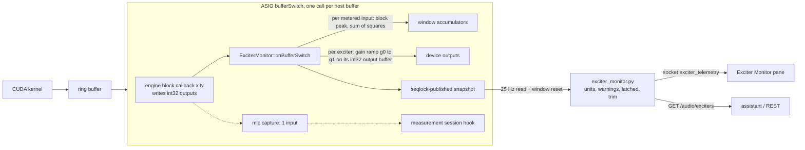

# Controlled Playback: Exciter Current Sensing and Limiting

**Status:** Phase 1 IMPLEMENTED (dev-8f54, 2026-10-20): multi-input metering in the ASIO callback, calibrated
per-exciter current / board readings, the per-exciter current-limit safety limiter, the `exciter_telemetry`
stream, the Exciter Monitor pane, assistant commands. Phase 2 (closed-loop level trim tuned on the rig, board
amplitude limit, sensor-fault actions) is open. Verified on the UMC1820 with no sensors connected (plumbing,
limiter with a lowered limit and with the injected test level); not verified with real current sensors.

**User request (2026-10-20):** "Controlled playback: normal system functioning, with current sensors plugged
into the inputs. Control the current and, ideally, the board amplitude on each exciter. The UI should show a
dynamic indicator."

## 1. Setting

Pianoid plays through ASIO (`audio_driver_type 4`) to 7 exciters, engine channels 0..6 on device outputs
`PIANOID_AUDIO_OUTPUT_MAP=8,9,2,3,4,5,6` (E1 → Out 9, E2 → Out 10, E3..E7 → Out 3..7; [rig output
map](../guides/MODE_DISCOVERY_FOR_ASSISTANT.md#rig-output-map)). The UMC1820 inputs carry one current-sense
signal per exciter and, optionally, piezo / board-vibration sensors. The input wiring changes between sessions
([rig inputs](../guides/MODE_DISCOVERY_FOR_ASSISTANT.md#rig-inputs)), so the mapping is a per-machine setting,
never a constant.

Before this work the engine metered nothing on the inputs during playback: the mic capture
(`setAsioCaptureInput`) records ONE input on demand, and the measurement session (`/audio/session`) captures N
inputs but owns every output and needs synthesis paused. The existing "limiter" is telemetry only: the kernel
peak-holds the post-volume output and the soft knee in `limiter_telemetry.py` is a model; nothing attenuates.

## 2. Signal flow

- The monitor runs **inside the same `bufferSwitch`**, right after the engine wrote the outputs of this
  switch and before the mic capture and the session hook. Input frame *n* and output frame *n* share the
  switch; the current measured now reflects the output of about one round trip earlier (304 + 30 frames on the
  UMC at buffer 64).
- Real-time path: no allocation, no lock, no Python. The configuration reaches the callback through a seqlock
  (the callback keeps its last good copy and never waits); the telemetry leaves it through a second seqlock.
  The reader bumps an epoch to start a new window; samples of at most one switch fall between two windows.
- Metered inputs are converted by their ASIO sample type (`AsioSampleFormat.h`, Int32LSB on the UMC).
- Process-wide state, like the output map and the capture input: it survives preset loads and driver
  re-opens. A backend restart starts unconfigured; the middleware pushes the stored configuration when it first
  sees an open ASIO device.

## 3. Measurement and calibration

| Item | Definition |
|---|---|
| Raw reading | per input and window: RMS and peak as a fraction of the input full scale (`rms_fs`, `peak_fs`, also dBFS) |
| Calibration | per input `scale` = physical units per full scale, `unit` (`A` for a current sense, e.g. `g` / `V` for a piezo). Sense resistor R with an interface gain G: `scale = V_fs / (G · R)`; a clamp probe of k V/A: `scale = V_fs / k`. `scale: null` = uncalibrated: the values are shown in FS and flagged `uncalibrated` |
| Per exciter | `channel` (engine channel), `name`, `sense_input` (current), `board_input` (optional piezo), `limit` (current peak, in the sense unit), `target` (current RMS, closed loop only), `release_ms` |
| Output meter | per exciter, the post-limiter peak / RMS of its device output (dBFS) |
| Rate check | frames metered per second (= the sample rate during normal playback; lower = the callback is late or stopped) |

The limiter detector is the **block peak** of the sense input (conservative: an amplifier / coil overload is a
peak event; the RMS is reported for the thermal view). Board amplitude is metered and shown; it does not limit in
Phase 1.

## 4. Control

**Safety limiter (per exciter, in the callback).** When the sense block peak exceeds `limit`, the gain of that
exciter's output drops at once to `gain · limit / peak` (never below `floor_db`, default −30 dB): fast attack.
Because the measurement lags the output by one round trip, a further attack step waits `holdoff` switches
(derived from the device's reported latencies + 30 frames converter delay, ≥ 2). When the sense level is below
`release_threshold · limit` (0.9) the gain recovers exponentially towards its ceiling with `release_ms` (default
500 ms): slow release. Between 0.9 and 1.0 × limit the gain holds (hysteresis). The gain is ramped linearly
across the switch (no zipper). Only the over-limit exciter is attenuated; the others play on.

**Closed-loop trim (optional, OFF by default).** With `closed_loop.enabled` and a `target` RMS current, the
middleware moves the exciter's gain ceiling ("trim") towards the target at `rate_db_per_s` (default 1 dB/s),
within `[−max_cut_db, +max_boost_db]` (defaults 12 / 0 dB; boost ≤ 6 dB, the int32 write saturates). It only
acts while the exciter plays above the noise floor, its sensor is valid and the limiter is not engaged. The
limiter always wins (the trim is a ceiling of the limiter gain).

**Interaction with the existing level chain.** `output_scale` (Layer B), the volume slider and the kernel
output define the nominal level; the kernel limiter telemetry (`/health.limiter`, clipping at INT32 full scale)
is measured **before** this stage. The exciter gain is the last stage, applied to the int32 device buffer after
the engine wrote it, so it never changes a preset, a calibration or `output_scale`. A measurement session
(`/audio/session`) owns the outputs while attached and overwrites them after the monitor ran; the monitor keeps
metering the inputs. While synthesis is paused the engine repeats the last buffer halves; a gain below 1 then
decays that stale output (harmless).

## 5. Telemetry and UI

- Socket event `exciter_telemetry` at `telemetry_hz` (default 25) while the monitor is enabled and an ASIO
  device is open; `GET /audio/exciters` returns the configuration and the latest sample.
- Per exciter: current RMS / peak (unit), board RMS / peak, output peak dBFS, gain dB, `limiting`, attack count,
  latched max current peak and min gain (cleared by `POST /audio/exciters/clear`), warnings.
- UI: the **Exciter Monitor** mosaic pane (Utility): one compact horizontal meter per exciter (current bar with
  the limit marker and the target tick, board bar where mapped), a limiter light with the gain reduction, and the
  warnings; an enable switch and a configuration editor (inputs, scales, limits, mapping).
- Configuration changes broadcast `session_changed {domain: exciter_monitor}`.

## 6. Configuration storage and API

Stored per machine in `<PianoidInstall>/pianoid_local_settings.json` (gitignored, key `exciter_monitor`; the same
file as the measurements folder). REST: `GET /audio/exciters`, `POST /audio/exciters/config` (a partial patch,
validated, persisted, pushed), `POST /audio/exciters/clear`, test hook `POST /debug/exciter_test_level`.
Assistant: `audio.exciters` (read), `audio.exciters_config` (hard confirm: limits / mapping protect hardware),
`audio.exciters_clear` (playback category).

**Default configuration** (decision: opt-in): `enabled: false`; inputs In 1..In 8 (In 1..7 kind `current`, In 8
kind `board`, uncalibrated); exciters E1..E7 = engine channels 0..6, sense In 1..In 7, board In 8 for E7 (the
10-14 evening wiring); no limits, closed loop off. The user sets the scales and limits once per machine.

## 7. Failure modes

| Failure | Detection | Behaviour |
|---|---|---|
| Sensor unplugged / dead | exciter output above `sensor_check.output_dbfs` (−50 dBFS) while its sense RMS stays below `sensor_check.min_sense_dbfs` (−90 dBFS) for 0.4 s | warning `sensor_silent`; the limiter cannot protect that exciter (it never trips): shown, not acted on (Phase 2 option: fail-safe gain) |
| Wrong channel map | `sensor_silent` on E*k* while another current input is ≥ 20 dB louder during E*k* playing alone | warning `map_suspect` naming the louder input |
| Sense input clipping | sense peak ≥ 0.99 FS | warning `input_clipping`; the reading is a lower bound; the limiter treats it as over limit if `limit` is below FS |
| Uncalibrated input | `scale: null` | values in FS, flag `uncalibrated` |
| Unsupported sample type / missing input | the device lacks the input or its type has no conversion | input reported `supported: false`; its exciter limiter is inactive |
| No ASIO device / SDL fallback | `asio_device_info().open == false` | telemetry `device_open: false`; nothing metered or limited |
| Callback late / stopped | frames per second below 90 % of the sample rate | warning `rate_low` |
| Limiter pinned at the floor | gain at `floor_db` for > 1 s | warning `limit_floor` (the limit is below the sensor's noise or the exciter is faulty) |

## 8. Phase 2 (open)

Closed-loop trim tuned with real sensors; a board-amplitude limit (piezo peak); fail-safe actions on a sensor
fault (mute or a fixed safe gain); RMS (thermal) limit with a long time constant; per-exciter calibration
wizard (known current through the sense chain).
